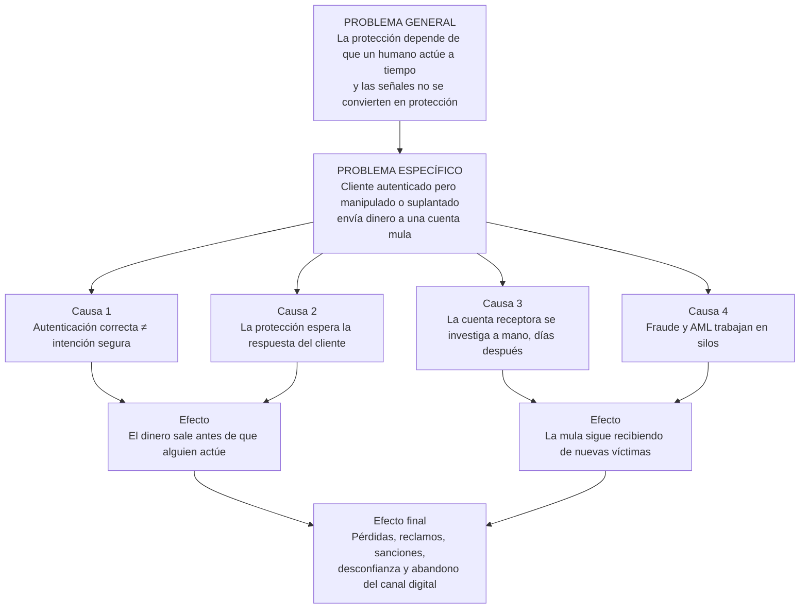
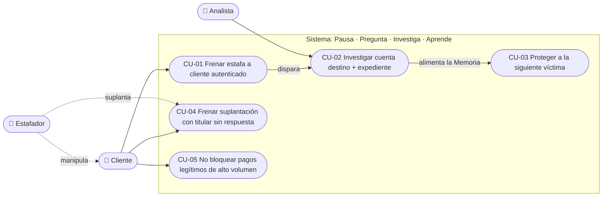
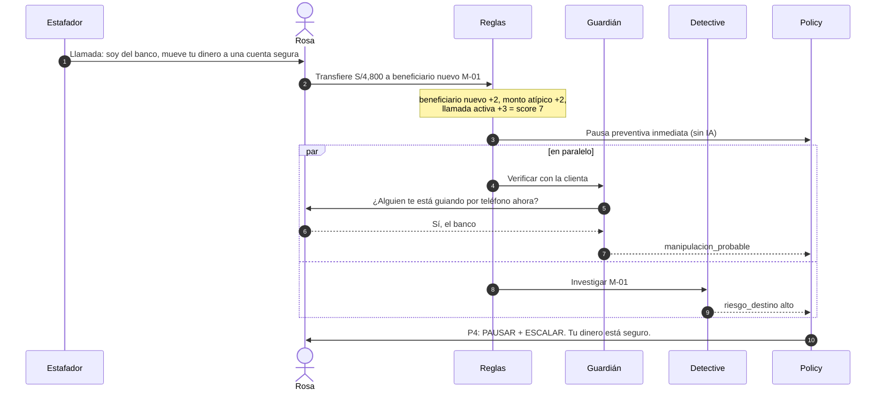
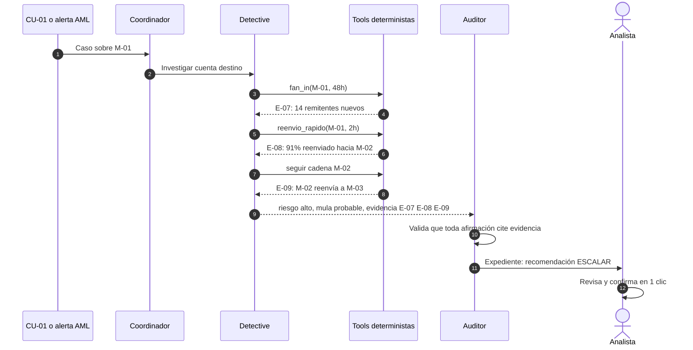
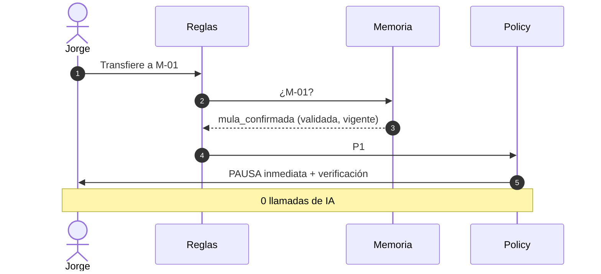
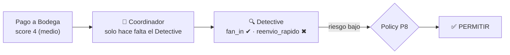
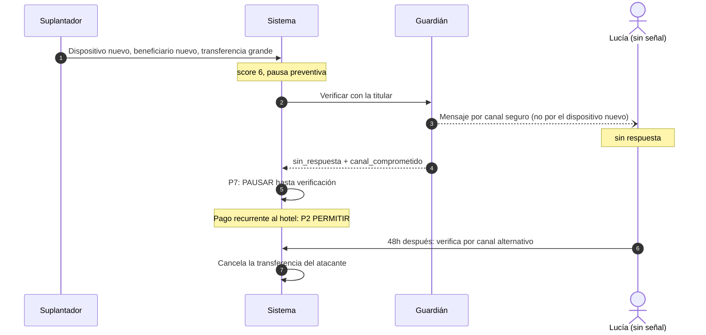
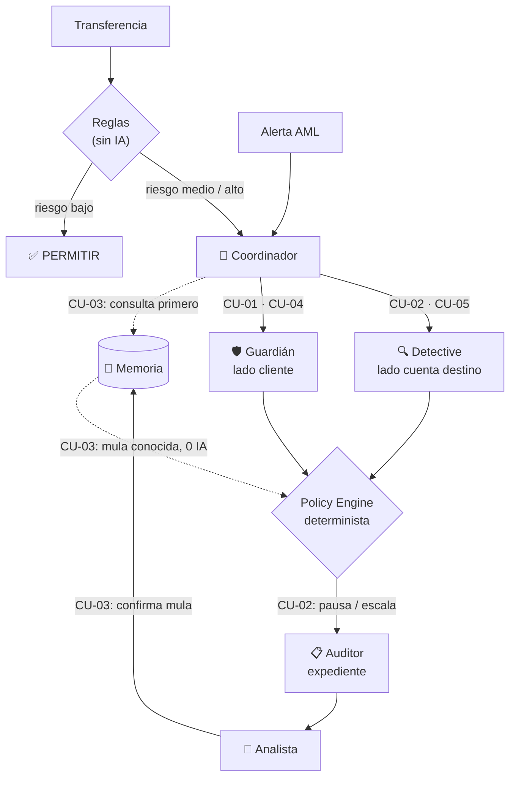

# Problema, casos de uso y solución

> Documento de definición: **qué problema resolvemos, para quién, en qué casos concretos y cómo**. Todo lo que construimos debe trazarse a un caso de uso de aquí.
>
> Resumen visual de la solución: [SOLUCION.md](SOLUCION.md) · Detalle técnico: [19_MULTIAGENT_SYSTEM](context/tony_dev/adaptive_financial_security_docs/19_MULTIAGENT_SYSTEM.md)

---

## 1. Problema general

> **La protección financiera digital depende de que un humano actúe a tiempo —el cliente que debe responder una alerta o el analista que debe investigar un caso— y las señales de riesgo, aunque existen, no se convierten en protección antes de que el dinero salga ni se reutilizan para proteger a la siguiente persona.**

## 2. Problema específico

> **Cuando un cliente de banca digital en Perú es manipulado por un estafador (falso banco, falso familiar, extorsión) o suplantado (dispositivo nuevo, SIM swap), puede transferir —o el atacante puede transferir— dinero a una cuenta mula aunque la autenticación sea correcta, porque la protección espera la respuesta del cliente y la cuenta receptora se investiga a mano, días después, en otro equipo. Resultado: el dinero sale, y la misma mula sigue recibiendo de nuevas víctimas.**

### Evidencia que lo respalda

| Dato | Fuente (`18`) |
|---|---|
| 47% de usuarios de servicios financieros digitales en Perú estuvo expuesto a fraude/estafas en el último año; 21% de los expuestos perdió dinero | #7 CGAP |
| Entre afectados: 25% redujo el uso, 11% lo dejó, 17% cambió de proveedor | #7 CGAP |
| Intentos de estafa por ingeniería social en bancos LATAM: +155% (2025) | #4, #5 BioCatch |
| Cuentas mula reportadas: +42% | #4, #5 BioCatch |
| Indecopi sancionó a un banco por no adoptar medidas ante una transferencia inusual de S/10,000 | #11 Indecopi |
| Investigar una alerta AML exige reconstrucción manual de contexto → backlog y riesgo regulatorio | #21 brief B1 |

### Árbol del problema

---

## 3. Actores

| Actor | Rol | Qué necesita |
|---|---|---|
| 👤 **Cliente** | Titular de la cuenta (víctima potencial) | No perder dinero **ni** quedar bloqueado |
| 🦹 **Estafador / suplantador** | Manipula al cliente o usa su cuenta | — (adversario) |
| 👤 **Analista** de fraude / AML | Valida casos y confirma mulas | Expediente listo, con evidencia, en minutos |
| 🏦 **Banco** | Comprador | Menos pérdida, menos reclamos, menos costo operativo |

---

## 4. Casos de uso elegidos

| ID | Caso de uso | Reto | Prioridad | Dueño principal |
|---|---|---|:-:|---|
| **CU-01** | Frenar una estafa a un cliente autenticado | Track 04 — estafa / extorsión | 🔴 Must | Tony (Guardián, Detective) + Ale (reglas, policy) |
| **CU-02** | Investigar la cuenta destino y entregar el expediente al analista | B1 — investigación AML | 🔴 Must | Tony (Detective, Auditor) + Ale (analytics, API) |
| **CU-03** | Proteger a la siguiente víctima de una mula confirmada | Ambos — diferencial | 🔴 Must | Ale (Memoria, P1) + Tony (Coordinador) |
| **CU-05** | No bloquear un pago legítimo a una cuenta de alto volumen | Control de falsos positivos | 🟡 Should | Ale (policy) + Tony (Detective) |
| **CU-04** | Frenar una suplantación cuando el titular no puede responder | Track 04 — suplantación | 🟢 Could | Ale (reglas, policy) + Tony (Guardián) |

**Must** = sin esto no hay demo. **Should** = una línea en el demo, cuesta poco. **Could** = solo si sobra tiempo (primer recorte).

### Diagrama de casos de uso

---

## 5. Detalle de cada caso de uso

### CU-01 — Frenar una estafa a un cliente autenticado 🔴

| | |
|---|---|
| **Actor** | Cliente (Rosa), Estafador |
| **Disparador** | Rosa inicia una transferencia guiada por una llamada del “banco” |
| **Precondiciones** | Rosa está autenticada (FaceID ✔, OTP ✔) en su dispositivo habitual |
| **Resultado esperado** | El dinero **no sale**; el caso queda escalado con evidencia |
| **Reglas aplicadas** | Nivel 0 score 7 → pausa preventiva · Policy **P4** (o **P6** si el destino no es de alto riesgo) |

**Flujos alternos**
- Rosa no responde → `sin_respuesta` → la pausa se mantiene (el silencio no es un sí).
- Rosa dice “no, lo hago yo” pero el destino es de alto riesgo → **P5**: se mantiene la pausa (posible coerción).
- Destino sin riesgo y Rosa confirma por canal seguro sin señales de manipulación → **P8**: se libera.

**Criterios de aceptación**
- [ ] La pausa ocurre **antes** de cualquier llamada de IA (TTPA ≈ 0).
- [ ] El Guardián hace máx. 3 preguntas y **nunca** pide clave, OTP o datos de tarjeta.
- [ ] El Guardián no puede aprobar la transferencia.
- [ ] La decisión final registra la regla aplicada (P4).

---

### CU-02 — Investigar la cuenta destino y entregar el expediente al analista 🔴

| | |
|---|---|
| **Actor** | Analista; disparado por CU-01 o por una alerta AML (Puerta B) |
| **Disparador** | Transferencia pausada hacia M-01, o alerta del monitoreo sobre M-01 |
| **Precondiciones** | M-01 es cuenta del mismo banco (ver límite en `19` §10) |
| **Resultado esperado** | Expediente con recomendación `escalar` y cada afirmación citada; el analista decide en minutos |
| **Tipologías** | `fan_in` + `reenvio_rapido` (+ cadena M-01 → M-02 → M-03) |

**Flujos alternos**
- Una afirmación del agente no cita evidencia → el Auditor reintenta → si persiste, `requiere_revision_manual`.
- El agente dice `alto` sin tipología marcada por las tools → se baja a `medio` y se marca para revisión.
- El analista descarta → la cuenta **no** entra a la Memoria.

**Criterios de aceptación**
- [ ] 100% de las afirmaciones del expediente citan un id de evidencia existente.
- [ ] Los hechos (14 remitentes, 91%) los calculan las tools, no el LLM.
- [ ] Una alerta por Puerta B produce expediente sin pasar por el Guardián.
- [ ] El expediente se genera sin bloquear la pausa de CU-01 (asíncrono).

---

### CU-03 — Proteger a la siguiente víctima 🔴

| | |
|---|---|
| **Actor** | Cliente (Jorge) |
| **Disparador** | Jorge transfiere a M-01, ya confirmada como mula en CU-02 |
| **Precondiciones** | M-01 está en la Memoria con veredicto validado por un humano y vigente |
| **Resultado esperado** | Pausa inmediata **sin investigación y sin IA** |
| **Regla aplicada** | Policy **P1** |

**Criterios de aceptación**
- [ ] 0 llamadas de IA (visible en el contador del demo).
- [ ] La Memoria solo contiene cuentas confirmadas por un analista.
- [ ] El veredicto tiene fecha de expiración.

---

### CU-05 — No bloquear un pago legítimo a una cuenta de alto volumen 🟡

| | |
|---|---|
| **Actor** | Cliente |
| **Disparador** | Primer pago grande a *Bodega Don Pepe* (compra al por mayor) |
| **Precondiciones** | La bodega recibe de muchas personas, pero **no** reenvía rápido |
| **Resultado esperado** | Se **permite**: fan-in solo no basta para llamar mula a una cuenta |
| **Reglas aplicadas** | Nivel 0 score 4 → Coordinador → solo Detective → Policy **P8** |

**Criterios de aceptación**
- [ ] El resultado es PERMITIR.
- [ ] El Guardián no se invoca (no se molesta al cliente).
- [ ] Máx. 2 llamadas de IA.

---

### CU-04 — Frenar una suplantación cuando el titular no puede responder 🟢

| | |
|---|---|
| **Actor** | Cliente (Lucía, viajando sin señal), Suplantador |
| **Disparador** | Desde un dispositivo nuevo se agrega un beneficiario y se intenta transferir |
| **Precondiciones** | Lucía no tiene conectividad; tiene un pago recurrente al hotel |
| **Resultado esperado** | La transferencia del atacante se pausa; el pago del hotel **sigue pasando** |
| **Reglas aplicadas** | Nivel 0 score 6 → Policy **P7** (atacante) · **P2** (hotel) |

**Criterios de aceptación**
- [ ] El silencio no libera la transferencia.
- [ ] El canal marcado como comprometido no se usa para verificar.
- [ ] El pago recurrente al hotel no se bloquea.

---

## 6. La solución

> **Una capa de protección multiagente que se agrega entre el risk engine del banco y la ejecución del pago, y sobre la cola de alertas AML: pausa la operación riesgosa, verifica con el cliente, investiga la cuenta destino y recuerda las mulas confirmadas.**

### Trazabilidad: problema → caso de uso → componente → métrica

| Causa del problema | Caso de uso | Componente | Métrica de éxito |
|---|---|---|---|
| Autenticación correcta ≠ intención segura | CU-01 | 🛡️ Guardián + Policy | % estafas simuladas pausadas antes de salir |
| La protección espera la respuesta del cliente | CU-01, CU-04 | Pausa preventiva (reglas) | TTPA ≈ 0 en riesgo alto |
| La cuenta receptora se investiga a mano | CU-02 | 🔍 Detective + 📋 Auditor | Tiempo hasta expediente · % afirmaciones con evidencia |
| Fraude y AML en silos | CU-03 | 🧠 Memoria + 🧭 Coordinador | Víctimas posteriores protegidas · llamadas de IA ahorradas |
| Controles duros generan falsos positivos | CU-05 | 🔍 Detective (reenvío rápido) | Pagos legítimos permitidos |

---

## 7. Fuera de alcance

- Desinformación (Track 04): solo indirecta vía impersonación del banco.
- Accesibilidad y canal alternativo como caso completo (se menciona, no se demuestra).
- Mulas en otros bancos con historial completo (ver `19` §10).
- Compartir señales entre bancos (S8).
- ML entrenado, core bancario real, KYC.

## 8. Definición de éxito del demo

- CU-01, CU-02 y CU-03 funcionan end-to-end en la URL pública.
- CU-05 se muestra en una línea.
- Cada decisión muestra su regla y su evidencia.
- El contador de IA muestra la diferencia entre Rosa (5–7 llamadas) y Jorge (0).
