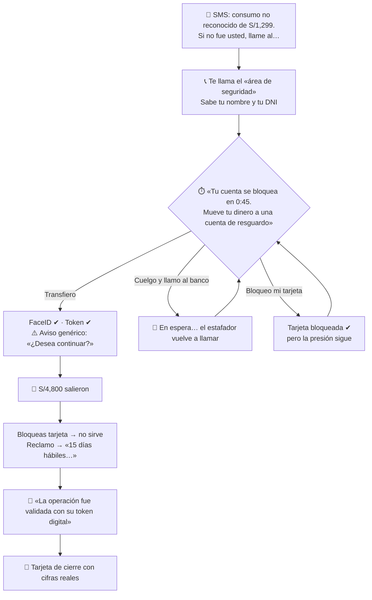
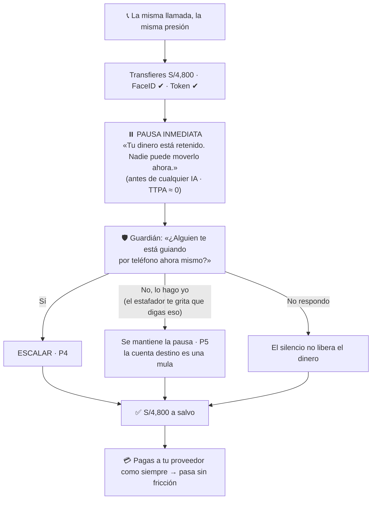
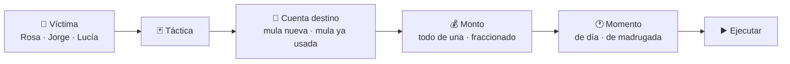

# Demo jugable: «Te están robando»

> Diseño UX del demo para usuarios. Dos roles, **víctima** y **atacante**, construidos sobre **casos reales de Perú** y medidos para **validar la propuesta de valor**.
>
> Contexto: [CASOS_DE_USO](CASOS_DE_USO.md) · [Hipótesis](context/tony_dev/adaptive_financial_security_docs/08_JTBD_AND_HYPOTHESES.md) · [Métricas y experimentos](context/tony_dev/adaptive_financial_security_docs/14_METRICS_AND_EXPERIMENTS.md) · [Riesgos y ética](context/tony_dev/adaptive_financial_security_docs/15_RISKS_ETHICS_PRIVACY.md)

---

## 1. Para qué sirve el juego

No es un adorno del pitch. Hace tres trabajos:

| Trabajo | Qué logra | Qué valida |
|---|---|---|
| **Sentir** | El jugador vive la frustración real de una víctima: presión, autenticación correcta, dinero perdido, reclamo que no avanza | Que el problema es real y duele (CU-01, FM2, FM7) |
| **Probar** | El jugador ataca el sistema con las mismas tácticas que se usan en Perú y ve cómo los agentes reaccionan | Que la capa resiste ataques reales (H3, H8, H10) |
| **Medir** | Cada partida deja datos: quién cayó, con qué, cuánto tardó la protección, cuánta fricción sintió y si activaría la protección | Hipótesis H1, H3, H5 y el experimento E3, con personas reales en el evento |

El cierre del pitch deja de ser una promesa y pasa a ser un resultado del propio evento:

> *«Hoy jugaron N personas. Con la seguridad actual cayó el X%. Con nuestra capa, nadie perdió dinero. El Y% activaría esta protección en su banco. Los atacantes hicieron Z intentos y lograron W.»*

Todo resultado se presenta como **simulación con participantes del evento**, nunca como dato de producción (ver §8).

### Tres rutas

| Ruta | Para quién | Qué hace |
|---|---|---|
| `/` (modo demo) | El jurado, en el pitch | Recorrido guiado de Rosa → M-01 → Jorge → Don Pepe en **≤ 90 s desde un navegador**. No depende de que jueguen otras personas |
| `/play` | Asistentes, desde su celular por QR | Los dos roles: víctima y atacante |
| `/monitor` | Pantalla proyectada | Feed en vivo, agentes, expediente, veredicto del analista de simulación y resultados del experimento |

**Restricción oficial del evento** ([guía Hack The Andes](https://hacktheandes.com/guide)): el jurado abre los enlaces **desde el equipo de la organización**, en ventana privada; no se conecta la laptop del equipo. La app debe estar **desplegada en una URL pública**, en un **solo proceso** (el estado vive en RAM; nada de serverless).

**Desplegar en Vercel:** sí, pero solo como frontal. Vercel es serverless y el estado vive en la RAM de un solo proceso, así que con `API_REMOTA=<URL del backend en Railway>` Vercel sirve las páginas y reenvía todo `/api/*` a Railway (`next.config.ts`). Sin esa variable, la API correría en Vercel y el demo fallaría al azar.

**Mula precargada para el pitch:** en el modo demo la cuenta M-01 puede confirmarse en vivo con el botón del analista, o llegar ya confirmada como **«validada por analista de simulación»**. Siempre se etiqueta así; nunca se presenta como una revisión humana real.

> Paquete de especificación ampliado (34 docs, 10 escenarios): [Te_Estan_Robando/INDICE.md](Te_Estan_Robando/INDICE.md). Es de referencia: asume Postgres, salas y realtime que **no** entran en el MVP del hackathon.

---

## 2. La base real: qué pasa hoy en Perú

Cada escena del juego sale de un caso o una cifra verificada. Lo no verificado está marcado.

### Cifras

| Dato | Fuente |
|---|---|
| 47% de usuarios de finanzas digitales estuvo expuesto a fraude o estafas en el último año; 21% de los expuestos perdió dinero. Entre los afectados por **riesgos digitales** en general (no solo fraude), 25% redujo su uso y 11% lo dejó | Encuesta SBS + CGAP 2025, 1,007 usuarios ([CGAP](https://www.cgap.org/research/publication/solutions-to-protect-consumers-fraud-in-digital-finance)) |
| Ene–jul 2026: 29,118 denuncias por delitos informáticos; 19,602 de fraude informático y 7,431 de suplantación de identidad | Ministerio Público, citado por [La Cámara](https://lacamara.pe/fraude-informatico-cinco-consejos-para-evitar-estafas-digitales/) (21-09-2026) |
| LATAM 2025: intentos de estafa +155%, fraude con herramientas de acceso remoto ×5, dispositivos robados +344%, cuentas mula +42% | [BioCatch 2026](https://www.biocatch.com/press-release/latin-american-banks-see-155-increase-in-scam-attempts) (36 instituciones) |
| Reclamos: el banco tiene 15 días hábiles para responder; en operaciones no reconocidas el promedio fue de 11 días hábiles (dato de 2023) | Ley 31763 / Res. SBS 4036-2022 ([Infobae](https://www.infobae.com/peru/2026/06/27/bancos-y-cobros-no-reconocidos-como-reclamar-por-pagos-que-no-realizaste/), [informe SBS](https://www.sbs.gob.pe/Portals/0/INFORME%20CONJUNTO%20N%2000181-2023-SBS.pdf)) |

### Casos reales que el juego reproduce

| Caso | Qué pasó | Por qué importa para nosotros |
|---|---|---|
| **Puno, Indecopi 2026** | Transferencia de **S/10,000** a un tercero que no coincidía con el patrón del cliente. El banco alegó que cumplió la autenticación. Indecopi: autenticar **no exime** de tener monitoreo eficaz. Multa de 3.78 UIT y devolución. [Comunicado Indecopi, 14/07/2026](https://www.gob.pe/institucion/indecopi/noticias/1418542-indecopi-sanciona-a-banco-por-no-adoptar-medidas-de-seguridad-para-evitar-una-operacion-no-reconocida) · [La República](https://larepublica.pe/sociedad/2026/07/14/indecopi-multa-a-bbva-por-no-alertar-transferencia-inusual-de-s10000-y-ordena-devolver-monto-a-cliente-1319612) | Es nuestra tesis dicha por el regulador: **autenticación correcta ≠ operación segura** (CU-01) |
| **Chimbote, Indecopi 2026** | Cuatro operaciones no reconocidas desde la banca móvil, pese a que el banco alegó el uso del token digital. Según la prensa: S/5,700, y el token no podía ser a la vez el factor de autenticación y el control contra «hombre en el medio» sin un control **fuera de banda**. [Comunicado Indecopi, 22/05/2026](https://www.gob.pe/institucion/indecopi/noticias/1396052-indecopi-sanciona-a-dos-bancos-y-un-restaurante-en-chimbote-por-consumos-no-reconocidos) · [La República](https://larepublica.pe/sociedad/2026/05/24/indecopi-multa-a-bbva-con-s20790-transferencia-no-reconocida-validada-con-token-digital-en-banca-movil-de-clienta-1794936) | Respalda que el Guardián verifique **por otro canal**, nunca por el comprometido (FM3, P7). En el pitch citar solo lo que dice el comunicado oficial |
| **Tarapoto, Indecopi 2026** | Transferencia no autorizada de S/1,550. El banco debe probar que la operación fue del cliente. [LP Derecho](https://lpderecho.pe/si-te-sustraen-dinero-a-traves-del-aplicativo-del-banco-este-tiene-que-probar-que-la-operacion-fue-tuya-resolucion-101-2026-ps0-indecopi-sam/) | El expediente con evidencia citada (Auditor) es lo que el banco necesita para probar |
| **Trujillo, Fiscalía, marzo 2026** | Accedieron al celular de una víctima y movieron ~**S/8,000**. Parte llegó a la cuenta de una mujer que habría «alquilado» su cuenta; la banda captaba personas para abrir cuentas y luego retirar el dinero o pasarlo a cripto. [LP Derecho](https://lpderecho.pe/dictan-prision-preventiva-presunto-integrante-banda-captaria-personas-crear-cuentas-y-usarlas-retiros-irregulares/) (una sola fuente) | Las **cuentas mula** existen, se reclutan y el dinero se mueve rápido (CU-02, CU-03) |

### Tácticas que usan los atacantes en Perú

| Táctica | Evidencia | Qué tan sólida |
|---|---|---|
| 📞 **Falso banco** (llamada: «detectamos un fraude, mueve tu plata a una cuenta segura») | SBS y ASBANC la listan entre las más frecuentes ([Gestión](https://gestion.pe/tu-dinero/finanzas-personales/fraude-phishing-bancario-senales-de-alerta-que-todo-usuario-debe-reconocer-segun-asbanc-noticia/), [Caretas](https://caretas.pe/economia/gratificacion-2026-sbs-alerta-sobre-fraudes-digitales-y-explica-como-proteger-tu-dinero)) | ✅ oficial |
| 💬 **SMS o correo con link falso** (bloqueo de cuenta, consumo no reconocido) → roba la clave | SBS: phishing y smishing, entre los cinco mecanismos más usados (Caretas, 2026) | ✅ oficial |
| 👨‍👩‍👧 **Falso familiar** («hola mamá, cambié de número, necesito plata») | Advertencia de la Fiscalía ([El Tiempo](https://eltiempo.pe/uncategorized/si-recibes-este-mensaje-en-whatsapp-no-respondas-podria-ser-una-estafa/)) | ✅ advertencia oficial, sin cifras |
| 📲 **App falsa / «mano fantasma»** (malware que controla el celular cuando la víctima no lo usa) | Troyano Zanubis: se hacía pasar por la app de SUNAT y atacaba 38 apps financieras peruanas ([Kaspersky vía Revista Economía](https://www.revistaeconomia.com/version-local-del-ataque-de-la-mano-fantasma-acecha-a-usuarios-de-la-banca-movil-en-peru-advierte-kaspersky/), 2023); acceso remoto ×5 en LATAM (BioCatch) | ⚠️ caso de 2023 + tendencia regional |
| 🔁 **Duplicado de chip (SIM swap)** | Osiptel dice haberlo reducido **más de 90%** con activación diferida de 4 h, biometría y alertas ([El Comercio](https://elcomercio.pe/economia/osiptel-hemos-reducido-en-mas-del-90-los-casos-de-sim-swapping-osiptel-creatividad-empresarial-sim-noticia/)) | ⚠️ hoy es una táctica **difícil** en Perú; el juego lo refleja |
| ❌ Falso asesor que pide instalar una app de acceso remoto | No encontramos una fuente peruana específica | ❌ no usar como «caso real» |

### Lo que el cliente puede hacer hoy

Es la «caja de herramientas» de la víctima en el juego, y es la fuente de la frustración:

| Herramienta | La realidad |
|---|---|
| Bloquear la tarjeta desde la app | Protege la **tarjeta**; una transferencia que ya salió no vuelve |
| Llamar a la banca telefónica | Espera, y el estafador sigue llamando |
| Presentar un reclamo | Hasta **15 días hábiles** para la respuesta |
| La respuesta del banco | En los casos reales: «la operación fue validada con su token» |
| Ir a la SBS o a Indecopi | Meses; en los casos de Puno y Chimbote el cliente ganó, pero tras un procedimiento largo |

---

## 3. Rol 1: la víctima

**Duración:** ~2 minutos. **Personaje:** Rosa, dueña de una bodega en Lima. El jugador **es** Rosa.

La víctima juega **el mismo ataque dos veces**. El contraste es el mensaje.

### Ronda A: «Aviso genérico» (línea base simulada)

> En la UI se llama **«Aviso genérico (simulado)»**, no «la seguridad de tu banco». Es una política de control definida por nosotros (autenticación + un aviso «¿desea continuar?»), **no** una reproducción de los sistemas de los bancos peruanos. Esta ronda no llama al motor.



**Mecánicas de presión** (todas reales):

- **Reloj** que corre durante la llamada.
- El estafador **sabe tus datos** (filtraciones, FM10).
- **Distracciones** de la bodega: un cliente pide vuelto, otro paga con Yape.
- **Autenticación perfecta:** FaceID y token pasan sin problema. El jugador siente que hizo todo bien.
- **Aviso genérico** del banco («¿Seguro que desea continuar?»), el que existe hoy. Es la **línea base del experimento E3**.
- Si cuelga, **vuelve a llamar**. Si llama al banco, **espera**.

**No hay trampa.** Si el jugador resiste hasta que se acaba el tiempo, no pierde dinero, pero termina la ronda habiendo hecho el trabajo de un equipo de respuesta a incidentes (FM7): llamó, esperó, bloqueó y quedó con miedo. Medimos honestamente cuántos caen.

**Tarjeta de cierre:**

> **No fue tu culpa.** Te autenticaste bien. El sistema esperaba que tú te dieras cuenta, bajo presión, en 45 segundos.
>
> En Perú, el 47% de usuarios de finanzas digitales estuvo expuesto a fraude o estafas el último año, y el 21% de ellos perdió dinero.
>
> En 2026, Indecopi multó a un banco por una transferencia de S/10,000 así: *autenticar no basta.*

### Ronda B: «Con nuestra capa»

La misma llamada, la misma presión y el mismo reloj. Cambia lo que pasa al transferir:



Los momentos que el jugador debe notar:

1. **El reloj del estafador deja de importar:** el dinero ya está retenido.
2. **El Guardián nunca pide clave, token ni datos de tarjeta.** Una línea lo dice explícitamente.
3. **Mentir no funciona:** aunque el estafador le haga decir «lo hago yo», la cuenta destino la delata (P5, coerción, R7).
4. **No molesta en lo normal:** el pago al proveedor pasa (P2/P8, FM6).

### Variante opcional: Lucía, sin señal

Para un segundo nivel, si hay tiempo. Lucía viaja y su pantalla queda **«sin señal»**: el jugador literalmente no puede tocar nada mientras alguien entra desde un celular nuevo.

- **Hoy:** el dinero sale y ella se entera días después.
- **Con la capa:** pausa sin necesitar su respuesta y verificación por otro canal (P7, estados C y E del doc 04). El pago recurrente del hotel sigue pasando.

Es la frustración más pura (FM1: notificar no es proteger) y el caso de Chimbote (control fuera de banda).

---

## 4. Rol 2: el atacante

**Duración:** ~2 minutos, máximo 5 intentos. **Objetivo:** **encontrar huecos del sistema**. Se gana un «descubrimiento» cada vez que una operación etiquetada como fraude **pasa** el motor. No se premian los soles robados (es red-teaming, no un entrenamiento para robar).

El jugador es parte de una banda y tiene lo que tienen las bandas reales: **datos filtrados, cuentas «alquiladas» (mulas) y un teléfono.**

### Arma el golpe en 4 decisiones



### Las cartas de táctica

Cada carta muestra **qué tan común es** (con fuente) y **qué señal enciende** en el sistema. Los puntajes son los reales de `lib/rules/level0.ts`.

| Carta | Común en Perú | Lo que ve el sistema | Resultado esperado |
|---|---|---|---|
| 📞 Falso banco | ✅ muy común | llamada activa +3 *(señal **simulada**: una web no puede saber si estás en una llamada; en producción haría falta una fuente autorizada)* · beneficiario nuevo +2 · monto atípico +2 = **7** | Pausa inmediata → Guardián ∥ Detective → **P4** |
| 💬 Link falso → entras con su clave | ✅ muy común | dispositivo nuevo +2 · beneficiario nuevo +2 · monto atípico +2 = **6** | Pausa → verificación por otro canal |
| 👨‍👩‍👧 Falso familiar | ✅ común | beneficiario nuevo +2 · monto atípico +2 = **4** | El Detective revisa el destino → si es mula, frenado |
| 📲 App falsa (control remoto) | ⚠️ tendencia en alza | acceso remoto +3 + … | Pausa + Guardián |
| 🔁 Duplicado de chip | ⚠️ **difícil hoy**: Osiptel exige 4 h de espera y biometría | si lo logras: cambio de SIM +2 · dispositivo nuevo +2 · … | La carta tiene probabilidad baja de funcionar **antes** de llegar al banco, como en la realidad |

Variables que el atacante también decide, y lo que provocan:

| Decisión | Efecto en el sistema |
|---|---|
| Mula **ya usada** y confirmada por el analista | **P1: frenado en 0 s, 0 llamadas de IA** (CU-03) |
| De madrugada | +1 |
| **Monto chico** a una cuenta nueva, sin otra señal | score 2 → **pasa** (P3) |

### El hueco honesto, convertido en la mejor escena

Un monto chico a una mula nueva, sin otra señal, **pasa**. No lo escondemos:

> *«Ganaste S/300.»*

Pero cada robo deja rastro en la cuenta destino. Cuando varios jugadores mandan dinero a la misma mula, su **fan-in crece**, entra una **alerta AML** (Puerta B), el Detective arma el expediente y **alguien del jurado** pulsa «Confirmar mula» en el monitor. Desde ese segundo, **todos** los intentos de **todos** los jugadores a esa cuenta mueren al instante, sin IA.

El atacante aprende lo que el sistema quiere enseñar: **cada robo quema la cuenta** (H8). Y el público lo ve pasar en vivo, provocado por ellos mismos.

### Fin de la partida

Tarjeta con: descubrimientos (huecos encontrados), intentos frenados, qué agente te atrapó en cada intento y por qué, en lenguaje humano. Por ejemplo: *«el Guardián detectó que alguien guiaba a la víctima por teléfono»*, nunca *«P4»*.

---

## 5. El monitor (pantalla proyectada)

Es la segunda pantalla, la del público y el jurado. Muestra **en vivo** cómo reaccionan los agentes a lo que hacen los jugadores.

```text
┌─────────────────────┬──────────────────────────────────┬─────────────────────┐
│ INTENTOS EN VIVO    │  🧭 Coordinador                   │ MARCADOR            │
│                     │     ↙          ↘                 │                     │
│ ⚡ "Zorro" → Rosa    │ 🛡️ Guardián    🔍 Detective       │ Intentos      37    │
│   Falso banco       │     ↘          ↙                 │ Frenados      35    │
│   ⏸️ ESCALAR · P4    │   ⚖️ Policy → 📋 Auditor          │ Pasaron        2    │
│                     │                                  │ S/ retenido* 142k   │
│ ⚡ "Ana" → M-01      │  (se iluminan en orden, por      │ IA por intento 1.3  │
│   ⏸️ P1 · 0 IA ⚡     │   cada intento que llega)        │ Mulas en memoria 1  │
│                     │                                  │                     │
├─────────────────────┴──────────────────────────────────┼─────────────────────┤
│ EXPEDIENTE  M-01: 14 remitentes nuevos en 48h [E-02]   │ EXPERIMENTO EN VIVO │
│ 91% reenviado en < 2h [E-03] · cadena M-01→M-02→M-03   │ Cayeron hoy    71%  │
│        [ ✅ Confirmar mula ]   [ ✖ Descartar ]          │ Cayeron c/capa  0%  │
│                                                         │ Activaría      86%  │
└─────────────────────────────────────────────────────────┴─────────────────────┘
          DATOS 100% SINTÉTICOS · simulación con participantes del evento
```

> Los números del boceto son **ilustrativos**: los reales salen de las partidas. \*«S/ retenido» = **importe sintético de transferencias riesgosas retenidas**, nunca «dinero ahorrado». Cada intento cuenta una vez.

Reglas de diseño:

- **Se lee a 5 metros:** números grandes y pocas palabras.
- **Causalidad visible:** cuando llega un intento, los agentes se encienden **en el orden real** del pipeline (reglas → pausa → Coordinador → Guardián ∥ Detective → Policy → Auditor). Un intento a una mula confirmada muestra el atajo: **Memoria → Policy**, sin agentes, y la etiqueta «0 IA».
- **El jugador se reconoce:** cada intento lleva su alias.
- **Toda decisión con su regla**, y toda afirmación del expediente con su cita clickeable (requisito del demo).
- **El botón «Confirmar mula»** lo pulsa una persona del jurado. Es el momento estrella (CU-03).

---

## 6. Cómo el juego valida la propuesta de valor

Cada partida produce datos. Esta es la tabla que conecta el juego con las hipótesis del research pack:

| Hipótesis / experimento | Qué medimos en el juego | Cómo |
|---|---|---|
| **H3**: la identidad correcta no basta | % de víctimas que transfieren en la ronda A **aun con FaceID y token correctos** | Registro automático de la partida |
| **E3**: aviso genérico vs. intervención contextual | Tasa de caída con el aviso genérico (ronda A) vs. con pausa + pregunta del Guardián (ronda B) | Registro automático |
| **H1 / TTPA** | Segundos desde la primera señal hasta la protección: ronda A (nunca, o tras el reclamo) vs. ronda B (≈ 0) | Timestamps del caso |
| **Fricción** (doc 14) | «¿La pausa te molestó?» y si el pago legítimo pasó sin fricción | 1 pregunta + registro |
| **H5**: los usuarios aceptan protección delegada | «¿Activarías esto en tu banco aunque a veces retrase un pago?» | 1 pregunta al final |
| **Confianza** (CGAP: entre afectados por riesgos digitales, 25% reduce uso y 11% abandona) | «Después de esto, ¿seguirías usando tu banca digital igual?», ronda A vs. B | 1 pregunta por ronda |
| **H8**: una mula, muchas víctimas | Intentos que reutilizaron una mula y cuántos frenó la Memoria | Registro + `/api/stats` |
| **H10**: la mayoría no necesita IA | Llamadas de IA por intento; % de intentos resueltos sin IA | `/api/stats` (`metricas.eficiencia_ia`) |
| **Robustez** (red team) | Tácticas que lograron pasar, montos y combinaciones | Registro del atacante + pregunta abierta «¿qué intentarías después?» |

### Las preguntas: máximo 3 por partida, de un toque

| Momento | Pregunta | Respuesta |
|---|---|---|
| Fin de ronda A | ¿Cuánta frustración sentiste? | 😌 🙂 😐 😟 😫 |
| Fin de ronda B | ¿La pausa te molestó? | No · Un poco · Mucho |
| Final | ¿Activarías esta protección en tu banco? | Sí · No · No sé |

### Límites que debemos decir en voz alta

- **Sesgo de juego:** quien sabe que juega a «detectar la estafa» cae menos que en la vida real. Si aun así cae, el resultado es **conservador**: en la vida real sería peor.
- **Orden fijo:** la ronda B va después de la A, así que el jugador ya conoce el guion. Por eso en la ronda B no medimos «si detectó la estafa», sino **si perdió dinero**, y eso no depende de él sino del sistema.
- **Muestra chica y no representativa:** decenas de personas de un evento tecnológico. Los resultados son **indicativos** y se presentan como tales.
- **El atacante juega con 5 tácticas conocidas.** No probamos ataques que no imaginamos; por eso la pregunta abierta recoge ideas para red-teaming posterior.

---

## 7. Experiencia: principios

| Principio | Cómo se aplica |
|---|---|
| **Corto** | Víctima ~2 min, atacante ~2 min; sin tutorial, se aprende jugando |
| **Celular por QR** | El jugador usa su propio celular, que es donde ocurre el fraude real; el monitor va proyectado |
| **Lenguaje humano para el jugador** | Nunca `P4`, `score 7` ni `E-07` en la pantalla del jugador; eso vive en el monitor |
| **2D, ilustrado y cálido** | Escena de bodega limeña, personajes simples y una pantalla de celular dentro de la escena |
| **Frustración con salida** | La frustración dura una ronda y siempre termina en «no fue tu culpa» y en la ronda B |
| **Coherente con el sistema real** | Cada intento llama al pipeline real (`/api/transfers`, `/api/alerts`, `/guardian/reply`, `/verdict`), no a una animación guionada |

---

## 8. Ética: lo que el juego **no** hace

- **No enseña a estafar.** Las tácticas se nombran como lo hacen las campañas de la SBS y ASBANC: sin guiones, sin pasos operativos, sin herramientas reales.
- **No culpa a la víctima.** Toda pantalla de pérdida dice «no fue tu culpa».
- **Algunas personas del público pueden haber sido víctimas.** Antes de jugar se avisa que el juego simula una estafa; al final se muestran los canales oficiales para denunciar (banco, SBS, Indecopi, PNP).
- **No usa marcas reales.** El banco del juego es ficticio («Banco Andino»). Los casos reales se citan como «un banco» en el juego; las fuentes completas están en este documento.
- **No elige víctimas por perfil.** Rosa, Jorge y Lucía se diferencian por su **situación** (bodega, viaje, sin señal), nunca por edad, discapacidad o ingreso (R1). El atacante elige a quién atacar; el sistema solo mira la operación.
- **Datos 100% sintéticos** y etiquetados así en las dos pantallas.
- **Las respuestas de las encuestas son anónimas:** alias libre, sin correo ni teléfono.

---

## 9. Qué necesita el juego del backend

Solo lo que el UX exige; la implementación queda en manos del dueño de cada bloque.

| Necesidad | Por qué | Estado |
|---|---|---|
| Listar los casos recientes | El monitor muestra el feed en vivo | ❌ falta (`GET /api/cases`) |
| Que una transferencia jugada **cuente como movimiento** de la cuenta destino | Para que el fan-in crezca con los jugadores y la mula «se queme» en vivo (§4) | ❌ hoy el fan-in solo lee `seed.json` |
| Guardar alias, ronda, táctica y respuestas de las 3 preguntas | Los datos de validación (§6) | ❌ falta |
| Guardián multiturno | Chat de la ronda B | ✅ ya existe (`/guardian/reply`) |
| Métricas de IA, TTPA y fricción | Marcador del monitor | ✅ ya existe (`/api/stats`) |
| Un solo proceso con estado compartido, **en URL pública** | Celulares, monitor y jurado deben ver los mismos casos; el jurado no usa nuestra laptop | ⚠️ desplegar `next start` en un servidor de un solo proceso (p. ej. Railway); **no** serverless ni laptop ([INFRA](context/tony_dev/INFRA_Y_ORQUESTACION.md) §4–5) |

---

## 10. Pendientes antes de construir

1. Validar este diseño con 2–3 personas fuera del equipo: ¿la ronda A frustra sin aburrir?
2. Confirmar las cifras marcadas ⚠️ si se van a decir en el pitch.
3. Decidir si la variante Lucía entra en la primera versión (recomendado: **no**; primero víctima-Rosa, atacante y monitor).

---

## 11. El juego implementado: rutas y países (`components/juego2d/`)

Recorrido: **video de intro** (casos y cifras reales) → título → apodo → **país** → **menú de rutas**. Todo a pantalla completa en el celular: se toca para avanzar, elegir y caminar.

| Ruta | Rol | Desenlaces | Qué decide |
|---|---|---|---|
| La llamada | víctima | R1 (aviso genérico simulado): pierde o resiste · R2: gana | motor real (P4/P5) |
| Sin señal | víctima | R1: pierde sin poder hacer nada · R2: gana sin contestar | motor real (P7; hotel P2) |
| El familiar | víctima | gana si verifica por otro canal; si transfiere: R1 pierde, R2 retenido | motor real (P5, cuenta mula) |
| El comprobante | víctima | gana si verifica en su app, pierde si entrega | **fuera del alcance de la capa** (no mueve dinero de su cuenta); se dice en el juego |
| La banda | atacante | golpe clásico contra el «banco de hoy»: **gana** · luego 5 golpes contra la capa | motor real |

**LOS DATOS** (epílogo, tras la primera ruta y en el menú): 47% / 21% (SBS–CGAP), +155% / +42% (BioCatch), el dato del país elegido, el caso de Puno (S/ 10,000, Indecopi), Tarapoto (S/ 1,550) y la brecha de disponibilidad (GSMA).

**Países**: Perú, Colombia, México y Argentina cambian nombres, moneda, lugares y modalidades locales; la lógica es la misma. El banco y la billetera que «fallan» son **ficticios** (Banco Andino, ChaskiPay, Banco Cordillera…). Las billeteras reales (Yape, Plin, Nequi, Daviplata, Mercado Pago, Ualá, Lemon) solo se nombran como contexto de cómo paga la gente.

Fuentes de contexto por país (prensa, verificar antes de citar en el pitch):
- Perú: «Yape falso» con capturas contra comercios ([Perú Retail](https://www.peru-retail.com/cuidado-con-el-falso-yape-como-funciona-esta-nueva-modalidad-de-estafa-a-comerciantes/), [La República](https://larepublica.pe/economia/2024/11/29/evita-estafas-en-yape-aprende-a-identificar-comprobantes-falsos-y-protege-tu-dinero-atmp-1529808)).
- Colombia: SMS de «pago pendiente» con el nombre de Bre-B ([Vanguardia](https://www.vanguardia.com/colombia/2026/08/05/no-caiga-en-la-trampa-asi-estan-usando-el-nombre-de-bre-b-para-estafar-a-usuarios/)); +64,000 denuncias por estafas digitales en 2025 ([Diario del Sur](https://www.diariodelsur.com.co/mas-del-36-de-los-colombianos-ha-sido-victima-de-fraude-digital-las-formas-mas-comunes-y-como-protegerse-en-2026/)).
- México: 35,762 reclamaciones por posible fraude ene–may 2026, +18% en la banca; llamadas como vía principal ([El Imparcial](https://www.elimparcial.com/dinero/2026/08/27/fraude-bancario-en-mexico-aumenta-18-y-las-llamadas-siguen-siendo-una-de-las-principales-vias-de-engano-alerta-la-condusef/)).
- Argentina: falsos operadores de billeteras y cuentas mula ([iProfesional](https://www.iprofesional.com/tecnologia/453048-tu-cuenta-de-mercado-pago-puede-estar-en-peligro-5-tips-para-protegerla), [El Ancasti](https://www.elancasti.com.ar/policiales/imputaron-tres-personas-el-uso-cuentas-mulas-la-venta-cubiertas-n606988)); UFECI 2024: 34,468 denuncias, 63% fraude en línea (según prensa).

## 12. Versión 3: que enganche y que deje datos

**Por qué.** La v2 se sentía como una app educativa: mucho texto, ritmo lento y poca mecánica. Además, la ronda B podía leerse como «un sistema que detecta patrones de comportamiento», que es la solución básica. Lo nuestro es otra cosa: **pausar sin depender del cliente, preguntar, investigar la cuenta que recibe y aprender para la siguiente víctima**. La v3 convierte eso en juego.

**Menú principal** (`guion.ts`). La primera partida arranca directo en el arcade, sin tutorial:

| Modo | Qué es | Qué demuestra | Qué dato deja |
|---|---|---|---|
| **¿REAL O ESTAFA?** (`realOEstafa.ts`) | Arcade de 45 s: llegan SMS, WhatsApp, llamadas, correos y capturas, y el jugador toca ESTAFA o REAL. Tiene combo, 3 vidas y bonus por rapidez. Un error muestra la pista. | Que cualquiera cae con prisa, y que desconfiar de todo también cuesta. Por eso la protección no puede depender del cliente. | En qué estafa cae la gente (por categoría) y cuántos mensajes reales rechaza |
| **SIGUE EL DINERO** (`sigueElDinero.ts`) | Eres el Detective. El dinero de 14 víctimas salta de mula en mula (4471 → 8820 → 1093 → retiro) y hay que congelarlas antes de que salga. Si congelas una bodega, un hotel o un mayorista, es un falso positivo. | **Investiga**: mirar el otro lado de la transferencia. Ver que muchos remitentes (fan-in) no bastan para llamar mula a una cuenta: hay que mirar adónde va el dinero. **Aprende**: el Auditor confirma, la Memoria la conoce y la siguiente víctima queda en pausa con 0 IA. | % recuperado, mulas, falsos positivos y tiempo |
| HISTORIAS | Las 4 rutas de la v2 (la llamada, sin señal, el familiar, el comprobante) | Pausa y Pregunta con el motor real | Partidas (`/api/juego/partidas`) |
| LA BANDA | El atacante (v2) | Red-teaming contra el motor real | Partidas |
| RANKING | Top del evento por modo, con bandera del país | Tracción en vivo | — |

**Casuísticas del arcade** (16 estafas y 8 mensajes reales): link falso (bloqueo, clave, multa), falso banco que pide el código, falso familiar (número nuevo o accidente), comprobante falso, premio falso, trabajo falso por likes, inversión milagro, préstamo con cobro adelantado, comprador falso de marketplace que pide el código, robo de WhatsApp, extorsión de cobranza, falso soporte que pide instalar una app y amor por internet. Son modalidades públicas, sin guiones operativos. Los bancos y billeteras que aparecen son los ficticios del país.

**La red de SIGUE EL DINERO sale del seed:** M-01 recibe de 14 remitentes nuevos (S/ 42,477) y reenvía a M-02 y M-03; M-02 reenvía a M-03. La bodega recibe de 35 clientes de años y solo le paga a su proveedor.

**La encuesta como bonus.** Al terminar cada modo, una pregunta de un toque que suma +100 puntos. No se repite en la sesión.

| Pregunta | Para qué |
|---|---|
| `vivido`: ¿a ti o a alguien cercano le pasó de verdad? | Tamaño del problema |
| `protege_hoy`: ¿tu banco hoy te protege? | El gap |
| `espera`: si tu banco pausa un pago raro, ¿cuánto esperarías? | Tolerancia a la pausa |
| `activaria`: ¿activarías esta protección? | Disposición a adoptar |
| `recomendaria`: ¿le pasarías el juego a un familiar? | Tracción |

**API** (`app/api/juego/arcade`, `lib/juego/arcade.ts`). Va aparte de las partidas de Ale y no las toca.

- `POST` registra una jugada y devuelve `{ id, posicion }`.
- `GET` devuelve: jugadores, partidas, por país, ranking por modo, `caidas` por categoría, `% de reales rechazados` y la encuesta. Con `?crudo=1` también entrega todas las jugadas, que son anónimas.
- `DELETE` exige el token del operador.

Reglas:
- El alias pasa por el mismo filtro que las partidas.
- Sin texto libre; solo valores cerrados.
- La persistencia es opcional con `ARCADE_ARCHIVO`. No se borra con el reset del demo.

El monitor muestra el panel **«Tracción y encuesta»** con todo esto en vivo.

## 13. Versión 4: más minijuegos, más puntos y que se entienda

**Feedback:** «Me encanta, pero necesito más minijuegos, mejores formas de ganar puntos, una intro más corta y emocionante, sonidos según el escenario. Algunos juegos no se entienden».

**Cuatro arcades** (menú principal):

| Juego | Mecánica | Qué enseña |
|---|---|---|
| ¿REAL O ESTAFA? | Tocar ESTAFA o REAL, 45 s | Reconocer las 16 modalidades |
| **ATRAPA LA MULA** (`atrapaLaMula.ts`, nuevo) | Golpea al topo: asoman cuentas con etiqueta (NUEVA, REENVÍA, RETIRA… o BODEGA, MAMÁ, SUELDO) | Qué es una cuenta mula y no prestar la tuya |
| **¿PAUSA O PASA?** (`pausaOPasa.ts`, nuevo) | Eres el sistema: llega una transferencia con señales rojas y verdes y decides antes de que se acabe su reloj. Si no decides, el dinero sale | Que una señal sola no basta, que la cuenta destino importa (Detective) y que la Memoria protege |
| SIGUE EL DINERO | Congelar la red de mulas | Investiga + Aprende |

**Que se entienda:**
- **CÓMO SE JUEGA** (`tutorial.ts`): antes de cada juego, 3 pasos con dibujo y un botón «¡A JUGAR!». Sale la primera vez en la sesión.
- **LO QUE TE LLEVAS**: al terminar, 3 consejos prácticos. En ¿REAL O ESTAFA? son las pistas de las estafas en las que caíste.
- En SIGUE EL DINERO:
  - La evidencia sale en colores: rojo es señal de mula, ámbar pide ojo y verde es normal.
  - Debajo aparece un veredicto sugerido («2 rojas: ¡es MULA!»).
  - Una flecha «¡TOCA AQUÍ!» marca la primera cuenta.

**Puntos y progresión** (`progreso.ts`, guardado en el celular por apodo):
- **Estrellas** (1 a 3) por juego, según umbrales de puntaje. Se ven en el menú.
- **Rangos** por puntos totales: NOVATO → ALERTA → DETECTIVE → GUARDIÁN → LEYENDA. Aparecen en la barra superior y en el resultado.
- **11 logros** con bonus de puntos, como Ojo de halcón, Imparable, Red desarmada, Cazamulas, Guardián perfecto o Todoterreno.
- Las historias también suman: ganar da +600 y jugar +200. En La Banda son +300 más +400 por cada hueco.
- **Ranking general** (suma de lo mejor en cada juego) y un ranking por juego.

**Intro:** dura unos 13 s en vez de 33. Los cortes son: llamada, voz, saldo a cero, «¡TE ROBARON!», tres titulares y «¿QUIÉN TE PROTEGE?». Tocar salta cada plano. En ese celular solo se ve la primera vez; después se puede repetir desde MÁS.

**Sonido** (`audio.ts`):
- Batería en las pistas.
- Pistas nuevas: `suspenso`, `mula`, `jefe` e `intro`.
- Efectos: latido, alarma, golpe de aire, explosión, interferencia, dinero que se drena, tensión, cuenta regresiva, estrella, logro, subir de nivel y congelar.
- En los últimos 10 s de cada arcade sube el tempo y suena un latido.
- Las historias usan suspenso en el chat del falso familiar, interferencia sin señal, el sonido del dinero que se drena en cada robo y una alarma cuando el sistema frena a la banda.

**Datos** (`/api/juego/arcade`):
- `atrapa_la_mula` guarda aciertos, errores y mulas que escaparon.
- `pausa_o_pasa` guarda cada decisión. El resumen calcula `% de robos que dejaron pasar` y `% de pagos normales que pausaron`, que mide cuánto les molesta la fricción.
- El ranking `general` se calcula con estos datos.
- El monitor muestra todo esto.

## 14. EN VIVO (multijugador) y menú propio

**Multijugador estilo concurso.**
- Desde el menú, **EN VIVO**: alguien elige *CREAR SALA* y el juego (¿REAL O ESTAFA? o ¿PAUSA O PASA?). Aparece un código de 4 letras, sin I ni O. Los demás eligen *UNIRME* y lo escriben.
- Todos ven la misma carta al mismo tiempo, durante 8 rondas de 10 s. Acertar vale 500 puntos más hasta 500 por rapidez, y hay bonus por racha.
- Al revelar cada carta, cada celular ve cuánto de la sala respondió ESTAFA o REAL y en qué puesto va. Al final hay podio, y el anfitrión puede pedir otra ronda.
- Cada jugador ve los textos de su país: un peruano ve S/, un mexicano ve $.

**Servidor:**
- `lib/juego/salas.ts` y `app/api/juego/salas/**`.
- El reloj es del servidor: las rondas avanzan solas y los celulares solo consultan cada 0,6 s. También califica el servidor, con la verdad de `lib/juego/cartas.ts`; un test verifica que coincida con las cartas del cliente.
- Las salas viven en RAM y duran 2 h. No exigen token: el anfitrión se identifica con el token que recibe al crear la sala.
- Endpoints:
  - `POST /api/juego/salas` crea una sala.
  - `GET /api/juego/salas` lista las activas (para el monitor).
  - `GET /api/juego/salas/:codigo?alias=` devuelve el estado.
  - `POST /api/juego/salas/:codigo` recibe `unirse | iniciar | reiniciar | responder`.

**Datos.** Al terminar, cada jugador registra sus respuestas en `/api/juego/arcade` con `origen: 'sala'`. Cuentan para «en qué estafa cae la gente» y para los jugadores totales, pero no entran al ranking arcade porque la escala de puntos es otra. Hay dos logros nuevos: EN VIVO y CAMPEÓN EN VIVO.

**Monitor.** El panel «🔴 Salas en vivo» va arriba de la columna derecha, para proyectarlo. Muestra la carta en juego, cuántos respondieron, el reparto al revelar y el top 5.

**Menú principal propio** (`hub.ts`). Ya no son tarjetas sobre la escena de Vega, que se asomaba por los huecos. Es una pantalla con:
- Arriba, el rango con su barra de progreso.
- EN VIVO destacado.
- Los 4 arcades con ícono, estrellas, récord o etiqueta NUEVO.
- Abajo, 2×2 accesos chicos.

Los demás menús de tarjetas llevan ahora un tablero sólido detrás. Los avisos de logros bajan solo hasta la franja de cabecera y el resultado espera a que terminen.

## 15. Jerga por país, más países y QR para entrar

**Voz por país** (`jerga.ts`). Un comentarista con jerga local habla en los momentos del juego: aciertos, rachas, caídas, desconfiados, mulas, inocentes, lobby, revelación de la sala, podio y el título del resultado. El sarcasmo apunta al estafador («ya está celebrando con una chela a tu nombre») y al jugador solo se le bromea con cariño. Un test exige:
- frases para cada país y cada momento;
- títulos de máximo 12 caracteres;
- **cero groserías**, con una lista negra.

**9 contextos:** Perú, Colombia, México, Argentina, **Chile, Ecuador, Bolivia, Venezuela** y **Otro país** (español neutro, sin dato local). Cada uno tiene banco y billetera ficticios, moneda, nombres, lugares, modalidades y un dato local **con fuente**. Si no hay fuente confiable, no se inventa: `datoLocal: null`. El país se elige en una grilla con banderas.

**QR:**
- `/play?sala=ABCD` entra directo a la sala: apodo, país y adentro, sin video ni arcade obligatorio.
- El lobby muestra el QR y el código.
- El monitor muestra un QR para `/play` y uno grande por cada sala en espera.

**Capacidad** (`scripts/carga-salas.ts`; los jugadores son virtuales y responden durante toda la ventana de cada ronda):

| Servidor | Jugadores | Pedidos/s | Latencia p50 / p95 | Errores |
|---|---|---|---|---|
| Mac en red local | 120 (tope de 80 por sala, ya subido a 150) | 214 | 4 / 12 ms | solo los rechazados por el tope |
| Railway (región California) | 60 | 69 | 227 / 739 ms | **0** (480/480 respuestas) |

El reloj y la calificación son del servidor, así que la latencia no rompe la sincronía. Una sala acepta hasta 150 jugadores.

**¿Railway o la Mac?** Railway es el principal: URL pública con HTTPS, el QR funciona con datos móviles y los datos del evento persisten en un volumen. La Mac queda de respaldo:

```bash
npm run servidor -- --red --juego --persistir   # celulares en la misma Wi-Fi; guarda memoria, partidas y arcade en .datos/
cloudflared tunnel --url http://localhost:3000  # URL pública si la Wi-Fi del evento aísla a los clientes
```

## 16. Navegación segura y pantallas chicas

**Siempre hay salida.** El botón **≡** (arriba a la derecha, donde antes estaba el de sonido) abre la **pausa**, que congela el juego. Ofrece:
- CONTINUAR.
- SONIDO.
- **VOLVER AL MENÚ**, solo dentro de un modo y con confirmación («Se pierde lo que estás jugando»).

En escritorio se abre con la tecla **P**.

Por dentro, el motor corta todas las esperas pendientes con `SalidaDelJugador` y `protegido` vuelve al menú sin dejar pantallas a medio cargar. Las promesas de los minijuegos se envuelven en `m.atar()` para que también se corten.

**Botones para volver:**
- *Cómo se juega* tiene VOLVER y ¡A JUGAR!; ahora es también la pantalla de confirmación antes de cada arcade.
- El teclado del código de sala tiene «< VOLVER».
- *Cambiar país* tiene una casilla VOLVER.
- La elección de juego para una sala tiene VOLVER.

**Nada te manda directo:**
- Los menús, el menú principal y la grilla de países eligen **al soltar el dedo sobre la misma opción**: un roce o un scroll no entra a un juego.
- Los botones de respuesta de los arcades siguen respondiendo al tocar, porque ahí la rapidez es el juego.

Piden confirmación:
- empezar una sala estando solo;
- otra ronda (los puntajes vuelven a cero);
- que el anfitrión salga con gente esperando;
- volver a la pantalla de inicio.

**Pantallas chicas:**
- La consola descuenta los márgenes seguros (notch, barra de inicio), escucha `visualViewport` y pide **girar el celular** si está acostado.
- Se revisó todo en 360×563, que es la altura lógica mínima de 300 px, y en 390×844.
- SIGUE EL DINERO compacta su panel en pantallas bajas para darle alto al mapa.
- El menú principal pone el nombre en una línea, y debajo o «de qué trata + NUEVO» o «estrellas + récord», sin que nada se pise.
- *Cómo se juega* junta las líneas para que entren 3.

Prueba automática (`navegacion.mjs`, fuera del repo): 10 recorridos de volver, pausa y confirmaciones, sin errores en ambos tamaños.

## 17. EN VIVO · LA BANDA (el modo de la jam)

El modo multijugador en el que **la sala entera ataca la capa a la vez**. Es lo
que se demuestra con el QR en un evento: cada intento es un caso real del
pipeline, con su decisión y su gasto de IA, y el monitor lo proyecta mientras
pasa.

**El recorrido del evento**

1. El operador abre la consola (`/monitor?token=…`) y la proyecta.
2. Alguien crea la sala desde `/play` → EN VIVO → CREAR SALA → **LA BANDA**.
3. El monitor muestra el **QR de la sala** mientras está en espera; la gente lo
   escanea y entra directo (`/play?sala=XXXX`), pone su apodo y su país.
4. El anfitrión toca ¡EMPEZAR! y arranca una fase de **2:30**.
5. Al final: podio, cuántos huecos encontró la sala y con qué tácticas.

**Cómo se juega**

Cinco perillas (a quién, cómo, qué cuenta, cuánto, cuándo) y el botón ¡LANZAR!
El golpe va al servidor, que lo evalúa con los agentes de verdad y devuelve:

- las señales que vieron las **reglas** (sin IA);
- si **frenó** o **pasó**, y la regla que lo decidió, en lenguaje humano;
- cuánta **IA** costó (lo más contundente es el `0 llamadas` de la Memoria);
- los puntos.

| Resultado | Puntos |
|---|---|
| Frenado | 100 |
| Hueco | 1000 |
| Primer hueco de la sala con esa táctica | +500 |

Diez golpes por persona, 2 s entre golpe y golpe, y **el mismo golpe no se
repite**: para volver a intentar hay que cambiar algo. Así nadie sube en el
ranking moliendo un hueco ya conocido, y el límite protege al pipeline cuando
los agentes corren con el modelo local.

**Por qué funciona como demo**

- Lo que la sala descubre es verdad: si alguien pasa con «falso familiar, monto
  chico», ese hueco existe de verdad y queda a la vista de todos.
- El operador puede **confirmar la mula** desde el monitor en pleno juego:
  desde ese momento, todos los golpes a esa cuenta caen al instante por P1, con
  0 llamadas de IA. Es la demostración más clara de la Memoria.
- Con `--juego`, el dinero de los golpes permitidos se mueve de verdad en los
  datos: la cuenta de paso acumula remitentes y los golpes siguientes a esa
  cuenta tienen más señales. La capa aprende durante la jam.

**Lo que ve el proyector** (panel «Salas en vivo» del monitor): la fase, cuánta
gente juega, el contador `golpes · frenados · huecos`, los últimos intentos con
alias, táctica, víctima, monto, decisión, regla e IA, y el ranking.

**Medido** (laptop Windows, agentes simulados): 6 jugadores lanzando a la vez,
24 golpes, 0 errores, respuestas de 40–55 ms. Con el modelo local el costo es
bajo porque solo un 13% de los golpes necesita al modelo: el resto lo resuelve
la Policy determinista.

## 17. Cada jugador es su celular (récords para siempre)

- **Id único por celular:** el servidor asigna `J-<hora>-<azar>` en la cookie `ter_jugador`, que dura 400 días, lo máximo que guardan los navegadores (`lib/juego/jugador.ts`, `GET /api/juego/yo`). El juego también lo guarda en localStorage: si alguien borra las cookies, se le devuelve el mismo id y no pierde su récord.
- **Ranking por jugador, no por apodo:** dos «ANA» en celulares distintos son dos filas con su propio récord, y el mismo celular con otro apodo sigue siendo el mismo jugador. Cada jugada y partida guarda su `jugador` en Supabase. La API nunca devuelve los ids: solo marca con `tuyo` la fila de quien consulta.
- **Salas:** cada jugador entra con su id. Si ya hay otra ANA, la nueva se ve como **ANA2**, y las respuestas y los golpes cuentan para el celular que los manda.
- **Volver:** el juego recuerda apodo y país. Al abrirlo de nuevo dice «¡Volviste, ANA! Tu récord sigue aquí» y ofrece SEGUIR o CAMBIAR APODO. El progreso local (estrellas, rango, logros) se guarda por id.
- **Para siempre:** los récords viven en Supabase. El borrado del operador no los toca (§ récords) y el título los muestra en modo atracción (HI-SCORE).

Prueba e2e (`identidad.mjs`, fuera del repo):
1. ANA juega, recarga y es reconocida con el mismo id.
2. Otra ANA en otro celular aparece como una segunda fila en el ranking.
3. En una sala aparecen «ANA» y «ANA2».
4. Borrar cookies recupera el mismo id y el récord.

Además se probó contra el Supabase real con reinicio del servidor.

## 18. Arreglos del playtest

Un jugador probó HISTORIAS, ¿REAL O ESTAFA? y ATRAPA LA MULA en escritorio. Esto es lo que cambió:

| Problema | Arreglo |
|---|---|
| Al pasar el diálogo con Espacio, ese mismo toque elegía TRANSFERIR, que venía marcado | Los combates y los menús cuya primera opción es la riesgosa (rosada) abren **sin opción marcada**: la primera flecha marca, y A no elige durante los primeros 40 cuadros de cualquier menú. Al abrir un menú se vacía la cola de teclas |
| Textos cortados | La pista de la primera carta tenía 5 líneas y la caja muestra 4: se acortó y un test exige ≤ 4 en todas. El título «EL FAMILIAR · RONDA 1/2» pone la ronda a la derecha. Los diálogos reparten las líneas en páginas parejas (6 líneas = 3 + 3), así ninguna palabra queda sola en una página |
| Elementos encimados | Si el diálogo tiene nombre (BANCO, ANALISTA VEGA, GUARDIÁN), las opciones suben y se compactan para no taparlo. El comentarista de ¿REAL O ESTAFA? sale encima de los botones, en 2 líneas y por 1 s. «ES NORMAL» y «CONGELADA» entran en botones iguales. El barrio tiene una franja de cielo arriba y la flecha de la puerta va pegada a ella: ni la barra de objetivo ni la flecha tapan el letrero |
| Recompensas que no cuadraban | «¡CRACK!» exige jugar bien, no solo sobrevivir: en los arcades, ≥ 70% de aciertos con al menos 5 cartas; en ATRAPA LA MULA, ≥ 5 mulas y no menos que las que escaparon. 5/5 sin errores asegura 1 estrella. El rango del perfil se muestra en **XP** (todo lo jugado suma) y el ranking general se titula «SUMA DE TUS MEJORES», para no confundirlo con el puntaje de cada juego |
| El reloj de la historia parecía correr mientras se leía | No corría, pero no se notaba. El cuadro dice **EN PAUSA** mientras lees y **¡DECIDE!** mientras eliges, y la ronda 1 lo explica |
| La ronda 2 repetía el guion | Mismo tipo de estafa, otro truco: en LA LLAMADA, el número oficial falsificado y el «supervisor»; en EL FAMILIAR, «me robaron el cel» |
| Banderas iguales | `dibujarBandera` (pincel) agrega el detalle: estrella de Chile, escudo de Ecuador, estrellas de Venezuela, sol de Argentina. Un solo dibujo para el menú, la grilla de países, el ranking y las salas |
| Faltaban tildes (QUIÉN, PERÚ, PAÍS…) | La fuente pinta mal las mayúsculas con tilde: `Pincel.texto` escribe la letra sin tilde y le dibuja la tilde encima |
| Rosa se quedaba quieta al tocar a Don Pepe | Su cabeza cae sobre el toldo, que es sólido. Tocar la cabeza de un vecino cuenta como tocarlo a él, y tocar algo sólido lleva a la casilla libre más cercana |
| Diálogo lento | 2 letras por cuadro en vez de 1 |
| ¿REAL O ESTAFA? muy fácil | El mazo va de lo obvio a lo sutil (3 niveles, al azar dentro de cada uno), con 5 cartas nuevas sutiles (`pago_error`, `clave_por_sms`, `paquete`, `aviso_banco`, `sueldo`). Cada carta tiene su reloj, que baja de 8 s a 4 s; si se acaba, «¡MUY LENTO!» cuenta como fallo, pero no entra a los datos de en qué estafa cae la gente |

Pruebas: `tests/juego/pulido.test.ts` y bots de navegador (fuera del repo) que pasan LA LLAMADA a Espacio sin elegir nada, llegan a Don Pepe tocándole la cabeza y juegan ¿REAL O ESTAFA? con 5 aciertos y con 28 de 29.
