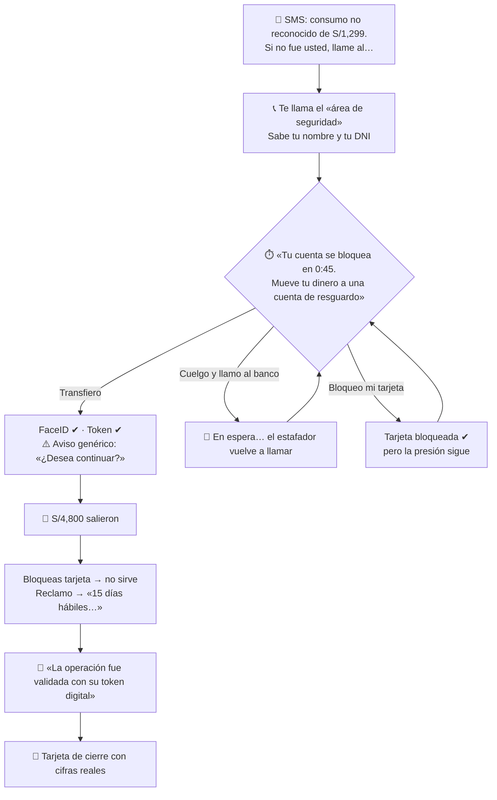
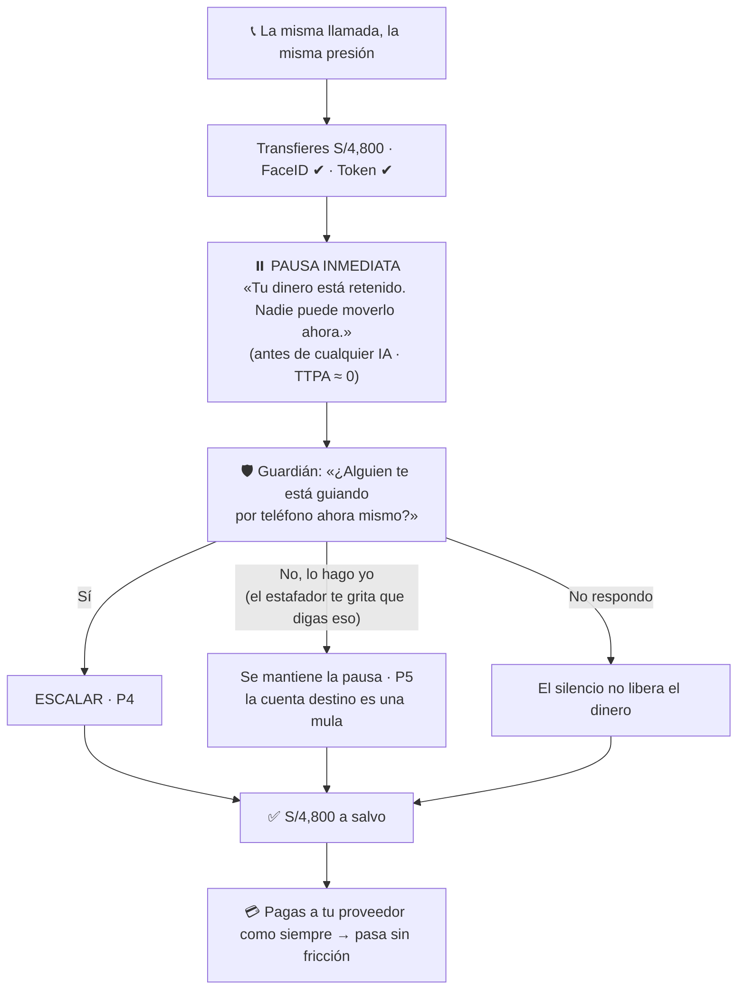
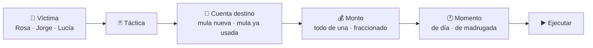

# Demo jugable: «Te están robando»

> Diseño UX del demo para usuarios. Dos roles, **víctima** y **atacante**, construidos sobre **casos reales de Perú** y medidos para **validar la propuesta de valor**.
>
> Contexto: [CASOS_DE_USO](CASOS_DE_USO.md) · [Hipótesis](context/tony_dev/adaptive_financial_security_docs/08_JTBD_AND_HYPOTHESES.md) · [Métricas y experimentos](context/tony_dev/adaptive_financial_security_docs/14_METRICS_AND_EXPERIMENTS.md) · [Riesgos y ética](context/tony_dev/adaptive_financial_security_docs/15_RISKS_ETHICS_PRIVACY.md)

---

## 1. Para qué sirve el juego

No es un adorno del pitch. Hace tres trabajos:

| Trabajo | Qué logra | Qué valida |
|---|---|---|
| **Sentir** | El jugador vive la frustración real de una víctima: presión, autenticación correcta, dinero perdido, reclamo que no avanza | Que el problema es real y duele (CU-01, FM2, FM7) |
| **Probar** | El jugador ataca el sistema con las mismas tácticas que se usan en Perú y ve cómo los agentes reaccionan | Que la capa resiste ataques reales (H3, H8, H10) |
| **Medir** | Cada partida deja datos: quién cayó, con qué, cuánto tardó la protección, cuánta fricción sintió y si activaría la protección | Hipótesis H1, H3, H5 y el experimento E3, con personas reales en el evento |

El cierre del pitch deja de ser una promesa y pasa a ser un resultado del propio evento:

> *«Hoy jugaron N personas. Con la seguridad actual cayó el X%. Con nuestra capa, nadie perdió dinero. El Y% activaría esta protección en su banco. Los atacantes hicieron Z intentos y lograron W.»*

Todo resultado se presenta como **simulación con participantes del evento**, nunca como dato de producción (ver §8).

### Tres rutas

| Ruta | Para quién | Qué hace |
|---|---|---|
| `/` (modo demo) | El jurado, en el pitch | Recorrido guiado de Rosa → M-01 → Jorge → Don Pepe en **≤ 90 s desde un navegador**. No depende de que jueguen otras personas |
| `/play` | Asistentes, desde su celular por QR | Los dos roles: víctima y atacante |
| `/monitor` | Pantalla proyectada | Feed en vivo, agentes, expediente, veredicto del analista de simulación y resultados del experimento |

**Restricción oficial del evento** ([guía Hack The Andes](https://hacktheandes.com/guide)): el jurado abre los enlaces **desde el equipo de la organización**, en ventana privada; no se conecta la laptop del equipo. La app debe estar **desplegada en una URL pública**, en un **solo proceso** (el estado vive en RAM; nada de serverless).

**Mula precargada para el pitch:** en el modo demo la cuenta M-01 puede confirmarse en vivo con el botón del analista, o llegar ya confirmada como **«validada por analista de simulación»**. Siempre se etiqueta así; nunca se presenta como una revisión humana real.

> Paquete de especificación ampliado (34 docs, 10 escenarios): [Te_Estan_Robando/INDICE.md](Te_Estan_Robando/INDICE.md). Es de referencia: asume Postgres, salas y realtime que **no** entran en el MVP del hackathon.

---

## 2. La base real: qué pasa hoy en Perú

Cada escena del juego sale de un caso o una cifra verificada. Lo no verificado está marcado.

### Cifras

| Dato | Fuente |
|---|---|
| 47% de usuarios de finanzas digitales estuvo expuesto a fraude o estafas en el último año; 21% de los expuestos perdió dinero. Entre los afectados por **riesgos digitales** en general (no solo fraude), 25% redujo su uso y 11% lo dejó | Encuesta SBS + CGAP 2025, 1,007 usuarios ([CGAP](https://www.cgap.org/research/publication/solutions-to-protect-consumers-fraud-in-digital-finance)) |
| Ene–jul 2026: 29,118 denuncias por delitos informáticos; 19,602 de fraude informático y 7,431 de suplantación de identidad | Ministerio Público, citado por [La Cámara](https://lacamara.pe/fraude-informatico-cinco-consejos-para-evitar-estafas-digitales/) (21-09-2026) |
| LATAM 2025: intentos de estafa +155%, fraude con herramientas de acceso remoto ×5, dispositivos robados +344%, cuentas mula +42% | [BioCatch 2026](https://www.biocatch.com/press-release/latin-american-banks-see-155-increase-in-scam-attempts) (36 instituciones) |
| Reclamos: el banco tiene 15 días hábiles para responder; en operaciones no reconocidas el promedio fue de 11 días hábiles (dato de 2023) | Ley 31763 / Res. SBS 4036-2022 ([Infobae](https://www.infobae.com/peru/2026/06/27/bancos-y-cobros-no-reconocidos-como-reclamar-por-pagos-que-no-realizaste/), [informe SBS](https://www.sbs.gob.pe/Portals/0/INFORME%20CONJUNTO%20N%2000181-2023-SBS.pdf)) |

### Casos reales que el juego reproduce

| Caso | Qué pasó | Por qué importa para nosotros |
|---|---|---|
| **Puno, Indecopi 2026** | Transferencia de **S/10,000** a un tercero que no coincidía con el patrón del cliente. El banco alegó que cumplió la autenticación. Indecopi: autenticar **no exime** de tener monitoreo eficaz. Multa de 3.78 UIT y devolución. [Comunicado Indecopi, 14/07/2026](https://www.gob.pe/institucion/indecopi/noticias/1418542-indecopi-sanciona-a-banco-por-no-adoptar-medidas-de-seguridad-para-evitar-una-operacion-no-reconocida) · [La República](https://larepublica.pe/sociedad/2026/07/14/indecopi-multa-a-bbva-por-no-alertar-transferencia-inusual-de-s10000-y-ordena-devolver-monto-a-cliente-1319612) | Es nuestra tesis dicha por el regulador: **autenticación correcta ≠ operación segura** (CU-01) |
| **Chimbote, Indecopi 2026** | Cuatro operaciones no reconocidas desde la banca móvil, pese a que el banco alegó el uso del token digital. Según la prensa: S/5,700, y el token no podía ser a la vez el factor de autenticación y el control contra «hombre en el medio» sin un control **fuera de banda**. [Comunicado Indecopi, 22/05/2026](https://www.gob.pe/institucion/indecopi/noticias/1396052-indecopi-sanciona-a-dos-bancos-y-un-restaurante-en-chimbote-por-consumos-no-reconocidos) · [La República](https://larepublica.pe/sociedad/2026/05/24/indecopi-multa-a-bbva-con-s20790-transferencia-no-reconocida-validada-con-token-digital-en-banca-movil-de-clienta-1794936) | Respalda que el Guardián verifique **por otro canal**, nunca por el comprometido (FM3, P7). En el pitch citar solo lo que dice el comunicado oficial |
| **Tarapoto, Indecopi 2026** | Transferencia no autorizada de S/1,550. El banco debe probar que la operación fue del cliente. [LP Derecho](https://lpderecho.pe/si-te-sustraen-dinero-a-traves-del-aplicativo-del-banco-este-tiene-que-probar-que-la-operacion-fue-tuya-resolucion-101-2026-ps0-indecopi-sam/) | El expediente con evidencia citada (Auditor) es lo que el banco necesita para probar |
| **Trujillo, Fiscalía, marzo 2026** | Accedieron al celular de una víctima y movieron ~**S/8,000**. Parte llegó a la cuenta de una mujer que habría «alquilado» su cuenta; la banda captaba personas para abrir cuentas y luego retirar el dinero o pasarlo a cripto. [LP Derecho](https://lpderecho.pe/dictan-prision-preventiva-presunto-integrante-banda-captaria-personas-crear-cuentas-y-usarlas-retiros-irregulares/) (una sola fuente) | Las **cuentas mula** existen, se reclutan y el dinero se mueve rápido (CU-02, CU-03) |

### Tácticas que usan los atacantes en Perú

| Táctica | Evidencia | Qué tan sólida |
|---|---|---|
| 📞 **Falso banco** (llamada: «detectamos un fraude, mueve tu plata a una cuenta segura») | SBS y ASBANC la listan entre las más frecuentes ([Gestión](https://gestion.pe/tu-dinero/finanzas-personales/fraude-phishing-bancario-senales-de-alerta-que-todo-usuario-debe-reconocer-segun-asbanc-noticia/), [Caretas](https://caretas.pe/economia/gratificacion-2026-sbs-alerta-sobre-fraudes-digitales-y-explica-como-proteger-tu-dinero)) | ✅ oficial |
| 💬 **SMS o correo con link falso** (bloqueo de cuenta, consumo no reconocido) → roba la clave | SBS: phishing y smishing, entre los cinco mecanismos más usados (Caretas, 2026) | ✅ oficial |
| 👨‍👩‍👧 **Falso familiar** («hola mamá, cambié de número, necesito plata») | Advertencia de la Fiscalía ([El Tiempo](https://eltiempo.pe/uncategorized/si-recibes-este-mensaje-en-whatsapp-no-respondas-podria-ser-una-estafa/)) | ✅ advertencia oficial, sin cifras |
| 📲 **App falsa / «mano fantasma»** (malware que controla el celular cuando la víctima no lo usa) | Troyano Zanubis: se hacía pasar por la app de SUNAT y atacaba 38 apps financieras peruanas ([Kaspersky vía Revista Economía](https://www.revistaeconomia.com/version-local-del-ataque-de-la-mano-fantasma-acecha-a-usuarios-de-la-banca-movil-en-peru-advierte-kaspersky/), 2023); acceso remoto ×5 en LATAM (BioCatch) | ⚠️ caso de 2023 + tendencia regional |
| 🔁 **Duplicado de chip (SIM swap)** | Osiptel dice haberlo reducido **más de 90%** con activación diferida de 4 h, biometría y alertas ([El Comercio](https://elcomercio.pe/economia/osiptel-hemos-reducido-en-mas-del-90-los-casos-de-sim-swapping-osiptel-creatividad-empresarial-sim-noticia/)) | ⚠️ hoy es una táctica **difícil** en Perú; el juego lo refleja |
| ❌ Falso asesor que pide instalar una app de acceso remoto | No encontramos una fuente peruana específica | ❌ no usar como «caso real» |

### Lo que el cliente puede hacer hoy

Es la «caja de herramientas» de la víctima en el juego, y es la fuente de la frustración:

| Herramienta | La realidad |
|---|---|
| Bloquear la tarjeta desde la app | Protege la **tarjeta**; una transferencia que ya salió no vuelve |
| Llamar a la banca telefónica | Espera, y el estafador sigue llamando |
| Presentar un reclamo | Hasta **15 días hábiles** para la respuesta |
| La respuesta del banco | En los casos reales: «la operación fue validada con su token» |
| Ir a la SBS o a Indecopi | Meses; en los casos de Puno y Chimbote el cliente ganó, pero tras un procedimiento largo |

---

## 3. Rol 1: la víctima

**Duración:** ~2 minutos. **Personaje:** Rosa, dueña de una bodega en Lima. El jugador **es** Rosa.

La víctima juega **el mismo ataque dos veces**. El contraste es el mensaje.

### Ronda A: «Aviso genérico» (línea base simulada)

> En la UI se llama **«Aviso genérico (simulado)»**, no «la seguridad de tu banco». Es una política de control definida por nosotros (autenticación + un aviso «¿desea continuar?»), **no** una reproducción de los sistemas de los bancos peruanos. Esta ronda no llama al motor.



**Mecánicas de presión** (todas reales):

- **Reloj** que corre durante la llamada.
- El estafador **sabe tus datos** (filtraciones, FM10).
- **Distracciones** de la bodega: un cliente pide vuelto, otro paga con Yape.
- **Autenticación perfecta:** FaceID y token pasan sin problema. El jugador siente que hizo todo bien.
- **Aviso genérico** del banco («¿Seguro que desea continuar?»), el que existe hoy. Es la **línea base del experimento E3**.
- Si cuelga, **vuelve a llamar**. Si llama al banco, **espera**.

**No hay trampa.** Si el jugador resiste hasta que se acaba el tiempo, no pierde dinero, pero termina la ronda habiendo hecho el trabajo de un equipo de respuesta a incidentes (FM7): llamó, esperó, bloqueó y quedó con miedo. Medimos honestamente cuántos caen.

**Tarjeta de cierre:**

> **No fue tu culpa.** Te autenticaste bien. El sistema esperaba que tú te dieras cuenta, bajo presión, en 45 segundos.
>
> En Perú, el 47% de usuarios de finanzas digitales estuvo expuesto a fraude o estafas el último año, y el 21% de ellos perdió dinero.
>
> En 2026, Indecopi multó a un banco por una transferencia de S/10,000 así: *autenticar no basta.*

### Ronda B: «Con nuestra capa»

La misma llamada, la misma presión y el mismo reloj. Cambia lo que pasa al transferir:



Los momentos que el jugador debe notar:

1. **El reloj del estafador deja de importar:** el dinero ya está retenido.
2. **El Guardián nunca pide clave, token ni datos de tarjeta.** Una línea lo dice explícitamente.
3. **Mentir no funciona:** aunque el estafador le haga decir «lo hago yo», la cuenta destino la delata (P5, coerción, R7).
4. **No molesta en lo normal:** el pago al proveedor pasa (P2/P8, FM6).

### Variante opcional: Lucía, sin señal

Para un segundo nivel, si hay tiempo. Lucía viaja y su pantalla queda **«sin señal»**: el jugador literalmente no puede tocar nada mientras alguien entra desde un celular nuevo.

- **Hoy:** el dinero sale y ella se entera días después.
- **Con la capa:** pausa sin necesitar su respuesta y verificación por otro canal (P7, estados C y E del doc 04). El pago recurrente del hotel sigue pasando.

Es la frustración más pura (FM1: notificar no es proteger) y el caso de Chimbote (control fuera de banda).

---

## 4. Rol 2: el atacante

**Duración:** ~2 minutos, máximo 5 intentos. **Objetivo:** **encontrar huecos del sistema**. Se gana un «descubrimiento» cada vez que una operación etiquetada como fraude **pasa** el motor. No se premian los soles robados (es red-teaming, no un entrenamiento para robar).

El jugador es parte de una banda y tiene lo que tienen las bandas reales: **datos filtrados, cuentas «alquiladas» (mulas) y un teléfono.**

### Arma el golpe en 4 decisiones



### Las cartas de táctica

Cada carta muestra **qué tan común es** (con fuente) y **qué señal enciende** en el sistema. Los puntajes son los reales de `lib/rules/level0.ts`.

| Carta | Común en Perú | Lo que ve el sistema | Resultado esperado |
|---|---|---|---|
| 📞 Falso banco | ✅ muy común | llamada activa +3 *(señal **simulada**: una web no puede saber si estás en una llamada; en producción haría falta una fuente autorizada)* · beneficiario nuevo +2 · monto atípico +2 = **7** | Pausa inmediata → Guardián ∥ Detective → **P4** |
| 💬 Link falso → entras con su clave | ✅ muy común | dispositivo nuevo +2 · beneficiario nuevo +2 · monto atípico +2 = **6** | Pausa → verificación por otro canal |
| 👨‍👩‍👧 Falso familiar | ✅ común | beneficiario nuevo +2 · monto atípico +2 = **4** | El Detective revisa el destino → si es mula, frenado |
| 📲 App falsa (control remoto) | ⚠️ tendencia en alza | acceso remoto +3 + … | Pausa + Guardián |
| 🔁 Duplicado de chip | ⚠️ **difícil hoy**: Osiptel exige 4 h de espera y biometría | si lo logras: cambio de SIM +2 · dispositivo nuevo +2 · … | La carta tiene probabilidad baja de funcionar **antes** de llegar al banco, como en la realidad |

Variables que el atacante también decide, y lo que provocan:

| Decisión | Efecto en el sistema |
|---|---|
| Mula **ya usada** y confirmada por el analista | **P1: frenado en 0 s, 0 llamadas de IA** (CU-03) |
| De madrugada | +1 |
| **Monto chico** a una cuenta nueva, sin otra señal | score 2 → **pasa** (P3) |

### El hueco honesto, convertido en la mejor escena

Un monto chico a una mula nueva, sin otra señal, **pasa**. No lo escondemos:

> *«Ganaste S/300.»*

Pero cada robo deja rastro en la cuenta destino. Cuando varios jugadores mandan dinero a la misma mula, su **fan-in crece**, entra una **alerta AML** (Puerta B), el Detective arma el expediente y **alguien del jurado** pulsa «Confirmar mula» en el monitor. Desde ese segundo, **todos** los intentos de **todos** los jugadores a esa cuenta mueren al instante, sin IA.

El atacante aprende lo que el sistema quiere enseñar: **cada robo quema la cuenta** (H8). Y el público lo ve pasar en vivo, provocado por ellos mismos.

### Fin de la partida

Tarjeta con: descubrimientos (huecos encontrados), intentos frenados, qué agente te atrapó en cada intento y por qué, en lenguaje humano. Por ejemplo: *«el Guardián detectó que alguien guiaba a la víctima por teléfono»*, nunca *«P4»*.

---

## 5. El monitor (pantalla proyectada)

Es la segunda pantalla, la del público y el jurado. Muestra **en vivo** cómo reaccionan los agentes a lo que hacen los jugadores.

```text
┌─────────────────────┬──────────────────────────────────┬─────────────────────┐
│ INTENTOS EN VIVO    │  🧭 Coordinador                   │ MARCADOR            │
│                     │     ↙          ↘                 │                     │
│ ⚡ "Zorro" → Rosa    │ 🛡️ Guardián    🔍 Detective       │ Intentos      37    │
│   Falso banco       │     ↘          ↙                 │ Frenados      35    │
│   ⏸️ ESCALAR · P4    │   ⚖️ Policy → 📋 Auditor          │ Pasaron        2    │
│                     │                                  │ S/ retenido* 142k   │
│ ⚡ "Ana" → M-01      │  (se iluminan en orden, por      │ IA por intento 1.3  │
│   ⏸️ P1 · 0 IA ⚡     │   cada intento que llega)        │ Mulas en memoria 1  │
│                     │                                  │                     │
├─────────────────────┴──────────────────────────────────┼─────────────────────┤
│ EXPEDIENTE  M-01: 14 remitentes nuevos en 48h [E-02]   │ EXPERIMENTO EN VIVO │
│ 91% reenviado en < 2h [E-03] · cadena M-01→M-02→M-03   │ Cayeron hoy    71%  │
│        [ ✅ Confirmar mula ]   [ ✖ Descartar ]          │ Cayeron c/capa  0%  │
│                                                         │ Activaría      86%  │
└─────────────────────────────────────────────────────────┴─────────────────────┘
          DATOS 100% SINTÉTICOS · simulación con participantes del evento
```

> Los números del boceto son **ilustrativos**: los reales salen de las partidas. \*«S/ retenido» = **importe sintético de transferencias riesgosas retenidas**, nunca «dinero ahorrado». Cada intento cuenta una vez.

Reglas de diseño:

- **Se lee a 5 metros:** números grandes y pocas palabras.
- **Causalidad visible:** cuando llega un intento, los agentes se encienden **en el orden real** del pipeline (reglas → pausa → Coordinador → Guardián ∥ Detective → Policy → Auditor). Un intento a una mula confirmada muestra el atajo: **Memoria → Policy**, sin agentes, y la etiqueta «0 IA».
- **El jugador se reconoce:** cada intento lleva su alias.
- **Toda decisión con su regla**, y toda afirmación del expediente con su cita clickeable (requisito del demo).
- **El botón «Confirmar mula»** lo pulsa una persona del jurado. Es el momento estrella (CU-03).

---

## 6. Cómo el juego valida la propuesta de valor

Cada partida produce datos. Esta es la tabla que conecta el juego con las hipótesis del research pack:

| Hipótesis / experimento | Qué medimos en el juego | Cómo |
|---|---|---|
| **H3**: la identidad correcta no basta | % de víctimas que transfieren en la ronda A **aun con FaceID y token correctos** | Registro automático de la partida |
| **E3**: aviso genérico vs. intervención contextual | Tasa de caída con el aviso genérico (ronda A) vs. con pausa + pregunta del Guardián (ronda B) | Registro automático |
| **H1 / TTPA** | Segundos desde la primera señal hasta la protección: ronda A (nunca, o tras el reclamo) vs. ronda B (≈ 0) | Timestamps del caso |
| **Fricción** (doc 14) | «¿La pausa te molestó?» y si el pago legítimo pasó sin fricción | 1 pregunta + registro |
| **H5**: los usuarios aceptan protección delegada | «¿Activarías esto en tu banco aunque a veces retrase un pago?» | 1 pregunta al final |
| **Confianza** (CGAP: entre afectados por riesgos digitales, 25% reduce uso y 11% abandona) | «Después de esto, ¿seguirías usando tu banca digital igual?», ronda A vs. B | 1 pregunta por ronda |
| **H8**: una mula, muchas víctimas | Intentos que reutilizaron una mula y cuántos frenó la Memoria | Registro + `/api/stats` |
| **H10**: la mayoría no necesita IA | Llamadas de IA por intento; % de intentos resueltos sin IA | `/api/stats` (`metricas.eficiencia_ia`) |
| **Robustez** (red team) | Tácticas que lograron pasar, montos y combinaciones | Registro del atacante + pregunta abierta «¿qué intentarías después?» |

### Las preguntas: máximo 3 por partida, de un toque

| Momento | Pregunta | Respuesta |
|---|---|---|
| Fin de ronda A | ¿Cuánta frustración sentiste? | 😌 🙂 😐 😟 😫 |
| Fin de ronda B | ¿La pausa te molestó? | No · Un poco · Mucho |
| Final | ¿Activarías esta protección en tu banco? | Sí · No · No sé |

### Límites que debemos decir en voz alta

- **Sesgo de juego:** quien sabe que juega a «detectar la estafa» cae menos que en la vida real. Si aun así cae, el resultado es **conservador**: en la vida real sería peor.
- **Orden fijo:** la ronda B va después de la A, así que el jugador ya conoce el guion. Por eso en la ronda B no medimos «si detectó la estafa», sino **si perdió dinero**, y eso no depende de él sino del sistema.
- **Muestra chica y no representativa:** decenas de personas de un evento tecnológico. Los resultados son **indicativos** y se presentan como tales.
- **El atacante juega con 5 tácticas conocidas.** No probamos ataques que no imaginamos; por eso la pregunta abierta recoge ideas para red-teaming posterior.

---

## 7. Experiencia: principios

| Principio | Cómo se aplica |
|---|---|
| **Corto** | Víctima ~2 min, atacante ~2 min; sin tutorial, se aprende jugando |
| **Celular por QR** | El jugador usa su propio celular, que es donde ocurre el fraude real; el monitor va proyectado |
| **Lenguaje humano para el jugador** | Nunca `P4`, `score 7` ni `E-07` en la pantalla del jugador; eso vive en el monitor |
| **2D, ilustrado y cálido** | Escena de bodega limeña, personajes simples y una pantalla de celular dentro de la escena |
| **Frustración con salida** | La frustración dura una ronda y siempre termina en «no fue tu culpa» y en la ronda B |
| **Coherente con el sistema real** | Cada intento llama al pipeline real (`/api/transfers`, `/api/alerts`, `/guardian/reply`, `/verdict`), no a una animación guionada |

---

## 8. Ética: lo que el juego **no** hace

- **No enseña a estafar.** Las tácticas se nombran como lo hacen las campañas de la SBS y ASBANC: sin guiones, sin pasos operativos, sin herramientas reales.
- **No culpa a la víctima.** Toda pantalla de pérdida dice «no fue tu culpa».
- **Algunas personas del público pueden haber sido víctimas.** Antes de jugar se avisa que el juego simula una estafa; al final se muestran los canales oficiales para denunciar (banco, SBS, Indecopi, PNP).
- **No usa marcas reales.** El banco del juego es ficticio («Banco Andino»). Los casos reales se citan como «un banco» en el juego; las fuentes completas están en este documento.
- **No elige víctimas por perfil.** Rosa, Jorge y Lucía se diferencian por su **situación** (bodega, viaje, sin señal), nunca por edad, discapacidad o ingreso (R1). El atacante elige a quién atacar; el sistema solo mira la operación.
- **Datos 100% sintéticos** y etiquetados así en las dos pantallas.
- **Las respuestas de las encuestas son anónimas:** alias libre, sin correo ni teléfono.

---

## 9. Qué necesita el juego del backend

Solo lo que el UX exige; la implementación queda en manos del dueño de cada bloque.

| Necesidad | Por qué | Estado |
|---|---|---|
| Listar los casos recientes | El monitor muestra el feed en vivo | ❌ falta (`GET /api/cases`) |
| Que una transferencia jugada **cuente como movimiento** de la cuenta destino | Para que el fan-in crezca con los jugadores y la mula «se queme» en vivo (§4) | ❌ hoy el fan-in solo lee `seed.json` |
| Guardar alias, ronda, táctica y respuestas de las 3 preguntas | Los datos de validación (§6) | ❌ falta |
| Guardián multiturno | Chat de la ronda B | ✅ ya existe (`/guardian/reply`) |
| Métricas de IA, TTPA y fricción | Marcador del monitor | ✅ ya existe (`/api/stats`) |
| Un solo proceso con estado compartido, **en URL pública** | Celulares, monitor y jurado deben ver los mismos casos; el jurado no usa nuestra laptop | ⚠️ desplegar `next start` en un servidor de un solo proceso (p. ej. Railway); **no** serverless ni laptop ([INFRA](context/tony_dev/INFRA_Y_ORQUESTACION.md) §4–5) |

---

## 10. Pendientes antes de construir

1. Validar este diseño con 2–3 personas fuera del equipo: ¿la ronda A frustra sin aburrir?
2. Confirmar las cifras marcadas ⚠️ si se van a decir en el pitch.
3. Decidir si la variante Lucía entra en la primera versión (recomendado: **no**; primero víctima-Rosa, atacante y monitor).
