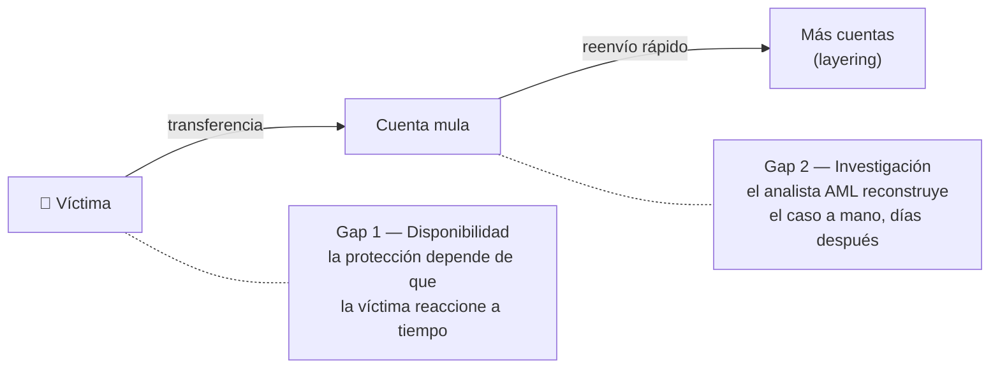
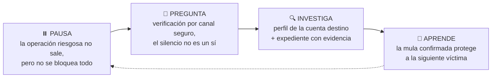
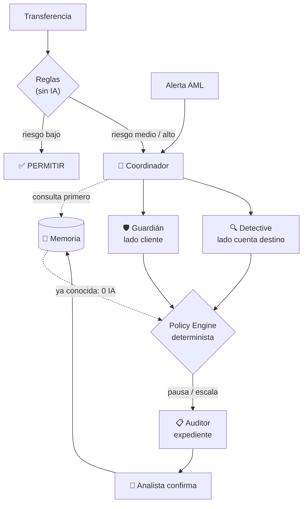
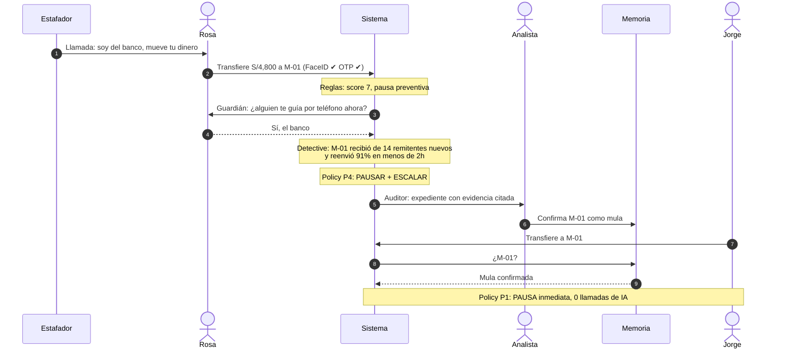

# La solución

> Este es el documento único de la solución. La definición formal del problema y de los casos de uso está en [CASOS_DE_USO.md](CASOS_DE_USO.md). El detalle técnico está en [19_MULTIAGENT_SYSTEM](context/tony_dev/adaptive_financial_security_docs/19_MULTIAGENT_SYSTEM.md), el demo en [13_MVP_30H](context/tony_dev/adaptive_financial_security_docs/13_MVP_30H.md) y por qué la elegimos en [09_SOLUTION_SPACE](context/tony_dev/adaptive_financial_security_docs/09_SOLUTION_SPACE.md).

## En una frase

> **Si alguien intenta estafarte, pausamos el pago, investigamos la cuenta que iba a recibir tu dinero y, si es una mula, la próxima víctima ya está protegida.**

---

## 1. El problema: la misma transacción, dos extremos, dos equipos

| | Gap 1 — Disponibilidad (Track 04) | Gap 2 — Investigación (B1) |
|---|---|---|
| Quién lo sufre | Cliente: estafado, suplantado, extorsionado o sin señal | Analista de fraude / AML |
| Qué falla | El banco detecta, pero espera a que el cliente responda | Cada alerta exige reunir contexto de varios sistemas |
| Consecuencia | El dinero sale antes de que alguien actúe | Backlog, inconsistencia y la mula sigue activa |

Hoy esos dos equipos trabajan separados: **lo que aprende AML no protege a tiempo a la siguiente víctima.**

---

## 2. Cómo lo resolvemos: Pausa → Pregunta → Investiga → Aprende

| Paso | Quién lo hace | Qué resuelve |
|---|---|---|
| ⏸️ Pausa | Reglas + Policy Engine (sin IA) | La protección no depende de que el cliente reaccione |
| 💬 Pregunta | 🛡️ Guardián | Detecta al cliente autenticado pero manipulado; nunca pide claves ni aprueba |
| 🔍 Investiga | 🔍 Detective + 📋 Auditor | El analista valida un expediente en vez de investigar desde cero |
| 🧠 Aprende | Memoria de riesgo | La siguiente víctima queda protegida sin gastar IA |

---

## 3. El sistema multiagente

**La IA recomienda; una política determinista decide; el humano confirma.** Ningún agente mueve dinero.

### Por qué multiagente y no un solo agente

| | Beneficio |
|---|---|
| **Optimiza recursos** | Reglas filtran primero; la Memoria vuelve gratis los casos repetidos; modelo barato para conversar, capaz solo para el expediente |
| **Mejores resultados** | Dos miradas independientes (cliente y cuenta destino) reducen falsos positivos; el Auditor no deja pasar afirmaciones sin evidencia |
| **Responde al pain point** | Cada agente existe por un problema concreto: Guardián → estafa/suplantación, Detective → investigación manual, Auditor → trazabilidad, Coordinador → silos |

---

## 4. El demo: Rosa, la mula y Jorge

**Control de falsos positivos:** un pago a *Bodega Don Pepe* (muchos remitentes, pero sin reenvío rápido) se **permite**. Fan-in solo no basta para llamar mula a una cuenta.

---

## 5. Qué cubre de cada reto

| Reto | Exigencia | Cómo lo cubrimos |
|---|---|---|
| Track 04 | Estafas | Guardián pregunta específicamente + pausa |
| Track 04 | Suplantación | Dispositivo nuevo / SIM swap + titular sin responder → pausa; no se verifica por el canal comprometido |
| Track 04 | Extorsión | Cooldown + verificación fuera del canal; la víctima no puede “autoaprobar” bajo presión |
| B1 | Reconstruir el caso | Detective con tools deterministas |
| B1 | Patrones de lavado | fan-in, reenvío rápido, estructuración, ciclos |
| B1 | Recomendación trazable | Auditor con cada afirmación citada |
| Ambos | Que lo aprendido sirva | Memoria de riesgo |

---

## 6. Límites honestos

- **Mula en otro banco:** solo vemos lo que nuestros clientes le envían; sigue siendo una señal fuerte (ver [19 §10](context/tony_dev/adaptive_financial_security_docs/19_MULTIAGENT_SYSTEM.md#10-límite-conocido-mula-en-otro-banco)).
- **Datos sintéticos:** todo número del demo es simulado y se presenta como tal.
- **No reemplaza al banco:** se agrega entre el risk engine y la ejecución, y sobre la cola de alertas AML.
- **Etiquetar mulas daña si se hace mal:** nada entra a la Memoria sin validación humana; expira y admite revisión.

---

## 7. Dónde está cada cosa

| Pregunta | Documento |
|---|---|
| ¿Cuál es el problema y por qué importa en LATAM/Perú? | [01](context/tony_dev/adaptive_financial_security_docs/01_CORE_THESIS.md), [02](context/tony_dev/adaptive_financial_security_docs/02_LATAM_AND_ANDEAN_CONTEXT.md), [03](context/tony_dev/adaptive_financial_security_docs/03_PROBLEM_MAP.md) |
| ¿Cómo funciona exactamente el sistema? | [19](context/tony_dev/adaptive_financial_security_docs/19_MULTIAGENT_SYSTEM.md) |
| ¿Qué construimos en 30h y cómo es el demo? | [13](context/tony_dev/adaptive_financial_security_docs/13_MVP_30H.md) |
| ¿Quién hace qué? | [Work Blueprint](work/00_WORK_BLUEPRINT.md) |
| ¿Cómo lo contamos? | [17](context/tony_dev/adaptive_financial_security_docs/17_PITCH_NARRATIVE.md) |
