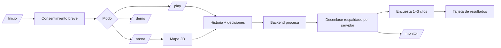

# 07 · UX: recorridos, pantallas y estados

> **Proyecto:** Te están robando / El barrio no duerme. **Fecha de corte:** 17 de octubre de 2026. **Tipo:** propuesta de diseño salvo indicación expresa. **Entorno:** exclusivamente datos y cuentas sintéticas.

## Principio
El jugador experimenta consecuencias; el sistema se entiende en el monitor. **Nunca** exigir que el usuario comprenda `P4`, `fan_in`, `rule_score` antes de jugar. La interacción se aprende en 5 segundos.

## Mapa de pantallas

## Screen inventory y requisitos
| Pantalla | Contenido obligatorio | Acción primaria | Fallos |
|---|---|---|---|
| Inicio | título, demo sintética, elegir modo | jugar | sin backend → estado fuera de servicio |
| Consentimiento | datos guardados y opción de no responder encuesta | continuar | no pedir email/DNI |
| Sala | alias, cupos, QR, rol cuando inicia | listo | reconectar sin duplicar |
| Mapa | sprite, iconos de estaciones, instrucciones de 1 línea | interactuar | baja FPS → menú textual |
| Teléfono ficticio | llamada, opciones y temporizador narrativo | elegir | no registrar datos personales |
| Transferencia | monto ficticio, beneficiario ficticio, confirmar | enviar | doble clic → una sola operación |
| Estado | pendiente/retención/cierre con explicación humana | ver resultado | timeout no es «éxito» |
| Resultados | historial, n, métricas del ensayo | responder encuesta | opt out disponible |
| Monitor | eventos, pipeline, evidence IDs, KPI y leyenda sintética | expandir evidencia | resync ante WebSocket caído |

## Flujo UX Rosa
Bodega → SMS ficticio → llamada → opciones (transferir, colgar, contactar canal oficial ficticio, continuar actividad) → confirmación de operación → resultado de motor. Si pregunta Guardián, muestra un máximo de tres preguntas no intrusivas, nunca claves/OTP. La transferencia puede permanecer retenida aunque el jugador diga «todo bien» si el riesgo destino es alto. La interfaz nunca promete fondos «salvados para siempre».

## Flujo adversario
Tarjetas de escenario con nombre abstracto («suplantación», «presión», «beneficiario nuevo»), destino del catálogo, monto predefinido, ventana temporal ficticia → vista previa **sin score interno** → ejecutar → explicación posterior de señales y decisión.

## Flujo monitor
Evento reciente → línea temporal de motor → explicación contextual → evidencia con ID y source → transferencia final. Modo «novato» muestra lenguaje humano; modo «inspector» enseña regla/policy/versiones.

## Carga cognitiva
- Jugador: una pregunta a la vez, botones grandes, errores reversibles.
- Monitor: cuatro KPI máximo en primer nivel; resto expandible.
- Pitch: botón de lanzamiento directo y reset de nueva ejecución sin navegar menús.

## A/B sin engaño
Baseline = simulación de una política definida por el equipo, no «todos los bancos actuales». La ronda defensiva usa el motor; comparar mismos escenarios y condiciones. Contrabalancear orden o asignar entre sujetos. Etiquetar en UI.
