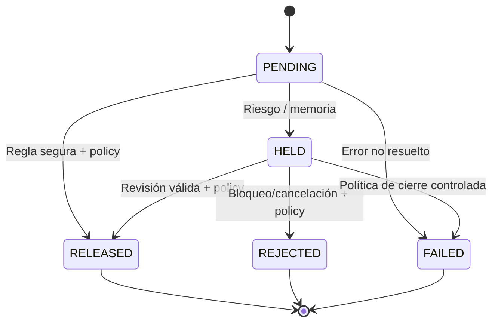

# 12 · Ledger sintético, estados e invariantes

> **Proyecto:** Te están robando / El barrio no duerme. **Fecha de corte:** 17 de octubre de 2026. **Tipo:** propuesta de diseño salvo indicación expresa. **Entorno:** exclusivamente datos y cuentas sintéticas.

## Definiciones
`PENDING`: creada/no ejecutada. `HELD`: retención persistida/no ejecutada. `RELEASED`: autorizada y efectivamente asentada en ledger simulado (pago ejecutado). `REJECTED`: cancelada antes de ejecución. `ESCALATED`: **estado de expediente**, no necesariamente estado excluyente de la transferencia. `FAILED`: falla técnica sin suponer éxito.

## Máquina de estados financiera recomendada

**No** pasar de `RELEASED` a `HELD` retroactivamente. Un caso `ESCALATED` puede coexistir con `HELD`; guardar aparte `case_status`.

## Invariantes obligatorias
- No insertar movimiento de débito en `ledger_entries` antes de que la transacción esté autorizada para ejecución.
- Para riesgo alto, `held_committed_at` estrictamente anterior a `first_agent_call_at`; no comparar sólo timestamps cliente.
- `RELEASED` y `REJECTED` terminales; no ejecutar transferencia dos veces.
- Idempotencia: (`room_id`, `idempotency_key`) UNIQUE y mismo resultado ante reintento.
- `balance` nunca se define desde request; se deriva de movimientos/ledger y saldo inicial.
- Decisiones incluyen `rule_id`, `policy_version`, estado previo/nuevo y pruebas.
- Cada `confirmed_mule` incluye origen, `validated_by`, `valid_until`, evidencia; si venció no activa P1 automáticamente.
- Orden de Memoria confirmada se comprueba antes de bypass por score bajo.
- Eventos públicos se publican después del commit; versión canónica mediante `seq` monotónico por sala.

## Concurrencia
Usar transacción SQL de corta duración para reservar cambio de estado y un outbox duradero. Evitar bloquear transacción mientras corre LLM. Un trabajador asíncrono procesa investigación; controles de leasing y reintentos mantienen integridad. Si dos peticiones llegan simultáneamente, un unique y compare-and-swap impiden dos ejecuciones.

## Métrica TTPA
`ttph_ms = held_committed_at - request_accepted_at` para casos efectivamente retenidos. Para casos permitidos, valor nulo/no aplica. Si hubo demora previa para recabar señales, esa latencia debe contabilizarse desde admisión, no ocultarse.

## Diferencia de dinero
- «Monto retenido en transacciones de fraude sintético», no dinero ahorrado realmente.
- «Monto autorizado de pago legítimo», no ingresos reales.
- Nunca sumar reintentos de una misma `transfer_id`; separar principal y reversión (si existe).
