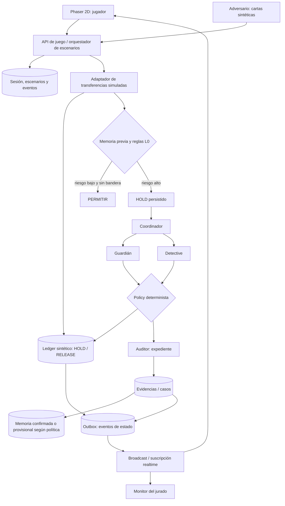
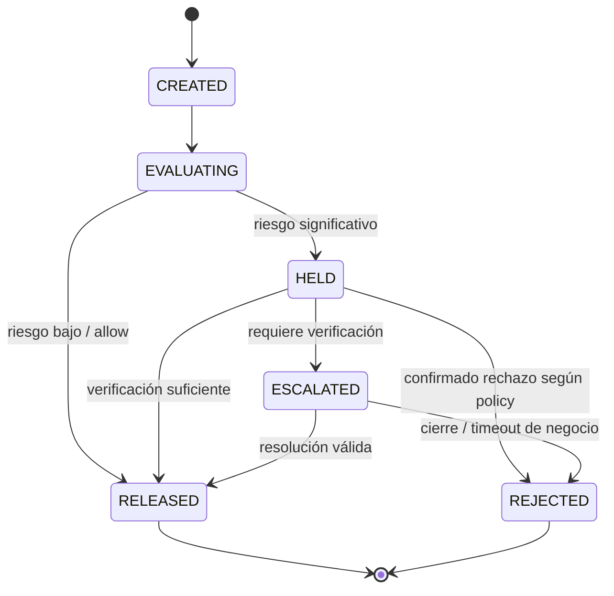

# TE ESTÁN ROBANDO — Game Design Document + Arquitectura de validación

**Proyecto:** laboratorio gamificado de protección financiera para Hack The Andes 2026  
**Concepto visual:** «El barrio no duerme» — videojuego web 2D pixel art + monitor técnico  
**Estado:** especificación propuesta, NO constatación de implementación.  
**Fecha:** 17 de octubre de 2026.

## 0. Decisión de producto

La **solución** es el motor de protección financiera. El **videojuego** es un arnés de experimentación, visualización y recolección de evidencia. Una escena puede dramatizar un contexto, pero jamás inventar una decisión del motor. Todos los importes, avatares y cuentas son sintéticos. No se conectan cuentas bancarias reales.

### Premisas verificadas en documentos del equipo

- Problema: operaciones autenticadas pueden ser inducidas por manipulación; protección no debe depender exclusivamente de una reacción inmediata del cliente.
- Componentes descritos: reglas (nivel 0), Coordinador, Guardián, Detective, Policy Engine determinista, Auditor, Memoria.
- CU-01: estafa con usuario autenticado; CU-02: investigación y expediente; CU-03: frenar a la siguiente víctima; CU-05: no bloquear comercio legítimo; CU-04: titular incomunicado, opcional.
- La pausa preventiva debe ocurrir antes de consultar IA.
- El documento base **sí contempla validación humana para confirmar mulas en Memoria**. No atribuir autonomía plena al sistema si eso no cambió realmente en el repositorio.
- Endpoints referidos por los documentos: `/api/transfers`, `/api/alerts`, `/guardian/reply`, `/verdict`, `/api/stats`; `/api/cases` aparecía pendiente.

### Restricciones oficiales Hack The Andes

- 17–18 de octubre de 2026; pitch 3 minutos y Q&A 2 minutos.
- Rúbrica: tracción 30%, esfuerzo técnico 40%, pitch 30%.
- Entregar URL de despliegue, URL de presentación, URL de GitHub, descripción Markdown.
- Presentación se abre en dispositivo de organización; no conectar laptop propia. Probar en incógnito y sin autenticación privada.
- Fuentes: https://hacktheandes.com/guide y https://hacktheandes.com/participation-terms

## 1. Game Loop

1. Jugador entra por QR, recibe alias efímero y sala.
2. Elige Story (víctima) o Arena (ciudadano / adversario), según modo de prueba.
3. Interactúa con estaciones del barrio (bodega, banco, hotel, mercado, plaza).
4. Cada elección genera un **evento sintético contextual**; el servidor construye/valida la operación.
5. Motor real ejecuta controles; el frontend no asigna el resultado financiero.
6. Monitor recibe el evento **después** de persistir la transición de estado.
7. Desenlace: permitido, retenido, rechazado o escalado; con evidencia y tiempos.
8. Encuesta de 1–3 respuestas y resumen anónimo.
9. Se acumulan partidas para analítica; escenarios repetibles con `scenario_version`.

No requerir movimiento preciso de multijugador para la prueba. Preferir estaciones clicables y sprites locales; la sincronización global se concentra en operaciones y resultados.

## 2. Roles y permisos

| Rol | Interacciones | NO puede hacer |
|---|---|---|
| Ciudadano | tareas, pagos, responder alertas ficticias | determinar score o veredicto |
| Adversario | escoger cartas de escenarios sintéticos y tiempos | editar señales de riesgo calculadas, cambiar el ledger, falsificar evidencia |
| Motor | aplica reglas, pausa, consulta IA, decide bajo Policy | inventar autorizaciones fuera de Policy |
| Presentador | iniciar/resetear sala, cambiar modo visual, ver dashboard | cambiar resultados ya ocurridos |
| Analista ficticio (opcional) | confirmar/descartar un expediente bajo un protocolo de simulación | etiquetar una cuenta como confirmada en silencio |

**Importante:** según la documentación vigente, la protección inmediata es automática y la confirmación durable de cuenta mula pasa por humano. Para una demostración totalmente automática sin operador: mostrar memoria provisional `suspected_account` con TTL e intensidad de protección limitada; mantener `confirmed_mule` únicamente tras validación humana. Alternativamente precargar una cuenta *ya confirmada* en datos de prueba y demostrar CU-03 sin botón durante la partida. No confundir provisional con confirmada.

## 3. Escenarios con ground truth conocido para el evaluador

| ID | Nombre | Contexto | Verdad sintética | Señales disponibles | Resultado que queremos observar | CU |
|---|---|---|---|---|---|---|
| S1 | La llamada de las seis | Rosa, bodega, falso banco, S/4,800 | Fraude | beneficiario nuevo, monto atípico, llamada: **solo señal simulada si se inyecta** | retención preventiva, Guardián + Detective | CU-01 |
| S2 | El token no basta | Jorge, cuenta habitual, S/10,000 inusuales | Fraude | monto y beneficiario atípicos, autenticación correcta | verificar que autenticación no equivalga a intención | CU-01 |
| S3 | La misma cuenta | varios ciudadanos pagan a M-01; evidencia de convergencia | Fraude | grafo de transacciones, fan-in, reenvío rápido | expediente y posterior retención por Memoria según estado de confirmación | CU-02/03 |
| S4 | Don Pepe recibe mucho | comercio legítimo con muchos pagadores | Legítimo | fan-in alto, sin reenvío rápido | permitir sin bloqueo indebido | CU-05 |
| S5 | Lucía sin señal | titular viaja, dispositivo nuevo; pago habitual al hotel | Mixto | dispositivo nuevo/beneficiario nuevo; pago recurrente conocido | retener anómalo, permitir recurrente | CU-04 |
| S6 | El intento pequeño | cuenta nueva sin señales suficientes, S/300 | Fraude | score bajo | posible falso negativo explícito y aprendizaje posterior | stress test |

La palabra 'fraude' en `ground_truth` se refiere únicamente a etiquetas **inventadas por el diseñador del experimento** para simular un mundo real. No se infiere automáticamente a partir del veredicto del mismo motor que se evalúa.

### Origen de escenas

- Perú, Puno: caso Indecopi, transferencia atípica de S/10,000, 14/07/2026: https://www.gob.pe/institucion/indecopi/noticias/1418542-indecopi-sanciona-a-banco-por-no-adoptar-medidas-de-seguridad-para-evitar-una-operacion-no-reconocida
- Chimbote, 22/05/2026: Indecopi confirmó sanciones relacionadas con consumos y operaciones no reconocidas y objeciones a mecanismos de autenticación: https://www.gob.pe/institucion/indecopi/noticias/1396052-indecopi-sanciona-a-dos-bancos-y-un-restaurante-en-chimbote-por-consumos-no-reconocidos
- CGAP, mayo de 2026: sondeo 2025 a 1,007 personas usuarias de servicios financieros digitales en Perú: https://www.cgap.org/research/publication/solutions-to-protect-consumers-fraud-in-digital-finance
- Las personas, llamadas, diálogos y montos en S1, S3–S6 son elementos de simulación, no reconstrucciones judiciales literales.

## 4. Tres modos de ejecución

### Modo A: Historia individual (`/play`)
- Duración objetivo 60–120 s, ejecutable con un navegador.
- Elegir situación de Rosa o Jorge.
- Generar interacción real, recibir política y respuesta.
- Para A/B, comparar **mismo `scenario_seed` en instancias aisladas** con política baseline vs. defensa; asignación y orden contrabalanceados. Nunca comparar una baseline ficticia con un banco real identificado.
- Registrar decisiones, no solo clicks finales.

### Modo B: Arena de barrio (`/arena/:roomId`)
- 2–8 participantes; participantes extras en modo espectador.
- Ciudadanos hacen pagos reales *dentro del ledger simulado*; adversarios activan variantes sintéticas prediseñadas.
- Eventos se intercalan; fan-in y grafo se alimentan de transacciones persistidas.
- Mostrar qué eventos generaron nueva evidencia o si el modelo se equivocó.
- Evitar que los adversarios aprendan pasos operativos reales de fraude; no proporcionar guiones ni instrucciones reutilizables.

### Modo C: Presentación (`/demo` y `/monitor`)
- Desde una URL se puede ejecutar una partida controlada, real y reproducible, aun sin público conectado.
- Botón `Iniciar escenario verificado` crea una nueva ejecución backend con `run_id`; no reproduce una animación pregrabada.
- Las transiciones provienen de API/event stream persistido. Si falla un servicio, mostrar el fallo.
- En modo presentación se puede usar cuenta de ejemplo ya validada para enseñar Memoria, etiquetándola claramente como seed sintético.

## 5. Principios de UX pixel-art

- Top-down 2D, tiles 16/32 px, sprites 4 direcciones; escala entera y pixelated rendering.
- Ambientación limeña/bodega de barrio sin logos de bancos reales.
- Paleta del mundo cálida y accesible; color de riesgo como acento no constante.
- Pantalla mobile: joystick virtual o toque en estaciones, diálogos legibles, interacción máxima dos taps por paso.
- Pantalla monitor: números grandes, grafo de cuentas, pipeline de agentes, tarjeta de evidencia clicable.
- No convertir etiquetas técnicas `P1`, `P4`, `fan_in` en texto principal de la víctima; sí mostrarlas en modo inspector del monitor.
- Etiqueta permanente: «Simulación con datos sintéticos».
- Escenas pueden dramatizar, pero nunca indicar «dinero retenido» si ledger/backend no lo confirma.
- Inclusión: evitar dependencia de movimiento rápido o audio; controles por teclado y móvil y subtítulos.

## 6. Arquitectura lógica



**Regla de seguridad:** en el camino de alto riesgo, guardar `HOLD` en el ledger antes de invocar IA. Nunca ejecutar desembolso y luego intentar retenerlo. Todas las operaciones sensibles pasan por controles y policy en backend; el cliente no puede hacer `RELEASED` directamente.

### Contexto y credibilidad de señales

Separar:
- `bank_available`: historial transaccional sintético, beneficiario nuevo, monto habitual, edad de dispositivo si está en perfil simulado.
- `scenario_only`: llamada activa, coerción directa, sospecha narrativa, entorno de víctima. Marcar explícitamente que no son señales bancarias disponibles sin una integración particular.
- `derived`: fan-in por ventana, reenvío rápido, cuenta conocida, reglas y scores computados servidor-side.

**NUNCA** incluir la etiqueta `ground_truth=fraud` en el payload entregado al motor de protección; se conserva en la tabla de evaluación aislada.

## 7. Máquina de estados de operación



- `HELD` es una operación no ejecutada, no dinero bancario real congelado.
- Si el sistema de IA cae o demora: no liberar automáticamente operaciones de alto riesgo; usar decisión y plazo definido por políticas.
- `RELEASED`/`REJECTED` terminales para la ejecución; no permitir doble gasto.
- Usar `idempotency_key`, bloqueo concurrente de saldo, transacciones atómicas y auditoría de quien/qué autorizó cambio.

## 8. Contratos de API propuestos (adaptar al repositorio real)

- `POST /api/game/sessions` -> session_id, room_id, experiment_arm, seed.
- `POST /api/game/actions` -> action_id, session_id, type, payload seguro; el backend verifica permisos.
- `POST /api/transfers` -> transacción simulada; retorna id, estado inicial, fuente de reglas.
- `GET /api/transfers/:id` -> estado canónico y evidencia permitida para ese rol.
- `POST /guardian/reply` -> reply de un caso vigente y autorizado.
- `GET /api/cases?room_id=...` -> casos paginados; endpoint pendiente según MD.
- `POST /verdict` -> SOLO función autorizada de analista/sistema según política explícita, no del jugador.
- `GET /api/stats?room_id=...` -> métricas agregadas.
- `GET /api/game/runs/:id/events` -> fuente de verdad para reconstruir y hacer replay.

No suponer que esos endpoints nuevos existen: son contratos propuestos para implementación.

## 9. Modelo mínimo de datos

- `rooms(id, created_at, status, scenario_set_version)`
- `sessions(id, room_id, alias, role, treatment_arm, consent, created_at)`
- `scenarios(id, version, seed, configuration_json, ground_truth_id)`
- `scenario_truth(id, encrypted_or_restricted_label, rationale)` — acceso exclusivo a evaluador server-side.
- `game_actions(id, session_id, scenario_run_id, type, payload, created_at)`
- `accounts(id, room_id, synthetic_profile, balance)`
- `transfers(id, room_id, run_id, from_id, to_id, amount, status, idempotency_key, created_at)`
- `risk_signals(id, transfer_id, signal_name, value, source_type, created_at)`
- `decisions(id, transfer_id, policy_version, rule_id, verdict, reason, decided_at)`
- `agent_runs(id, transfer_id, agent, start_ts, end_ts, token_usage, cost_estimate, status)`
- `evidence(id, run_id, evidence_type, computed_value, source_transfer_ids, created_at)`
- `account_memory(id, account_id, status, evidence_ids, validated_by, ttl_until, created_at)`
- `event_log(id, room_id, run_id, seq, type, public_payload, created_at)`
- `survey_responses(id, session_id, after_round, frustration, friction, opt_in, created_at)`

**Modelo multijugador:** cada sala tiene un universo aislado de cuentas, operaciones y memoria. Solo elegir explícitamente una «sala global» cuando queráis demostrar efectos cruzados; de otra forma las pruebas se contaminan unas a otras.

## 10. Esquema de evento para la UI

```json
{
  "event_id": "evt_demo_042",
  "room_id": "room_demo",
  "run_id": "run_002",
  "transaction_id": "tx_1002",
  "seq": 12,
  "type": "transfer.held",
  "occurred_at": "2026-10-17T20:00:00-05:00",
  "payload": {
    "amount_pen": 4800,
    "status": "HELD",
    "rule": "P4",
    "is_synthetic": true
  }
}
```

El estado mostrado en el monitor debe proceder de eventos persistidos, ordenados por `seq`, no de cadenas animadas con tiempos arbitrarios.

## 11. Métricas y definición de denominadores

| Métrica | Definición |
|---|---|
| `fraud_hold_rate` | operaciones de etiqueta sintética fraudulenta que ingresaron a HELD antes de ejecución / todas las operaciones sintéticas fraudulentas |
| `false_positive_rate` | operaciones sintéticas legítimas incorrectamente retenidas / operaciones sintéticas legítimas |
| `false_negative_rate` | operaciones sintéticas fraudulentas permitidas / operaciones sintéticas fraudulentas |
| `ttph_p50/p95` | del instante en que se admite la operación al commit de HELD, sólo operaciones retenidas; reportar n |
| `agent_calls_per_case` | llamadas totales a modelos / casos evaluados |
| `evidence_coverage` | afirmaciones verificables del expediente con ID de evidencia válido / afirmaciones verificables totales |
| `memory_reuse` | transferencias con decisión por Memoria sin llamadas IA / transferencias evaluadas por Memoria |
| `survey_opt_in` | encuestados que responden sí / encuestados que responden sí, no o no sé; publicar n y no-respuesta |

**Nunca** etiquetar `S/ protegidos` como dinero efectivamente recuperado o ahorrado en producción. Usar «monto sintético de transferencias fraudulentas retenidas», con n y reglas de contabilización (sin sumar reintentos duplicados).

### Qué evidencia demuestra cada cosa

1. **Pruebas automatizadas:** correcto funcionamiento de código para ejemplos conocidos.
2. **Experimento con jugadores:** usabilidad, decisiones, fricción e interés declarado, no eficacia bancaria real.
3. **Prueba adversarial:** comportamiento ante escenarios programados; no ataques no imaginados.
4. **Tracción comercial:** requiere evidencia independiente de interés de instituciones financieras; una encuesta a asistentes no sustituye intención de compra.

### Diseño A/B sugerido

- Mismos escenarios/seeds asignados aleatoriamente a `baseline` o `defense` en salas/instancias aisladas.
- Evitar contaminación de Memoria entre variantes.
- Si cada persona juega ambas rondas, alternar el orden entre participantes y reportar el efecto de aprendizaje.
- La baseline es un **modelo ilustrativo de controles convencionales definidos para el experimento**, no un benchmark oficial del sector financiero.

## 12. Eventos visuales y relación con backend

| Evento canónico | UI del jugador | UI del monitor |
|---|---|---|
| `transfer.created` | microinteracción de pago | nueva transacción |
| `transfer.held` | candado animado, pendiente | regla, timestamp de pausa |
| `guardian.prompted` | ventana de diálogo contextual | nodo Guardián iluminado |
| `detective.evidence_found` | sin información interna | grafo y evidencia E-XX |
| `policy.decided` | mensaje en lenguaje humano | política y decisión |
| `transfer.released` | comerciante confirma cobro | permitido + latencia |
| `case.escalated` | revisión pendiente | expediente y estatus |
| `memory.updated` | ninguna o reacción ambiental genérica | transición explícita y versión de Memoria |
| `agent.failed` | verificación pendiente, no ocultar | error visible, no atribuir éxito |

## 13. Riesgos de integridad y mitigaciones

- **Resultado teatral:** solo acciones del servidor pueden cambiar estados y emitir eventos finales.
- **Ground truth filtrado al modelo:** almacenar separado; no incluirlo en señales.
- **Escenarios que siempre ganan:** incluir al menos S4 legítimo y S6 de falso negativo.
- **Cuentas cruzadas contaminadas:** aislar memoria y operaciones por sala/experimento.
- **Eventos perdidos:** DB como verdad, resync `/events?after_seq=N`, Broadcast para UX.
- **Simultaneidad:** `seq`, `idempotency_key`, transacción SQL, retención antes de agente.
- **LLM lento o no disponible:** timeout con `HELD` o escalamiento según política; registrarlo.
- **Usuarios no autorizados:** tokens efímeros por sala, privilegios separados; RLS de Realtime.
- **Sin conexión:** modo `/demo` con un solo navegador y semilla fija, backend real.
- **Privacidad:** alias sin PII, consentimiento específico para métricas, sin grabar comunicaciones reales.
- **Reputación:** no afirmar nivel de fraude detectado en la banca peruana; son transacciones sintéticas.

## 14. Implementación recomendada

- Frontend: Next.js + React + Phaser (tilemaps y sprites); Phaser dispone de plantilla oficial Next.js.
- Backend: adaptador hacia endpoints existentes, con lógica financiera siempre en servidor.
- Estado durable: PostgreSQL / Supabase; ledger de operaciones simulado.
- Sincronización: Supabase Realtime Broadcast en canales por sala y eventos públicos/privados sanitizados.
- Presencia de participantes: Realtime Presence de baja frecuencia (join/leave), **no usar `track()` para cada frame**.
- Animación de sprites: estado local Phaser; evitamos sincronización de movimiento global si no es esencial a la demo.
- Serverless puro con estado mutable en memoria: **no** usar como fuente canónica de estado compartido.

Fuentes:
- https://docs.phaser.io/phaser/getting-started/project-templates
- https://supabase.com/docs/guides/realtime/broadcast
- https://supabase.com/docs/guides/realtime/presence
- https://supabase.com/docs/guides/realtime/authorization

## 15. Checklist de MVP (orden estricto)

- [ ] URL pública de `/demo` y `/monitor`, accesibles desde navegador privado.
- [ ] Un escenario «Rosa» end-to-end con transferencia `HELD` persistida antes de IA.
- [ ] Una operación legítima «Don Pepe» que termina `RELEASED`.
- [ ] Una cuenta M-01 con investigación + evidencias y posterior reutilización de Memoria, dejando claro si es confirmada o provisional.
- [ ] `GET /api/cases` y event feed funcionando; monitor basado en eventos reales.
- [ ] 3 métricas fiables: fraude retenido, falso positivo, tiempo de pausa, además de llamadas IA si disponibles.
- [ ] Entradas de un ciudadano y un adversario; si no da tiempo, adversario es un menú de escenarios.
- [ ] Dos sprites, una bodega, una terminal bancaria, pixel-art con overlays legibles.
- [ ] Reset seguro de sesión y replay documentado.
- [ ] Al menos 2 usuarios externos prueban la versión y dejan comentarios reales.
- [ ] Bitácora de resultados verificables; fuentes externas separadas de pruebas sintéticas.
- [ ] GitHub y pitch online, links públicos, sin sesión y sin laptop del equipo.

**No construir primero:** chat libre de estafador, 6 edificios ilustrados complejos, físicas multijugador precisas, autenticación tradicional, generación procedural infinita o veinte agentes visuales.

## 16. Guion de pitch de 180 segundos

- **0:00–0:25 — Dolor:** caso peruano Puno/Chimbote y tesis «autenticación correcta no garantiza seguridad»; fuente oficial.
- **0:25–0:45 — Producto:** «capa que pausa, investiga, decide y reutiliza evidencia antes de ejecutar pagos».
- **0:45–1:50 — Demo de URL:** lanzar Rosa, ver `HELD` confirmado por backend; abrir Detective y expediente; activar nuevo intento y mostrar Memoria; legit Don Pepe aprobado.
- **1:50–2:20 — Evidencia:** métricas reales de pruebas sintéticas y encuesta de participantes con n, tasa y limitaciones.
- **2:20–2:40 — Ingeniería:** hold persistente previo a IA, Policy determinista, citas de evidencia, decisión auditable, separación UI/motor.
- **2:40–3:00 — Cierre:** comprador potencial, siguiente paso de integración y límites reales.

Preguntas previstas: ¿cómo conocen una llamada activa? ¿qué ocurre con falso positivo? ¿qué parte es IA? ¿quién confirma una mula? ¿qué evita que la demo sea una animación? ¿cómo se integra con banco? ¿qué evidencia comercial existe?

## 17. Prioridad de comunicación

La idea puede ser memorable gracias al juego, pero la tracción oficial del 30% requiere datos externos verificables: sesiones de usuarios, observaciones, entrevistas y, si se consigue, comentarios de personal del sector financiero. Distinguir cuidadosamente interés de jugadores, eficacia en sandbox e interés comercial de bancos.

**Mensaje final:** «No jugamos a adivinar qué operación es fraude. Provocamos transacciones sintéticas, y nuestro motor debe demostrar —con estados persistidos, decisiones y evidencia— cuándo protege, cuándo deja pasar y cuándo se equivoca».
