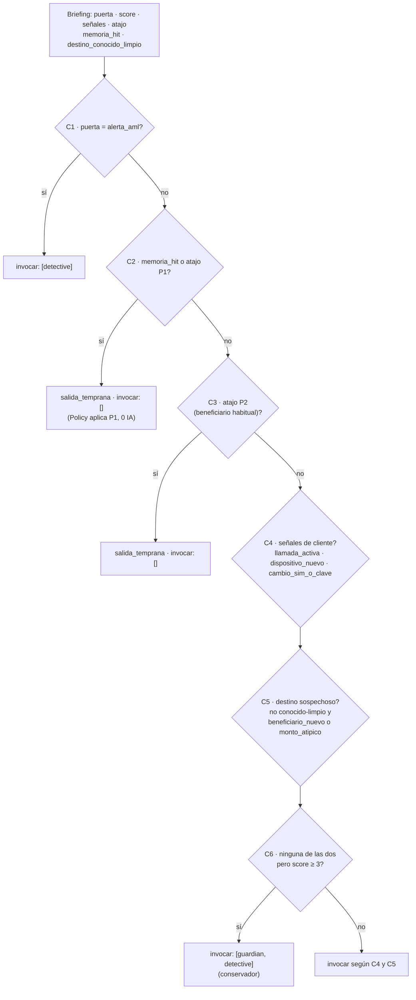
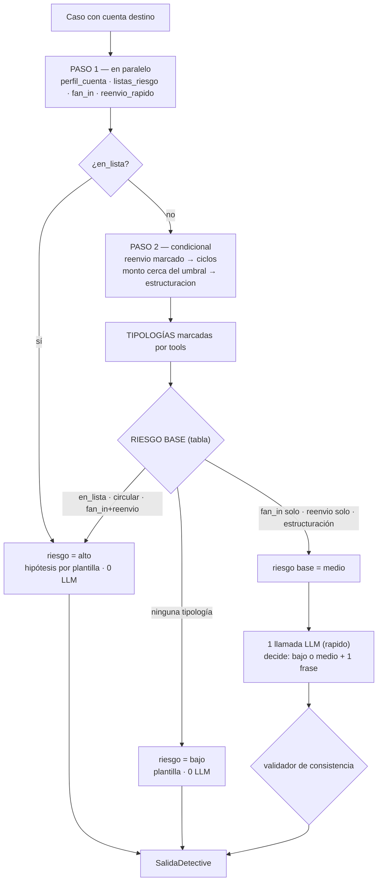
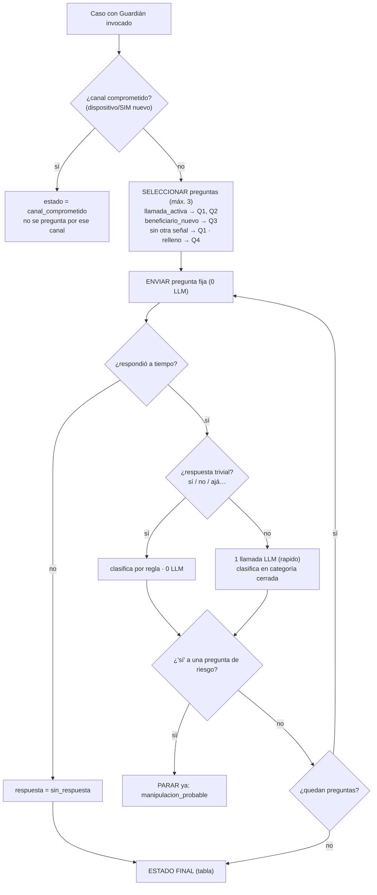
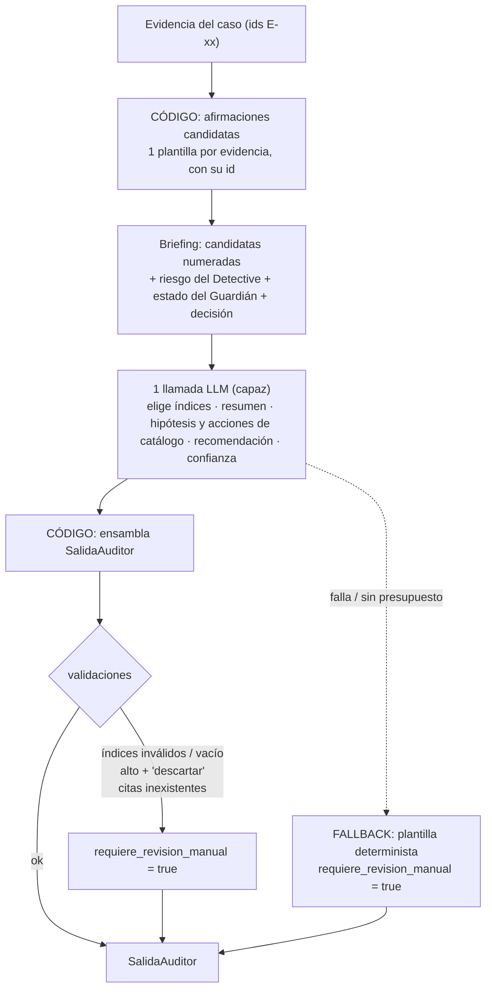

# Playbooks de los 4 agentes — arquitectura de decisión

> **Para qué existe este documento:** un LLM al que solo se le dice "investiga esto" divaga, razona de más y quema tokens entendiendo qué hacer. Aquí cada agente tiene **pasos fijos, entradas ya digeridas, decisiones cerradas y un tope de gasto**. El LLM nunca decide *qué hacer*; solo resuelve el hueco que el código le deja.
>
> Implementación: [`lib/agents/decisiones/`](../../../lib/agents/decisiones/) (funciones puras, con tests) · Contexto del diseño: [19_MULTIAGENT_SYSTEM](adaptive_financial_security_docs/19_MULTIAGENT_SYSTEM.md) · Notas de API: [AGENTS_RUNTIME_NOTES](AGENTS_RUNTIME_NOTES.md)

---

## 1. Principios (valen para los 4)

| # | Principio | Qué implica |
|---|---|---|
| 1 | **El código decide el camino, el LLM rellena un hueco** | Los pasos, el orden de las tools y las condiciones de parada están en código. Nada de "elige tu propia aventura" |
| 2 | **Tools primero, LLM al final** | Se ejecutan *todas* las tools que el plan fijo pide **antes** de llamar al modelo. Cero loops agénticos: se paga 1 llamada, no 6 |
| 3 | **Entrada digerida, nunca cruda** | El modelo recibe un *briefing* corto (JSON de ≤ ~600 tokens), no miles de transacciones |
| 4 | **Salida cerrada** | Enums y catálogos en vez de texto libre. El texto libre que quede tiene tope de caracteres |
| 5 | **Camino sin LLM cuando el caso es claro** | Si la tabla de decisión ya resuelve el caso, **no se llama al modelo**. El LLM se reserva para ambigüedad, texto libre y redacción |
| 6 | **Todo agente tiene fallback determinista** | Si el LLM falla, se agota el presupuesto o no valida, el código produce una salida válida y conservadora |
| 7 | **Prompt con esqueleto fijo** | `ROL` (1 línea) → `TAREA` (1 línea) → `REGLAS` (≤ 5) → `SALIDA` (esquema) → 2 ejemplos. Parte estática arriba (cacheable), briefing variable al final dentro de `<datos>…</datos>` |
| 8 | **Parámetros de gasto fijos** | `effort: low`, sin thinking, `max_tokens` bajo por agente, 1 reintento máximo |
| 9 | **Lo que escribe el cliente es dato, no instrucción** | Va dentro de `<datos>`; el modelo solo lo **clasifica**, nunca lo obedece |

### Quién decide qué

| | 🧭 Coordinador | 🔍 Detective | 🛡️ Guardián | 📋 Auditor |
|---|---|---|---|---|
| **Código decide** | a quién invocar (tabla) | qué tools correr, el riesgo base, las tipologías | qué preguntar, cuándo parar, el estado final | qué afirmaciones existen, con qué evidencia |
| **LLM decide** | *(nada por defecto)* | bajo vs. medio en el caso ambiguo | cómo clasificar una respuesta libre | resumen, hipótesis (catálogo), recomendación, cuáles afirmaciones incluir |
| **Llamadas LLM** | **0** | **0 o 1** | **0 a 3** (solo si la respuesta no es trivial) | **1** |
| **Nivel de modelo** | — | `rapido` | `rapido` | `capaz` |
| **Tope de salida** | — | 400 tokens | 120 tokens | 700 tokens |

---

## 2. 🧭 Coordinador — enruta, no razona

**Decisión de diseño:** es una **tabla de decisión determinista**. Un LLM aquí solo sumaría costo y latencia a una decisión que se puede escribir en 6 filas. Sigue siendo "el agente Coordinador" y devuelve el mismo esquema (`SalidaCoordinador`); lo que cambia es que su cerebro es una tabla.

| Fila | Condición | Resultado | Rosa | Jorge | Bodega |
|:-:|---|---|:-:|:-:|:-:|
| C1 | `puerta = alerta_aml` | `[detective]` | | | |
| C2 | `memoria_hit` o `atajo = P1` | salida temprana, `[]` | | ✅ | |
| C3 | `atajo = P2` | salida temprana, `[]` | | | |
| C4 | señal de cliente presente | añade `guardian` | ✅ | | |
| C5 | destino no conocido-limpio y (`beneficiario_nuevo` o `monto_atipico`) | añade `detective` | ✅ | | ✅ |
| C6 | C4 y C5 vacías, `score ≥ 3` | `[guardian, detective]` | | | |

- **Entrada (`BriefingCoordinador`):** `puerta`, `score`, `senales[]`, `atajo?`, `memoria_hit`, `destino_conocido_limpio`.
- **`destino_conocido_limpio`** = el cliente **ya le transfería antes** (no hay `beneficiario_nuevo`) **y** es cuenta propia con ≥ 90 días. Una cuenta antigua pero nueva para el cliente (la Bodega) **no** cuenta: ahí sí se mira el destino.
- **Gasto:** 0 llamadas. **Parada:** siempre termina en una fila.
- **Qué NO hace:** no lee datos, no llama tools de análisis, no opina sobre riesgo.

---

## 3. 🔍 Detective — tools por plan fijo, LLM solo si es ambiguo

El riesgo lo calcula el código a partir de lo que **marcaron las tools**. El LLM solo entra en el caso ambiguo (`medio`) para decidir si es un falso positivo.

**Tabla de riesgo base**

| Tipologías marcadas por las tools | Riesgo base | ¿LLM? |
|---|---|---|
| `en_lista` · `circular` · `fan_in` + `reenvio_rapido` | **alto** | No (plantilla) |
| solo `fan_in` · solo `reenvio_rapido` · `estructuracion` | **medio** | **Sí**, 1 llamada |
| ninguna | **bajo** | No |

- **Cuenta destino externa** (otro banco, ver `19` §10): el riesgo se **limita a `medio`**, salvo que esté en lista.
- **Qué puede hacer el LLM (solo en `medio`):** responder `riesgo_destino ∈ {bajo, medio}` y una hipótesis de ≤ 240 caracteres citando evidencia. **No puede subir a `alto`.** Esa es la regla que protege a la Bodega: el LLM ve "comercio, antigüedad alta, sin reenvío" y baja a `bajo`.
- **Entrada (`BriefingDetective`):** hallazgos de las tools (números ya calculados) + tipo y antigüedad de la cuenta. Nunca transacciones crudas.
- **Gasto:** Rosa 0, Jorge 0, Bodega 1. Alerta AML con patrón claro: 0.
- **Parada:** el plan de tools termina cuando `siguientesTools()` devuelve `[]` (máx. 2 pasos).

---

## 4. 🛡️ Guardián — guion cerrado, el LLM solo clasifica

**Decisión de diseño:** el Guardián **no redacta**. Las preguntas salen de un **banco cerrado** de texto fijo. Eso garantiza por construcción que nunca pide una clave, un OTP ni datos de tarjeta, y que no puede aprobar nada. El LLM solo **clasifica la respuesta libre** del cliente en una categoría cerrada.

**Banco de preguntas (texto fijo)**

| ID | Pregunta | Si responde «sí» → señal |
|---|---|---|
| Q1 | ¿Alguien te está pidiendo o guiando por teléfono para hacer esta transferencia ahora mismo? | `guiado_por_telefono` |
| Q2 | ¿Te dijeron que tu dinero está en peligro o que debes moverlo rápido? | `urgencia` |
| Q3 | ¿Te pidieron mandar tu dinero a una «cuenta segura» o a una cuenta que no conoces? | `cuenta_segura` |
| Q4 | ¿Alguien que dice ser familiar, autoridad o una empresa te está presionando o amenazando por este pago? | `presion_tercero` |

**Clasificación de una respuesta libre** (única tarea del LLM): `respuesta ∈ {si, no, incierta}` + `senales_extra ⊆ {guiado_por_telefono, urgencia, cuenta_segura, presion_tercero, intenta_aprobar_por_chat}`. Máx. 120 tokens de salida.

**Estado final — tabla en orden, la primera que aplica gana**

| # | Condición | `estado_usuario` |
|:-:|---|---|
| G1 | canal comprometido | `canal_comprometido` |
| G2 | cualquier señal de manipulación (un «sí», o `intenta_aprobar_por_chat`) | `manipulacion_probable` |
| G3 | alguna `sin_respuesta` o `incierta` | `sin_respuesta` |
| G4 | todas las respuestas son «no» | `confirmado_seguro` |
| G5 | no se hizo ninguna pregunta | `no_consultado` |

- **Por qué `intenta_aprobar_por_chat` cuenta como manipulación:** si el cliente escribe «apruébalo, soy yo», el estafador puede estar dictándole. Se registra y se trata como señal; nunca se obedece.
- **Por qué `incierta` equivale a `sin_respuesta`:** ante la duda se mantiene la pausa (Policy P7), no se libera.
- **Gasto:** Rosa 0–1 (responde «sí» → regla), cliente que escribe texto largo: 1 por turno. Tope: 3 turnos.
- **Reglas duras:** el Guardián **nunca aprueba**; el silencio **no** es un «sí».

---

## 5. 📋 Auditor — las afirmaciones las arma el código

**Decisión de diseño:** el LLM **no escribe afirmaciones**. El código genera una lista de **afirmaciones candidatas** a partir de la evidencia (una plantilla por tipo de evidencia, cada una con su id `E-xx`). El LLM solo **elige cuáles incluir**, redacta el resumen y escoge de catálogos. Así **no puede inventar un hecho ni una cita**.

**Plantillas de afirmación (código)**

| Fuente de evidencia | Afirmación |
|---|---|
| `fan_in` | La cuenta `{cuenta}` recibió de `{n}` remitentes nuevos en `{h}` h |
| `reenvio_rapido` | Reenvió el `{pct}`% de lo recibido en menos de `{h}` h |
| `estructuracion` | `{n}` operaciones entre el 90% y el 100% del umbral de reporte |
| `ciclos` | Se detectó un ciclo de fondos: `A → B → A` |
| `listas_riesgo` | La cuenta figura en: `{listas}` |
| `perfil_cuenta` | Cuenta de tipo `{tipo}` con `{n}` días de antigüedad |
| `guardian_respuesta` | La persona titular respondió «`{texto}`» a: `{pregunta}` |

**Lo que el LLM devuelve (esquema reducido)**

| Campo | Tipo |
|---|---|
| `resumen` | texto, ≤ 320 caracteres |
| `hipotesis` | catálogo: `estafa_vishing_mula` · `suplantacion_ato` · `mula_sin_cliente_afectado` · `falso_positivo_comercio` · `indeterminada` |
| `recomendacion` | `descartar` · `escalar` |
| `indices_afirmaciones` | lista de enteros (máx. 6) |
| `acciones` | catálogo: `confirmar_mula` · `preparar_borrador_ROS` · `mantener_pausa` · `liberar_tras_verificacion` · `pedir_info_titular` · `sin_accion` |
| `confianza` | `baja` · `media` · `alta` |

**Validaciones sobre la salida:** índices fuera de rango se descartan; sin afirmaciones → revisión manual; `riesgo_destino = alto` con `descartar` → revisión manual; toda cita pasa por `validarCitasAuditor`.

- **Se ejecuta solo** en casos pausados/escalados y en alertas AML, y **no bloquea la pausa** (corre después de la decisión).
- **Gasto:** 1 llamada (`capaz`), ≤ 700 tokens de salida.

---

## 6. Contratos que estos playbooks fijan

> `CONTRACT:` Ale debe respetar estos valores en sus bloques.

**Ids de señales del nivel 0** (`lib/rules/level0.ts` de Ale debe emitir exactamente estos):
`beneficiario_nuevo` · `monto_atipico` · `dispositivo_nuevo` · `cambio_sim_o_clave` · `llamada_activa` · `horario_atipico`

**Salida de cada tool de analytics** (forma del campo `data`; Ale las implementa, Tony las consume): ver `lib/contracts/analytics.ts` — `ResultadoPerfil`, `ResultadoFanIn`, `ResultadoReenvio`, `ResultadoEstructuracion`, `ResultadoCiclos`, `ResultadoListas`.

**Nombres de `fuente` de evidencia:** `perfil_cuenta` · `fan_in` · `reenvio_rapido` · `estructuracion` · `ciclos` · `listas_riesgo` · `guardian_respuesta`.

**`guardianTurno`:** como el Guardián conversa varios turnos, devuelve un `TurnoGuardian` (`{ mensaje?, terminado, salida? }`) y no solo la salida final. Cambio en `lib/contracts/firmas.ts`.

---

## 7. Gasto esperado por escenario

| Escenario | Coord. | Detective | Guardián | Auditor | **Total LLM** | (antes, `19` §7) |
|---|:-:|:-:|:-:|:-:|:-:|:-:|
| Transferencia normal | 0 | 0 | 0 | 0 | **0** | 0 |
| **Rosa** (estafa + mula) | 0 | 0 (riesgo claro) | 0–1 | 1 | **1–2** | 5–7 |
| **Jorge** (mula en Memoria) | 0 | 0 | 0 | 0 | **0** | 0 |
| **Bodega** (falso positivo evitado) | 0 | 1 | 0 | 0 | **1** | 2 |
| Alerta AML con patrón claro | 0 | 0 | 0 | 1 | **1** | 3–4 |
| Alerta AML ambigua | 0 | 1 | 0 | 1 | **2** | 3–4 |

> Rosa baja de 5–7 llamadas a 1–2 sin perder nada: el riesgo de M-01 lo decide la tabla, y el LLM redacta el expediente. Si el equipo quiere que el LLM "narre" también al Detective en el demo, se puede subir con una bandera (`AGENTS_LLM_MODE=completo`); por defecto manda el ahorro.

---

## 8. Orden de implementación

1. ✅ Este documento + funciones puras en `lib/agents/decisiones/` con tests.
2. ✅ `lib/agents/mocks.ts` + `lib/agents/index.ts` (`AGENTS_MOCK=1`).
3. ✅ `lib/agents/runtime.ts` + `llm.ts` (structured outputs, effort bajo, 1 reintento).
4. ✅ Adaptadores de los 4 agentes con fallback + `orquestador.ts` para el pipeline.
5. ✅ `npm run evals`: gasto por escenario (verifica §7) y E7. ⏳ E5 necesita API key.

> **Sobre E7:** la población es sintética y la diseñamos nosotros; muestra que la regla «fan-in + reenvío» se comporta como se espera (20/20 mulas, 0 comercios marcados frente a 93 con «solo fan-in»), **no** es una medición de desempeño real.
