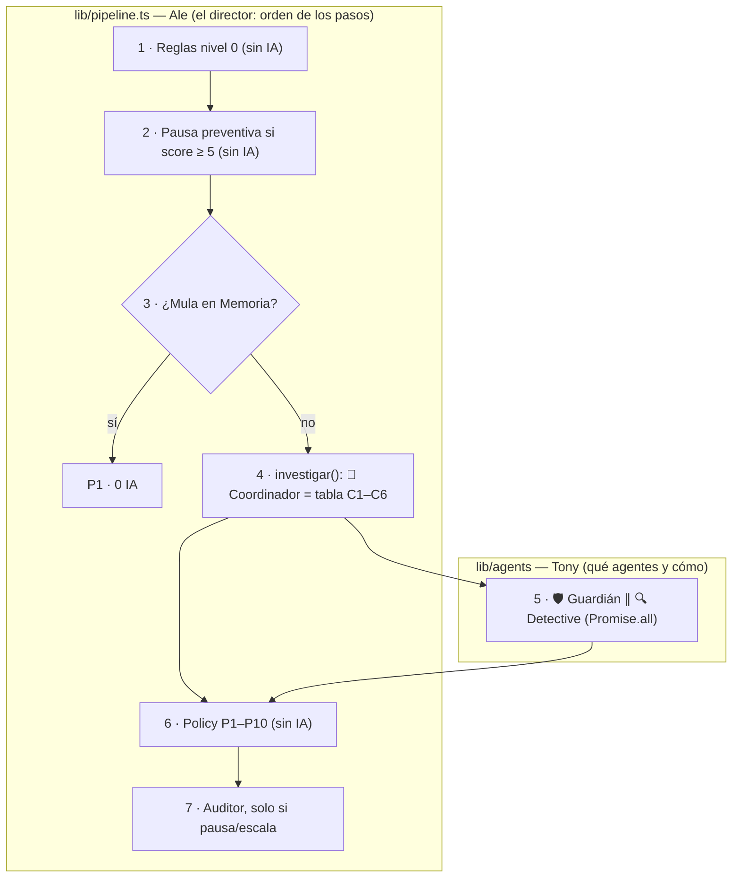

# Infraestructura, orquestación y próximos pasos

> **Para qué existe:** responde de una vez las preguntas que salieron al cerrar el backend: qué infraestructura usamos, quién orquesta, si hace falta LangGraph, dónde corre el demo, cómo probaremos con un modelo local (Ollama) y qué queda pendiente.
>
> Última actualización: 2026-10-17 · Relacionado: [AGENT_PLAYBOOKS](AGENT_PLAYBOOKS.md) · [lib/agents/README](../../../lib/agents/README.md) · [Work Blueprint](../../work/00_WORK_BLUEPRINT.md)

---

## 1. Infraestructura actual

**Resumen:** un solo servidor **Next.js (Node.js)** con todo el estado en memoria, más llamadas directas al LLM. No hay base de datos ni orquestador externo.

| Capa | Qué usamos | Estado |
|---|---|---|
| Servidor / API | Next.js 15, solo rutas `app/api/**` (8 endpoints) | ✅ `next build` OK |
| Lenguaje | TypeScript (Node 20+) | ✅ |
| Orquestación | Código propio: `lib/pipeline.ts` (Ale) + Coordinador y `lib/agents/orquestador.ts` (Tony) | ✅ |
| Agentes / LLM | `@anthropic-ai/sdk` directo detrás de una interfaz `LlmCaller`; modo `simulado` sin key | ⚠️ Nunca probado contra un LLM real |
| Validación | `zod` (contratos y salidas del LLM) | ✅ |
| Datos | JSON sintético (`lib/data/seed.json`) en memoria | ✅ |
| Estado (casos, Memoria de mulas, evidencia) | `Map` en la RAM del proceso | ⚠️ Se pierde si el proceso se reinicia |
| Tests | `vitest` (229 tests) | ✅ |
| Scripts | `tsx`: `npm run demo` (8/8), `npm run evals`, `npm run seed` | ✅ |
| Deploy | Laptop como servidor (§5) | ⏳ Por armar |
| Frontend | — (`app/page.tsx` es el de ejemplo de Next) | ❌ Fase 2, sin dueño |
| Base de datos | — | ❌ No hace falta para el demo |

---

## 2. ¿Quién orquesta?

**Nuestro propio código, en dos capas. Ningún LLM decide el flujo.**



| Capa | Responsable | Qué decide | Cómo |
|---|---|---|---|
| **Pipeline** | Ale | El **orden** de los pasos | Funciones en secuencia, `if`, `Promise.all` |
| **Coordinador + orquestador** | Tony | **Qué agentes** se invocan en cada caso | Tabla fija (C1–C6); fallos → `errores` → Policy P10 |
| **Agentes** | Tony | Solo el **hueco** que el código les deja | Ver [AGENT_PLAYBOOKS](AGENT_PLAYBOOKS.md) |

### Por qué así es más práctico

| Razón | En concreto |
|---|---|
| **Predecible** | El mismo caso siempre sigue el mismo camino; el LLM no "decide qué hacer después" |
| **Barato** | El LLM solo entra en 3 huecos: Rosa 1–2 llamadas, Jorge 0 |
| **Auditable (banca)** | Cada decisión deja su regla (P1–P10) y su evidencia (`E-xx`) |
| **Testeable** | 229 tests en < 1 s, sin API key |
| **Seguro** | Si un agente falla → fallback conservador (P10, se mantiene la pausa) |
| **Rápido de construir** | Sin framework que aprender en un hackathon de 30 h |

---

## 3. ¿Necesitamos LangGraph? **No.**

**Qué es LangGraph:** un framework (LangChain, Python y JS) para armar agentes como un **grafo** de nodos y aristas. Trae de fábrica: estado persistente para reanudar flujos (*checkpointers*), pausas que esperan a un humano, ciclos donde el agente decide cuántas vueltas dar, y visualización/trazas (LangGraph Studio, LangSmith).

| Lo que necesitamos | ¿Requiere LangGraph? | Cómo lo resolvemos |
|---|---|---|
| Pasos en orden | No | `lib/pipeline.ts` |
| Guardián y Detective en paralelo | No | `Promise.all` |
| Elegir qué agente llamar | No | Tabla del Coordinador |
| LLM con salida estructurada | No | SDK + `zod` |
| Fallbacks | No | Orquestador + P10 |
| Conversación de varios turnos | No | Estado guardado como evidencia del caso |
| Analista confirma la mula | No | `/api/cases/[id]/verdict` + Memoria |
| Memoria viva durante el demo | No | Laptop corriendo `next start` (§5) |
| Trazabilidad | No | Timeline + reglas + evidencia por caso |

### Comparación

| Aspecto | Nuestras capas | LangGraph |
|---|---|---|
| Control del flujo | Explícito, se lee de arriba abajo | Grafo; hay que aprender el modelo |
| Tests | 229 en < 1 s, sin key | Posible, con más andamiaje |
| Auditoría | Regla + evidencia por decisión | El trazado regla por regla hay que construirlo igual |
| Dependencias | Ninguna extra | `@langchain/langgraph` y su ecosistema |
| Adopción | Ya funciona (demo 8/8) | Reescribir el pipeline |
| **Persistencia / reanudar tras días** | ❌ RAM | ✅ Checkpointers |
| **Pausa por humano** | Manual (evidencia + `/reply`) | ✅ Nativa |
| **Visualización / trazas** | Diagramas Mermaid | ✅ Studio / LangSmith |

**Cuándo sí convendría:** flujos que deben reanudarse tras días sobreviviendo reinicios, agentes que deciden libremente pasos y ciclos, o decenas de agentes. Nada de eso está en el MVP.

**Frase para el pitch:**
> «No usamos un framework de agentes porque el flujo bancario es fijo y regulado: lo orquestamos con código determinista y auditable, y la IA solo interviene donde aporta. En producción, el pipeline se montaría sobre un orquestador durable (LangGraph o Temporal) para pausas de días y trazabilidad completa.»

---

## 4. Persistencia: el estado vive en RAM

| Contexto | ¿Problema? | Por qué |
|---|---|---|
| Demo en la laptop | 🟡 Bajo | Un solo proceso continuo: la Memoria sobrevive mientras no se reinicie |
| Serverless (p. ej. Vercel) | 🔴 Grave | Instancias que se reinician solas: el acto 3 (Jorge) fallaría al azar. **Por eso no usamos serverless** |
| Producto real | 🔴 Inaceptable | Perder veredictos y evidencia rompe la trazabilidad de compliance |
| Pregunta del jurado | 🟡 Probable | Respuesta honesta: «en el demo vive en memoria; en producción, en base de datos» |

**Si sobra tiempo:** persistir solo la Memoria de riesgo (veredictos de mulas) en un archivo o en SQLite. Es del bloque de Ale.

---

## 5. La laptop como servidor (sin pagar hosting) — ❌ DESCARTADO para la entrega

> **No sirve para la evaluación.** La [guía oficial de Hack The Andes](https://hacktheandes.com/guide) dice que **no se conecta la laptop del equipo**: la organización abre los enlaces entregados desde su propio equipo, en ventana privada, sin depender de archivos locales ni sesiones. Hace falta una **URL pública** con `next start` en **un solo proceso** (p. ej. Railway; no serverless, por §4). Lo de abajo queda solo como opción para ensayos locales.

Correr `next start` en la laptop es un **servidor continuo**: resuelve el problema de la RAM para el demo y no cuesta nada.

| Riesgo | Mitigación |
|---|---|
| La Mac se duerme / tapa cerrada | `caffeinate` (incluido en macOS) mientras corre el servidor; enchufada |
| Reinicio del proceso borra la RAM | `next build && next start` (no `next dev`); ensayar el demo completo de corrido; `POST /api/demo/reset` antes de presentar |
| Se cae el wifi del evento | Presentar en `localhost`; video de respaldo |
| Piden URL pública | Túnel gratuito (p. ej. Cloudflare Tunnel `cloudflared`), creado justo antes de presentar |
| API abierta a internet (con túnel) | Proteger `/api/demo/reset` y `/api/cases/[id]/verdict` con un token simple |

**Confirmado (17/10/2026):** la entrega exige URL pública de despliegue que funcione en ventana privada desde el equipo de la organización. `localhost` y la laptop quedan descartados.

---

## 6. Modelo local (Ollama) — ✅ hecho el 18/10/2026

**Cómo se usa:** `OLLAMA_MODELO=qwen3.5:9b` y `OLLAMA_THINK=false` en `.env.local`. Con esa variable, `modoAgentes()` devuelve `ollama`. `lib/agents/llm-ollama.ts` pide JSON con el esquema zod del agente, a temperatura 0, y deja el modelo cargado (`keep_alive`). `npm run servidor` verifica Ollama y precarga el modelo.

**Medido en un Apple M5 de 24 GB:**

| Modelo | Llamada del Guardián (cargado) | `npm run demo` |
|---|---|---|
| qwen3.5:9b (`think:false`) | ~0,8 s | 8/8 |
| qwen2.5:7b | ~0,8 s | 8/8 |
| gpt-oss:20b (`think:low`) | expediente del Auditor: 11–16 s | — |

**Lección:** usar **un solo modelo**. Con gpt-oss:20b (12 GB) cargado, Ollama no logró cargar un segundo modelo y los pedidos quedaron colgados en vez de reemplazarlo.

Las decisiones no cambian con el modelo, porque las toma la Policy determinista. El modelo solo entra en lo ambiguo, como la respuesta libre del cliente al Guardián: las respuestas rápidas se clasifican sin IA.

### Plan original

**Objetivo:** probar los agentes con un LLM real sin API key ni costo, corriendo el modelo en la laptop.

**Por qué es fácil:** todo el código de agentes depende de la interfaz `LlmCaller` (`lib/agents/llm.ts`), no del SDK de Anthropic. Basta con un segundo *caller*:

```text
LlmCaller ──┬── crearLlmAnthropic()   (hoy)
            ├── runAgentSimulado       (hoy, sin key)
            └── crearLlmOllama()       (por hacer)
```

| Paso | Detalle |
|---|---|
| 1 | Instalar Ollama y descargar un modelo que respete JSON (a elegir con evals) |
| 2 | `lib/agents/llm-ollama.ts`: llamar al API local de Ollama pidiendo salida con **esquema JSON** (`format`), generado desde el esquema `zod` del agente |
| 3 | `modoAgentes()` gana un modo `ollama` (variables `OLLAMA_URL`, `OLLAMA_MODELO`) |
| 4 | La validación `zod` + 1 reintento del runtime ya protege si el modelo local devuelve algo mal formado |
| 5 | Correr `npm run demo` y `npm run evals` en modo `ollama` y comparar con `simulado` |

**Ojo:** un modelo local pequeño puede clasificar peor que Claude. Lo que importa es que **las decisiones no cambien**, porque las toma la Policy determinista. Si el modelo falla, cada agente cae a su fallback.

---

## 7. Pendientes

### Tony (agentes)
| # | Pendiente | Estado |
|---|---|---|
| 1 | Probar con un LLM real: primero **Ollama** (§6), luego Claude si hay key | ⏳ Siguiente |
| 2 | **E5** (1 agente vs. multiagente), necesita un LLM real | ⏳ Tras el #1 |
| 3 | Estructuración conectada: corre siempre en el paso 2 del Detective (no depende del monto actual) | ✅ Hecho |
| 4 | Números para el pitch (`npm run evals`) en una slide | ⏳ |
| 5 | Orquestador blindado contra errores sincrónicos (reporte de Ale) | ✅ Hecho |

### Ale (infraestructura) — ya cerró SYNC 2
| Pendiente | Estado |
|---|---|
| Pipeline sobre el orquestador de Tony + Guardián multiturno por `/reply` | ✅ |
| `/api/health` muestra `modoAgentes()` | ✅ |
| Borrar `lib/agents-provisional.ts` | ✅ |
| Script para correr la laptop como servidor (§5) | ⏳ |
| (Opcional) persistir la Memoria de riesgo (§4) | ⏳ |

### Equipo
| Pendiente | Estado |
|---|---|
| **Frontend (Fase 2)**: sin dueño; hoy el demo es por consola/API | ❌ |
| ¿La entrega exige URL pública? | ❓ Confirmar |
| Pitch: slides + video de respaldo | ⏳ |


---

## 8. Todo local (la Mac como servidor, con el modelo de Ollama)

El modelo no se puede subir a Railway. Por eso el día del evento puede correr **todo en la Mac**: la app, los agentes con Ollama, las salas EN VIVO y los datos (Supabase y `.datos/`).

```bash
# 1. Ollama abierto, con el modelo descargado (ollama pull qwen3.5:9b)
# 2. .env.local con OLLAMA_MODELO=qwen3.5:9b y OLLAMA_THINK=false (y Supabase si se quiere guardar en la nube)
npm run servidor -- --red --juego --persistir --tunel
```

El script:
- compila;
- arranca en `0.0.0.0:3000`;
- impide que la Mac se duerma (`caffeinate`);
- verifica y precarga el modelo;
- abre un **túnel de Cloudflare** e imprime la URL pública `https://….trycloudflare.com`. Los QR del juego y del monitor la usan solos.

Ollama **no** se publica: queda en localhost, porque su API permite bajar y borrar modelos.

**Probado de punta a punta por la URL pública:** salud en modo `ollama`, `/play`, una sala creada y el Guardián razonando una respuesta libre con el modelo local («mi sobrino me dijo… el banco lo llamó» → `manipulacion_probable` → P4), en unos 6 s por el túnel.

**Railway queda de respaldo** siempre encendido, con agentes simulados: misma app, mismas decisiones, sin el modelo.

**Riesgos y qué hacer:**

| Riesgo | Qué hacer |
|---|---|
| La URL del túnel rápido cambia en cada arranque | Arrancar una vez antes de presentar y no cerrar la terminal. Para una URL fija, usar un túnel con nombre y dominio propio |
| Wi-Fi del evento inestable | El túnel funciona por cualquier red de la Mac, también el hotspot del celular |
| La Mac se queda sin batería | Enchufarla: `caffeinate` evita que se duerma, no que se apague |
| Ollama cerrado o sin el modelo | El script avisa al arrancar. Mientras tanto, los agentes caen a su fallback y las decisiones siguen igual |
