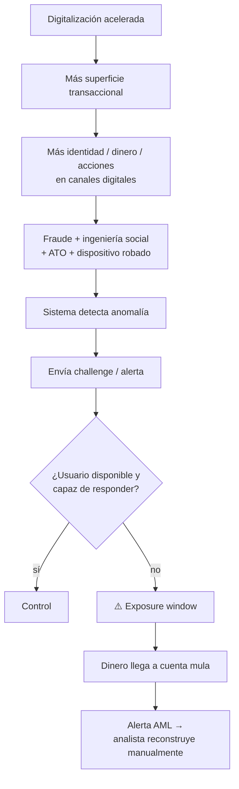
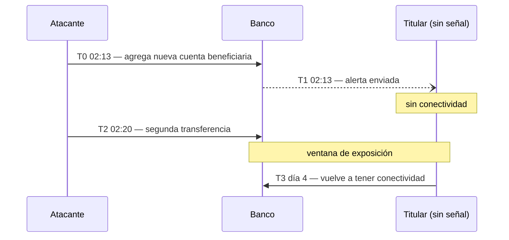
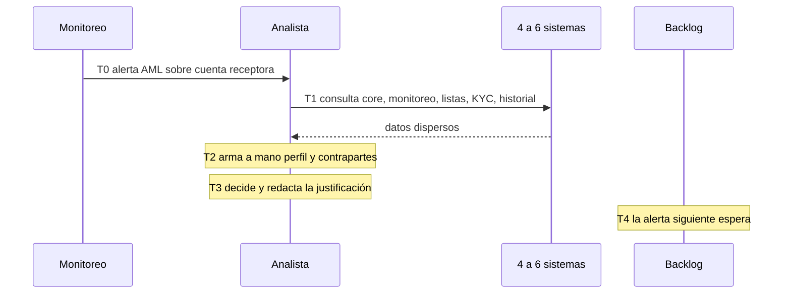
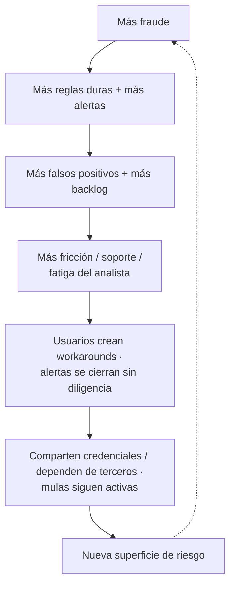
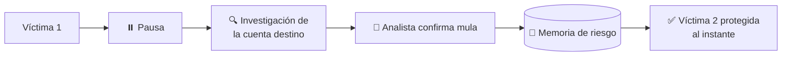

# 03 — Problem Map

## Problema raíz

La protección antifraude es parcialmente reactiva y depende de una interacción humana oportuna. Y cuando el fraude ocurre, la investigación del lado receptor (AML) vuelve a empezar desde cero, en otro equipo.

## Gap 1 — Availability Gap

Definición:

> Tiempo entre el momento en que una operación o patrón se vuelve riesgoso y el momento en que el titular legítimo puede participar de manera efectiva en una acción protectora.

Ejemplo:

La métrica relevante no es “alert sent in 3 seconds”.

Es **cuánto demoró la acción protectora efectiva** (TTPA, ver `14`).

## Gap 2 — Investigation Gap

Definición:

> Tiempo y trabajo manual entre que el sistema de monitoreo genera una alerta y que existe una decisión (descartar / escalar) con evidencia trazable.

Ejemplo (HIPÓTESIS, a validar con analistas):

Mientras el caso espera, la mula sigue recibiendo de nuevas víctimas.

## Causas inmediatas

### C1 — Dependencia de canales
- push;
- SMS;
- llamada;
- correo;
- app;
- agencia.

### C2 — Dependencia de contexto técnico
- celular operativo;
- SIM activa;
- internet;
- batería;
- app actualizada;
- cámara/sensor disponible.

### C3 — Dependencia cognitiva
- reconocer estafa;
- comprender urgencia;
- diferenciar banco real vs impersonación;
- comprender consecuencias.

### C4 — Dependencia de accesibilidad
- lector de pantalla compatible;
- alternativa a llamada de voz;
- interacción motora posible;
- lenguaje comprensible.

### C5 — Dependencia temporal
- el challenge tiene valor solamente si ocurre antes de que el dinero se vuelva irrecuperable.

### C6 — Dependencia de reconstrucción manual
- el contexto del caso está repartido en varios sistemas;
- cada analista lo arma a su manera → inconsistencia;
- la justificación se redacta a mano → trazabilidad débil.

### C7 — Silo fraude ↔ AML
- el equipo de fraude ve al emisor; el de AML ve al receptor;
- una mula confirmada en AML no siempre frena la siguiente transferencia de otra víctima.

## Efectos para el usuario

- pérdida de fondos;
- bloqueo de cuenta legítima;
- pérdida de autonomía;
- necesidad de terceros;
- estrés y tiempo perdido;
- abandono de servicios digitales;
- desconfianza.

## Efectos para la institución financiera

- fraude y chargebacks;
- investigación manual y backlog de alertas;
- costo de soporte;
- reclamos y disputas;
- sanciones/regulación (consumidor y AML);
- reputación;
- churn;
- falsos positivos;
- presión por controles más duros que generan nueva fricción.

## Loop negativo clásico

## Loop positivo que buscamos

## Dónde actúa cada componente

| Causa | Componente (ver `19`) |
|---|---|
| C1, C2, C5 | 🛡️ Guardián + Policy Engine (pausa) |
| C3 | 🛡️ Guardián (preguntas específicas de estafa) |
| C4 | 🛡️ Guardián (canal alternativo según preferencia declarada) |
| C6 | 🔍 Detective + 📋 Auditor |
| C7 | 🧠 Memoria de riesgo + 🧭 Coordinador |

## Tensión central

**Seguridad** vs **autonomía** vs **conveniencia** vs **costo operativo** no deberían ser tratadas como objetivos mutuamente excluyentes.
