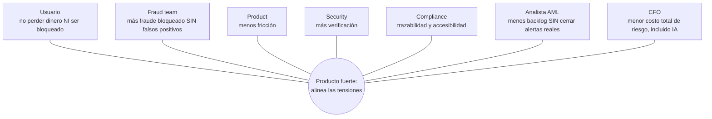

# 05 — Stakeholder Map

## 1. Titular de la cuenta

### Job
Mover y custodiar dinero sin convertirse en experto en fraude.

### Pains
- pérdida económica;
- bloqueo injustificado;
- procesos de reclamo;
- dificultad para demostrar “yo no fui”;
- dependencia de terceros;
- miedo a usar servicios digitales.

### Success
“Puedo usar mi dinero con autonomía y sigo protegido cuando algo sale de mi patrón.”

---

## 2. Familiar o persona de apoyo

No debe convertirse por defecto en el dueño operativo de la cuenta.

### Riesgo
Una arquitectura inaccesible puede obligar al usuario a compartir secretos con terceros.

### Principio
Apoyo voluntario ≠ dependencia obligatoria.

---

## 3. Fraud / Risk Operations

### Job
Reducir pérdidas sin inundar de falsos positivos.

### Pains
- reglas demasiado sensibles;
- investigación manual;
- señales dispersas;
- falta de contexto;
- scam vs legitimate intent difícil de diferenciar.

### Métricas
- fraud loss;
- fraud capture rate;
- false positive rate;
- investigation time;
- scam detection rate.

---

## 4. Customer Support

### Job
Resolver incidentes y desbloqueos.

### Pains
- usuarios llegan después del fraude;
- información incompleta;
- picos de llamadas;
- procesos manuales;
- canales no accesibles.

---

## 5. Digital Product / UX

### Job
Conversión y uso fluido.

### Tensión
Cada control extra puede reducir fraude pero también aumentar abandono.

---

## 6. Security / Identity

### Job
Evitar account takeover, robo de credenciales y compromiso de canal.

### Riesgo de silo
Puede saber que hubo login extraño sin conocer el contexto de la transferencia que ocurre después.

---

## 7. Compliance / Consumer Protection

### Job
Asegurar trazabilidad, debida protección, reclamos y accesibilidad.

### Necesidad
Decisiones explicables y evidencia auditable.

---

## 8. CFO / Economic buyer

### Intereses
- pérdida por fraude ↓
- costo operativo ↓
- reclamos ↓
- sanciones ↓
- churn ↓
- confianza ↑

El pitch empresarial debe traducir seguridad en impacto económico.

---

## 9. Regulador / autoridad de consumidor

### Interés
- protección efectiva;
- monitoreo de anomalías;
- transparencia;
- accesibilidad;
- no trasladar toda la responsabilidad al consumidor.

---

## 10. Analista AML / Oficial de cumplimiento

### Job
Investigar alertas del monitoreo transaccional y decidir si se descartan o se reportan (ROS), con debida diligencia.

### Pains (brief B1 + HIPÓTESIS)
- información dispersa en varios sistemas;
- reconstrucción manual del perfil y contrapartes;
- backlog creciente y fatiga de alertas;
- inconsistencia entre analistas;
- riesgo regulatorio si una alerta real se cierra sin diligencia.

### Success
“Valido un expediente ya armado, con evidencia citada, en vez de investigar desde cero.”

### Usuario de
La **consola del analista** (ver `13`).

---

## 11. UIF-Perú

### Interés
Reportes de operaciones sospechosas oportunos, fundamentados y de calidad.

### Implicación de diseño
El expediente debe poder servir como **borrador** de la justificación; la decisión y el reporte siguen siendo responsabilidad humana.

---

## 12. Titular de la cuenta receptora

Puede ser un criminal, una persona reclutada/engañada o un negocio legítimo con muchos ingresos.

### Riesgo
Etiquetarlo erróneamente como mula le congela fondos y le causa daño real.

### Principio
Ninguna cuenta entra a la Memoria de riesgo sin validación humana, con expiración y vía de revisión (ver `15`).

---

## Mapa de tensiones

Un producto fuerte alinea estas tensiones; no optimiza solo una.
