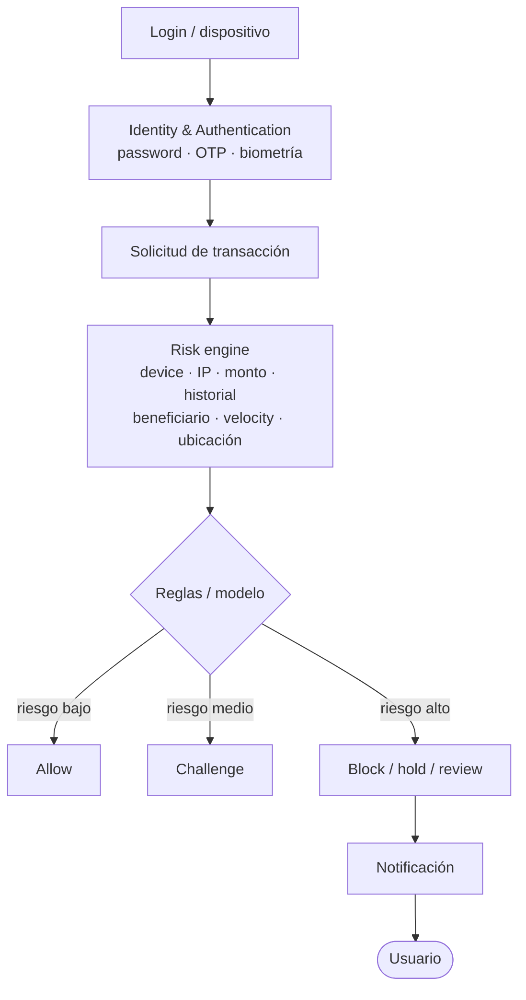
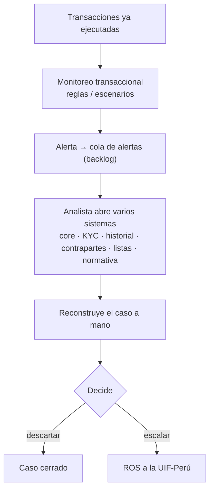
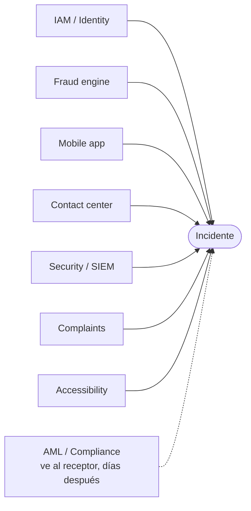
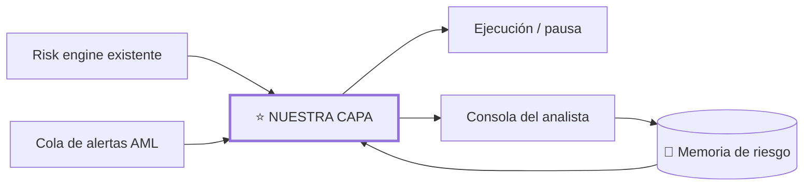

# 06 — Current System

## Arquitectura simplificada actual — fraude (lado emisor)

## Arquitectura simplificada actual — AML (lado receptor)

## Controles clásicos útiles

- MFA / OTP;
- biometría;
- device binding;
- behavioral analytics;
- velocity rules;
- límites transaccionales;
- new-beneficiary controls;
- AML / mule detection;
- transaction monitoring;
- fraud operations;
- alertas push/SMS/email;
- bloqueos manuales;
- call center;
- branch escalation.

El problema no es que estos controles sean inútiles. El problema aparece en los **gaps entre ellos**.

## Tres paradigmas distintos

### Authentication
“¿Quién eres?”

### Transaction risk
“¿Esta operación se parece a fraude?”

### Customer safety
“¿Esta operación refleja la intención segura del usuario y puede verificarse de manera accesible y oportuna?”

La tercera pregunta es la menos resuelta.

## Arquitectura organizacional fragmentada

Cada equipo ve una parte distinta. En particular, **fraude ve a la víctima y AML ve a la mula**, aunque sea la misma transacción.

## Hipótesis de gap

La información existe, pero la organización no siempre convierte señales dispersas en una **política contextual de protección** antes de que el dinero salga, ni reutiliza lo que AML confirma para proteger a la siguiente víctima.

## Dónde se inserta nuestra capa

No reemplaza nada: se agrega **entre el risk engine y la ejecución**, y **sobre la cola de alertas AML**.

- **Entrada:** transacciones marcadas por el risk engine + alertas AML.
- **Salida:** decisión `PERMITIR / PAUSAR / VERIFICAR / ESCALAR` + expediente.
- **Integración mínima:** API de lectura de historial y una API para retener/liberar una operación pendiente.
