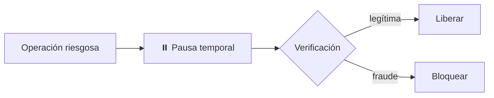
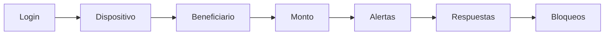

# 09 — Solution Space

> Este documento lista las opciones exploradas y marca cuáles entran al MVP. La decisión se basa en el criterio del final y en el alcance de 30h.

**Leyenda:** ✅ en el MVP · 🟡 versión mínima · ⏭️ futuro / fuera del MVP

| Opción | Estado | Dónde vive (ver `19`) |
|---|:-:|---|
| S1 — Adaptive Challenge Engine | 🟡 | 🛡️ Guardián elige canal |
| S2 — Protective Hold (pausa) | ✅ | Policy Engine |
| S3 — User-defined safety policies | 🟡 | 1–2 reglas de ejemplo (beneficiarios habituales siempre pasan) |
| S4 — Trusted recovery graph | ⏭️ | — |
| S5 — Scam-intent interruption | ✅ | 🛡️ Guardián |
| S6 — Post-breach heightened mode | ⏭️ | — |
| S7 — Evidence timeline / expediente | ✅ | 📋 Auditor |
| S8 — Cross-institution signal sharing | 🟡 | Versión interna: 🧠 Memoria de riesgo dentro de una institución |
| S9 — AML alert investigation (B1) | ✅ | 🔍 Detective + 📋 Auditor |
| S10 — Feedback fraude ↔ AML | ✅ | 🧠 Memoria de riesgo |

---

## S1 — Adaptive Challenge Engine 🟡

Selecciona challenge según:
- riesgo;
- disponibilidad;
- confiabilidad de canal;
- preferencias de accesibilidad;
- urgencia de la operación.

No depende de una sola modalidad.

---

## S2 — Protective Hold ✅

Ante riesgo alto + usuario no alcanzable o manipulado:

No todo debe ser “aprobar o bloquear para siempre”.

---

## S3 — User-defined safety policies 🟡

Ejemplos voluntarios:

- durante viaje, nuevo beneficiario > S/500 → hold;
- nuevo dispositivo + cambio de clave + transferencia → deny;
- transferencias recurrentes → allow;
- emergencia → mecanismo alternativo previamente configurado.

---

## S4 — Trusted recovery graph ⏭️

Métodos preestablecidos de recuperación:
- segundo dispositivo;
- contacto seguro voluntario;
- token físico;
- passkey;
- presencial;
- videollamada accesible;
- combinación de evidencias.

Nunca asumir que un tercero es obligatorio.

---

## S5 — Scam-intent interruption ✅

Para operación legítimamente autenticada pero contextualmente peligrosa:

- preguntas específicas de scam;
- explicación contextual;
- friction escalonada;
- cooldown para operación irreversible;
- verificación fuera del canal comprometido.

---

## S6 — Post-breach heightened mode ⏭️

Tras exposición de datos / dispositivo / identidad:
- elevar vigilancia;
- cambiar canales permitidos;
- ignorar ciertos factores comprometidos;
- reforzar nuevas cuentas beneficiarias.

---

## S7 — Evidence timeline / expediente ✅

Construcción automática de:

Útil para soporte, fraude, auditoría y reclamo. En el MVP lo produce el 📋 Auditor, con cada afirmación citando su evidencia.

---

## S8 — Cross-institution signal sharing 🟡

A más largo plazo, señales sobre:
- cuenta mula;
- beneficiario riesgoso;
- identidad comprometida;
- dispositivo;
- scam campaign.

Requiere gobernanza y privacidad fuertes. **En el MVP solo existe la versión interna (S10).**

---

## S9 — AML alert investigation (B1) ✅

Dada una alerta o una cuenta destino sospechosa:
- arma el perfil transaccional;
- identifica tipologías (fan-in, reenvío rápido / pass-through, estructuración, circular);
- cruza contra listas de riesgo;
- genera recomendación `descartar / escalar` con justificación trazable para que el analista valide.

---

## S10 — Feedback fraude ↔ AML ✅

Una cuenta confirmada como mula por un analista entra a la Memoria de riesgo. Las transferencias futuras hacia esa cuenta se pausan **sin investigación nueva y sin llamadas de IA**.

Es a la vez el diferencial de producto y la principal optimización de recursos.

---

## Criterio para escoger

La solución ganadora debe demostrar mejor:

1. reducción de riesgo;
2. menor dependencia de reacción inmediata;
3. mínima fricción legítima;
4. menor tiempo de investigación;
5. accesibilidad;
6. explicabilidad;
7. costo de IA controlado;
8. viabilidad de integración.

## Decisión

El MVP combina **S2 + S5 + S7 + S9 + S10** sobre un núcleo multiagente compartido. Es la combinación mínima que cubre Track 04 (estafa, suplantación, extorsión) y B1 (investigación AML), y que muestra un efecto que ninguna de las dos por separado tiene: **la investigación de una víctima protege a la siguiente.**
