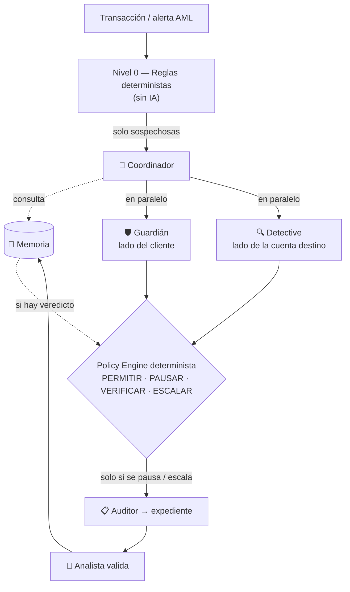

# 10 — Agentic System Hypothesis

> Diseño detallado (contratos, tools, reglas): [19_MULTIAGENT_SYSTEM.md](19_MULTIAGENT_SYSTEM.md).

## Cuándo un agente SÍ tiene sentido

Un sistema agentic aporta cuando debe:

- consultar varias fuentes;
- elegir qué evidencia falta;
- decidir qué herramienta invocar;
- adaptar un flujo;
- coordinar verificaciones;
- conversar con el usuario para detectar manipulación;
- explicar por qué escaló;
- mantener política del usuario durante indisponibilidad.

## Cuándo NO tiene sentido

- scoring determinista simple;
- regla de monto;
- cálculo de velocity;
- cálculo de fan-in, reenvío rápido o ciclos;
- MFA;
- detección de device fingerprint;
- decisiones irreversibles sin policy guardrails.

Eso debe seguir en componentes deterministas (reglas y tools).

> **Las tools calculan; los agentes razonan sobre resultados ya calculados; la política decide.**

## Por qué multiagente y no un solo agente

| Motivo | Explicación |
|---|---|
| **Foco** | Cada agente tiene un prompt corto y 2–4 tools. Menos opciones → menos errores. |
| **Dos miradas independientes** | El lado del cliente (Guardián) y el lado de la cuenta destino (Detective) se evalúan por separado y se combinan en la política. Reduce falsos positivos. |
| **Paralelismo** | Guardián y Detective corren al mismo tiempo → la pausa dura menos. |
| **Costo por nivel** | Modelo rápido/económico para coordinar y conversar; modelo más capaz solo para el expediente de casos escalados. |
| **Control de calidad** | El Auditor revisa que cada afirmación tenga evidencia antes de que llegue al analista. |
| **Salida temprana** | El Coordinador consulta la Memoria primero; si ya hay veredicto, no se llama a nadie más. |

Esto es la hipótesis H9 (`08`) y se mide con el experimento E5 (`14`).

## Arquitectura

## Roles finales

### 🧭 Coordinador
Lee las señales, consulta la Memoria, decide qué especialistas llamar y corta temprano cuando ya hay respuesta.

### 🛡️ Guardián (frente cliente — Track 04)
Estima si el titular puede responder y por qué canal seguro; conversa con preguntas específicas de estafa. **Nunca aprueba**: solo reporta el estado del usuario.

### 🔍 Detective (frente cuenta destino — B1)
Perfila la cuenta receptora con tools deterministas (fan-in, reenvío rápido, estructuración, ciclos, listas) e interpreta los resultados.

### 📋 Auditor
Arma el expediente con hipótesis, recomendación y justificación; rechaza toda afirmación sin evidencia citada.

### 🧠 Memoria de riesgo (no es agente)
Guarda veredictos validados por analistas; con expiración y vía de revisión.

> Los roles “Availability Agent”, “Verification Planner” y “Scam Context Agent” de versiones anteriores quedan absorbidos por el Guardián; “Context Agent” por Coordinador + Detective; “Explanation Agent” por el Auditor.

## Guardrails obligatorios

- el LLM no mueve dinero;
- herramientas con permisos mínimos y de solo lectura;
- policy engine final determinista;
- salidas de agentes en JSON validado contra esquema;
- todo lo que escribe el usuario o llega de datos externos es **dato, no instrucción**;
- logs completos de cada llamada y tool;
- no inferir discapacidad como señal de fraude;
- preferencias de accesibilidad explícitas y voluntarias;
- presupuesto máximo de llamadas por caso + timeout/circuit breaker;
- si un agente falla: riesgo alto → pausa + revisión humana; riesgo medio → verificar;
- human-in-the-loop para confirmar mulas y casos extremos.
