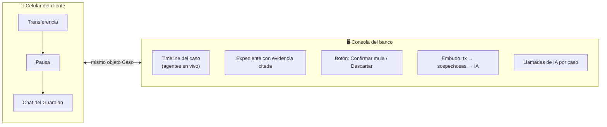

# 13 — MVP 30h

## Objetivo de demo

Demostrar una sola historia, de punta a punta:

> **Una estafa se frena aunque la víctima esté autenticada, la cuenta que iba a recibir el dinero se investiga automáticamente, y la siguiente víctima queda protegida al instante — gastando IA solo donde aporta.**

## No construir

- core bancario real;
- scoring ML entrenado;
- KYC;
- red interbancaria real;
- app completa;
- dataset completo de 9.5M filas;
- las 17 tipologías de SAML-D;
- accesibilidad como escenario completo, desinformación.

## Construir

### 1. Datos semilla (JSON pequeño)

| Entidad | Contenido |
|---|---|
| **Rosa** | víctima 1: historial normal, dispositivo conocido, sin beneficiario previo |
| **Jorge** | víctima 2: transfiere a la misma cuenta después |
| **Lucía** *(acto extra)* | viajera sin señal; un atacante entra desde dispositivo nuevo |
| **M-01** | mula: 14 remitentes nuevos en 48h, reenvía ~90% en < 2h a M-02/M-03 |
| **Bodega Don Pepe** | negocio legítimo: muchos remitentes, pero sin reenvío rápido (control de falsos positivos) |
| Población de fondo | ~200 transacciones normales; opcional: muestra pequeña de SAML-D |

### 2. Reglas nivel 0 (sin IA)

Señales: beneficiario nuevo, monto fuera de patrón, dispositivo nuevo, cambio de SIM/clave reciente, llamada activa / acceso remoto, horario atípico, destino en Memoria. Detalle de puntajes en `19`.

### 3. Agentes

🧭 Coordinador · 🛡️ Guardián · 🔍 Detective · 📋 Auditor — contratos en `19`.

### 4. Policy Engine determinista

`PERMITIR / PAUSAR / VERIFICAR / ESCALAR` combinando reglas + salidas de agentes + Memoria.

### 5. Memoria de riesgo

Veredictos validados por el analista; se consulta antes que cualquier agente.

### 6. Una sola pantalla, dos paneles

## Demo principal — 3 actos (~3 min)

### Acto 1 — Rosa, la estafa (Track 04)

1. Rosa recibe una llamada del “banco” y empieza a transferir S/4,800 a un beneficiario nuevo.
2. FaceID ✔, OTP ✔.
3. Reglas: beneficiario nuevo + monto fuera de patrón + llamada activa → sospechosa.
4. 🧭 Coordinador: Memoria sin datos → llama a 🛡️ Guardián y 🔍 Detective en paralelo.
5. 🛡️ Guardián: *“¿Alguien te está pidiendo esta transferencia por teléfono ahora mismo?”* → Rosa: “sí, el banco”.
6. Policy: **PAUSA con cooldown** + verificación fuera del canal.

### Acto 2 — La mula (B1)

1. 🔍 Detective sobre M-01: 14 remitentes nuevos en 48h, ~90% reenviado en < 2h, cadena hacia M-02 → M-03.
2. 📋 Auditor: expediente con hipótesis, recomendación **escalar** y cada hecho citado.
3. El analista lo revisa en la consola y confirma con un clic → M-01 entra a la Memoria.

### Acto 3 — La segunda víctima

1. Jorge intenta transferir a M-01.
2. 🧭 Coordinador consulta la Memoria → **mula confirmada**.
3. **PAUSA inmediata, 0 llamadas de IA.** El contador del embudo lo muestra.

### Acto extra (si sobra tiempo) — Lucía, la suplantación

1. Lucía viaja sin señal. Un atacante entra desde un dispositivo nuevo y agrega un beneficiario.
2. 🛡️ Guardián: titular sin respuesta + canal habitual posiblemente comprometido.
3. Policy: **PAUSA** de la operación del atacante, mientras el **pago recurrente del hotel sigue pasando**.
4. Lucía vuelve 48h después, verifica por canal alternativo y recupera control.

### Control de falsos positivos (una línea en el demo)

Transferencia a **Bodega Don Pepe**: muchos remitentes, pero sin reenvío rápido → 🔍 Detective: riesgo bajo → **PERMITIR**.

## Stack conceptual

Frontend (una página) → API → reglas → 🧭 Coordinador → agentes con tools → Policy Engine → Memoria / datos semilla.

Stack concreto: **TypeScript + Fastify + zod**, backend primero y desplegado en Railway; el frontend es la Fase 2 (ver [Work Blueprint](../../../work/00_WORK_BLUEPRINT.md)).

## Plan por horas

> Plan para una persona. La división en paralelo entre Ale_dev y Tony_dev está en [Work Blueprint](../../../work/00_WORK_BLUEPRINT.md).

| Horas | Entregable | Sin IA aún |
|---|---|:-:|
| 0–4 | Datos semilla + reglas nivel 0 + policy engine | ✔ |
| 4–9 | Tools deterministas del Detective + Memoria | ✔ |
| 9–17 | Agentes con salidas JSON validadas + Coordinador | |
| 17–23 | Pantalla de dos paneles + timeline + embudo | |
| 23–27 | Guion de 3 actos end-to-end, pulido, deploy | |
| 27–30 | Buffer, ensayo de pitch, README | |

**Si vamos atrasados (plan de recorte en orden):**
1. eliminar acto extra (Lucía);
2. fusionar Auditor dentro del Detective (pierde el control de calidad separado);
3. Coordinador como función determinista en vez de agente.

El orden asegura que **siempre exista un demo funcional**: a la hora 9 ya hay pausa y memoria funcionando sin IA.

## Definition of Done

- URL pública;
- flujo reproducible de los 3 actos;
- decisiones explicables con evidencia citada;
- embudo y llamadas de IA por caso visibles;
- latencia razonable (pausa decidida en segundos);
- README claro;
- sin claims inventados; todo dato marcado como simulado/sintético.
