# Work Blueprint: Tony_dev + Ale_dev

> Cómo nos dividimos el MVP ([13_MVP_30H](../context/tony_dev/adaptive_financial_security_docs/13_MVP_30H.md)) y el sistema multiagente ([19_MULTIAGENT_SYSTEM](../context/tony_dev/adaptive_financial_security_docs/19_MULTIAGENT_SYSTEM.md)). Casos de uso: [CASOS_DE_USO](../CASOS_DE_USO.md).
>
> Checklists: [tony_dev/TASKS.md](tony_dev/TASKS.md) · [ale_dev/TASKS.md](ale_dev/TASKS.md). **Este documento es la fuente de verdad.**

## Reglas del juego

1. **Solo `main`.** Nada de ramas ni PRs. Commits pequeños y frecuentes; antes de pushear: `git pull --rebase`.
2. **Nadie pide permiso para construir.** Cada uno decide y hace dentro de su bloque. No hay aprobaciones ni revisiones previas.
3. **Lo único que se avisa** (no se pide permiso) es cambiar un contrato de la §3: se hace, se escribe `CONTRACT:` en el mensaje del commit y se avisa por chat al otro.
4. **Solo backend por ahora** (route handlers de Next.js). El frontend es la Fase 2 y se asigna después (§7). El demo se corre por API + script de consola.
5. **`main` siempre arranca** (`npm run dev` y `npm test` verdes antes de pushear).

---

## 1. División por bloques

```mermaid
flowchart LR
    subgraph ALE["🏗️ ALE_DEV — Infraestructura backend"]
        direction TB
        a1["Servidor + API HTTP"]
        a2["Datos semilla + repositorios"]
        a3["Reglas nivel 0"]
        a4["Policy Engine P1–P10"]
        a5["Memoria de riesgo"]
        a6["Ledger de evidencia"]
        a7["Analytics (fan-in, reenvío, ciclos…)"]
        a8["Store de casos + timeline"]
        a9["Pipeline / orquestación"]
        a10["Observabilidad + deploy + demo script"]
    end
    subgraph TONY["🤖 TONY_DEV — Agentes"]
        direction TB
        t1["Runtime LLM (niveles, validación, presupuesto)"]
        t2["🧭 Coordinador"]
        t3["🛡️ Guardián"]
        t4["🔍 Detective"]
        t5["📋 Auditor"]
        t6["Prompts + tools de agentes"]
        t7["Mocks + evals de agentes"]
    end
    ALE <-->|"contratos §3"| TONY
```



| | **Tony_dev — Agentes** | **Ale_dev — Infraestructura** |
|---|---|---|
| **Es dueño de** | Todo lo que llama a un LLM | Todo lo determinista y la plataforma |
| **Entrega** | 4 agentes + runtime + mocks | API, datos, reglas, policy, memoria, analytics, pipeline, deploy |
| **Depende del otro por** | `ToolContext` (datos y analytics de Ale) | `AgentsApi` (agentes y mocks de Tony) |
| **Casos de uso** | CU-01 (Guardián), CU-02 (Detective + Auditor) | CU-03 (Memoria + P1), CU-05 y CU-04 (reglas y policy), Puerta B |

**Por qué así:** la frontera es limpia. Tony nunca toca datos ni decisiones; Ale nunca toca prompts. El LLM **razona** (Tony), el resto **calcula y decide** (Ale).

---

## 2. Stack (ya montado en `main`)

| Capa | Elección |
|---|---|
| Framework | **Next.js 15** (App Router). Por ahora solo **route handlers** en `app/api/**`; la UI queda para la Fase 2 |
| Lenguaje | TypeScript, alias `@/*` → raíz del repo (sin `src/`) |
| Validación | **zod 4** (contratos y salidas de agentes) |
| Tests | **vitest 3** (`npm test`), `npm run typecheck` |
| Datos | JSON en `lib/data/` + memoria en proceso (sin base de datos) |
| LLM | `@anthropic-ai/sdk`. `rapido` = `claude-haiku-5-5` (Coordinador, Guardián, Detective); `capaz` = `claude-opus-5-5` (Auditor). Notas: [AGENTS_RUNTIME_NOTES](../context/tony_dev/AGENTS_RUNTIME_NOTES.md) |
| Deploy | **Vercel** (Ale; requiere cuenta). Alternativa: Railway |
| Config | `.env.example` versionado; claves en `.env.local`, nunca en el repo |

---

## 3. Contratos

Viven en **`lib/contracts/`** y se importan siempre desde `@/lib/contracts`.

| Archivo | Dueño | Contenido |
|---|---|---|
| `caso.ts`, `memoria.ts`, `validadores.ts` | Ale | `Caso`, `Evidencia`, `Transaccion`, `Decision`, `Veredicto`, validadores cruzados |
| `agentes.ts` | Tony | Esquemas de salida de los 4 agentes (los de [19 §3](../context/tony_dev/adaptive_financial_security_docs/19_MULTIAGENT_SYSTEM.md#3-agentes)) |
| `firmas.ts` | **Ambos** | `AgentsApi`, `ToolContext`, `runAgent`, `evaluateRules`, `decide`, `Memoria`, `runPipeline`. **Es la frontera: cambiarlo = `CONTRACT:` + aviso** |

### Lo que Tony expone a Ale (`AgentsApi`)

```ts
coordinador(caso, ctx)                    → { salida: SalidaCoordinador, uso }
detective(caso, ctx)                      → { salida: SalidaDetective,   uso }
guardianTurno(caso, ctx, mensajeCliente?) → { salida: SalidaGuardian,    uso }
auditor(caso, ctx)                        → { salida: SalidaAuditor,     uso }
// AGENTS_MOCK=1 → salidas fijas por escenario (lib/agents/mocks.ts)
```

### Lo que Ale expone a los agentes (`ToolContext`)

```ts
data       // cuentas y transacciones
analytics  // fanIn, reenvioRapido, estructuracion, ciclos, listasRiesgo, disponibilidad, canalesSeguros
memoria    // solo lectura: get(cuenta)
evidencia  // registrar(fuente, dato) → Evidencia con id E-xx (los agentes NO inventan ids)
mensajes   // enviar(cliente, texto) · esperar(cliente, ms)
```

### API HTTP (Ale) — la Fase 2 la consumirá

| Método | Ruta | Para qué |
|---|---|---|
| `GET` | `/api/health` | Salud del servicio |
| `POST` | `/api/transfers` | Puerta A: evaluar una transferencia → `Caso` |
| `POST` | `/api/alerts` | Puerta B: alerta AML → `Caso` |
| `GET` | `/api/cases/[id]` | Estado del caso (timeline, decisión, expediente, uso de IA) |
| `POST` | `/api/cases/[id]/guardian/reply` | El cliente responde al Guardián |
| `POST` | `/api/cases/[id]/verdict` | El analista confirma / descarta la mula |
| `GET` | `/api/stats` | Embudo y contador de IA |
| `POST` | `/api/demo/reset` | Reiniciar datos de demo |

---

## 4. Estructura del repo (backend)

```text
app/api/**                                  # route handlers                        → Ale
lib/contracts/caso|memoria|validadores.ts   #                                       → Ale
lib/contracts/agentes.ts                    #                                       → Tony
lib/contracts/firmas.ts · context.ts        # frontera                              → AMBOS
lib/data/seed.json · repo.ts                #                                       → Ale
lib/analytics/*.ts                          # fanIn, reenvioRapido, ciclos…         → Ale
lib/rules/level0.ts                         #                                       → Ale
lib/policy/engine.ts                        # P1–P10                                → Ale
lib/memory/store.ts                         #                                       → Ale
lib/evidence/ledger.ts                      # ids E-xx                              → Ale
lib/cases/store.ts · lib/observability/*    #                                       → Ale
lib/pipeline.ts                             #                                       → Ale
lib/agents/llm.ts · runtime.ts              #                                       → Tony
lib/agents/coordinador|guardian|detective|auditor.ts                               → Tony
lib/agents/prompts/*.md · tools/*.ts        #                                       → Tony
lib/agents/mocks.ts · index.ts              # exporta AgentsApi                     → Tony
scripts/demo.ts                             #                                       → Ale
scripts/evals.ts                            #                                       → Tony
tests/**                                    # cada uno los de su bloque
```

## 5. Plan por horas (solo backend)

### Ale_dev

| Horas | Tarea | Listo cuando |
|---|---|---|
| 0–2 ✅ | Scaffold Next.js + zod + vitest + `lib/contracts/` (hecho en S0) | `npm run dev` y `npm test` corren |
| 2–4 | Deploy inicial en Vercel + `/api/health` (`.env.example` ya está) | URL pública responde |
| 4–6 | Datos semilla (`seed.json`) + `repo.ts` | Rosa, Jorge, Lucía, M-01..03, Bodega cargan |
| 6–8 | Reglas nivel 0 + Policy P1–P10 | tests: Rosa 7, Lucía 6, Bodega 4, hotel→P2, Jorge→P1 |
| 8–10 | Memoria + ledger de evidencia + analytics (6 funciones) | tests de tipologías sobre M-01 y Bodega |
| 10–12 | Store de casos + pipeline con **mocks de Tony** + rutas `/api/transfers`, `/api/cases` | `POST /api/transfers` devuelve `Caso` completo |
| **12** | **🔁 SYNC 1** | `npm run demo` corre los 3 actos con mocks y da las reglas correctas |
| 12–17 | Puerta B (`/api/alerts`), `/api/cases/[id]/verdict`, `/api/stats`, observabilidad (embudo + uso de IA por caso) | alerta AML produce expediente; stats refleja el embudo |
| 17–22 | Tests e2e, endurecer errores/timeouts, modo seguro (P10), `scripts/demo.ts` pulido | todos los escenarios verdes |
| **22** | **🔁 SYNC 2** | agentes reales integrados, mismas decisiones que con mocks |
| 22–26 | Deploy final, README, documentar la API para la Fase 2 (OpenAPI o `docs/work/API.md`) | demo corre contra la URL pública |

### Tony_dev

| Horas | Tarea | Listo cuando |
|---|---|---|
| 0–2 | Revisar y ajustar `lib/contracts/agentes.ts` (Ale dejó los esquemas) + confirmar `AgentsApi` en `firmas.ts` | `npm run typecheck` verde |
| 2–5 | **`mocks.ts`** con salidas fijas por escenario (**entregar a Ale antes de la hora 5**) | Ale puede armar el pipeline sin LLM |
| 5–9 | `llm.ts` + `runtime.ts`: niveles `rapido`/`capaz`, validación zod + 1 reintento, presupuesto máx. 10 llamadas, timeout, conteo de tokens | un agente de prueba devuelve JSON válido y registra uso |
| 9–12 | 🧭 Coordinador (Memoria primero, salida temprana, paralelo) + definiciones de tools sobre `ctx.analytics` | Jorge → 0 llamadas; Bodega → solo Detective |
| **12** | **🔁 SYNC 1** | igual que Ale |
| 12–17 | 🔍 Detective (prompt, loop de tools, regla de consistencia, cadena de 2 saltos) | Rosa → `alto` (`fan_in` + `reenvio_rapido`); Bodega → `bajo` |
| 17–22 | 🛡️ Guardián (turnos máx. 3, nunca pide claves ni aprueba, trata lo que escribe el cliente como dato) | Rosa → `manipulacion_probable`; Lucía → `sin_respuesta` + `canal_comprometido` |
| **22** | **🔁 SYNC 2** | igual que Ale |
| 22–26 | 📋 Auditor (expediente, validador de citas, reintento → `requiere_revision_manual`) | 100% de afirmaciones con id de evidencia válido |
| 26–30 | `scripts/evals.ts`: E5 (1 agente vs multiagente) y E7 (falsos positivos); números del demo | tabla de resultados lista para el pitch |

> Si el Auditor queda al final y falta tiempo, se usa su mock de forma temporal (el expediente no bloquea la pausa).

---

## 6. Puntos de control

| Hora | Nombre | Criterio de salida |
|---|---|---|
| 5 | Mocks | Tony entrega `mocks.ts`; Ale integra |
| 12 | **SYNC 1 — Demo sin IA** | `npm run demo` ejecuta CU-01, CU-02, CU-03 y CU-05 con mocks y da la regla correcta |
| 22 | **SYNC 2 — Agentes reales** | mismo resultado que SYNC 1 pero con IA real |
| 26 | **SYNC 3 — Producción** | los casos corren contra la URL pública |
| 27 | **Freeze backend** | solo arreglos; empieza la Fase 2 |

Entre syncs: check de 5 min cada ~4h (qué terminé, qué sigue, qué me bloquea).

---

## 7. Fase 2 — Frontend (por asignar)

- **Cuándo:** desde el freeze del backend (hora 27) o antes, si alguien termina su bloque.
- **Quién:** se decide cuando el backend esté estable; quien termine primero lo toma.
- **Qué:** pantalla de dos paneles (📱 cliente · 🖥️ consola del analista) que consume la API de §3. Detalle en [13_MVP_30H](../context/tony_dev/adaptive_financial_security_docs/13_MVP_30H.md).
- **Mientras tanto:** el demo se muestra con `npm run demo` (consola) y llamadas a la API.

---

## 8. Plan de recorte (si hay atraso en SYNC 2)

| Orden | Recorte | Quién |
|:-:|---|---|
| 1 | Quitar CU-04 (Lucía) | Ale |
| 2 | Auditor como plantilla determinista en vez de LLM | Tony |
| 3 | Coordinador como función determinista | Tony |
| 4 | Quitar Puerta B; AML solo dentro de CU-02 | Ale |

**Nunca se recorta:** la pausa, la Memoria (CU-03), el expediente con evidencia citada ni el contador de IA.

---

## 9. Riesgos

| Riesgo | Mitigación |
|---|---|
| Esperar al otro | Mocks de Tony en la hora 5; `ToolContext` de Ale con datos reales desde la hora 10 |
| Contrato cambia a mitad de camino | Se avisa con `CONTRACT:`; cambios mínimos y solo hacia adelante |
| El LLM falla o se vuelve lento | `AGENTS_MOCK=1` y modo seguro P10 |
| Costo de API | Presupuesto por caso en el runtime + Memoria |
| Choques en `main` | Archivos separados por dueño; `git pull --rebase` antes de cada push |
